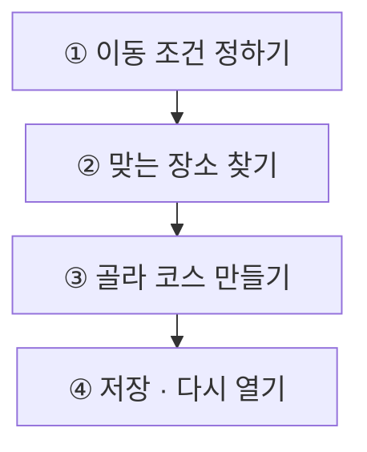
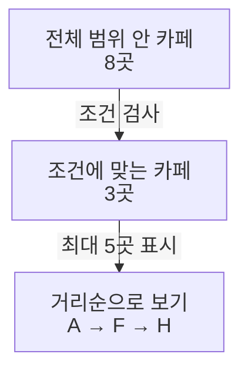

# 구현 흐름 한눈에 보기

**조건을 정하면 → 맞는 장소를 찾아 보여주고 → 사용자가 골라 코스를 만든 뒤 → 저장하고 다시 연다.**

[기능별 문서](features/README.md) · [전체 참조 자료](README.md) · [기능별 코드 흐름](10-flow-details.md) · 소스 기준 `a0d9436` · 2026-11-25

**프로그램은 후보를 찾고, 최종 장소와 순서는 사용자가 정한다.** 추천은 직선 거리 기준이고 실제 길찾기는 별도로 조회한다.

## 예시로 이해하기: 500m 안의 1만 원 이하 카페 찾기

이미 식당을 골랐고, 다음에 갈 카페를 찾는 상황이다. 전체 범위는 **출발지에서 2km**, 다음 범위는 **선택한 식당에서 500m**로 정했다. **포장 가능한 곳**을 고르고, 가격 미확인 포함은 끄고, 표시 수는 5곳으로 정했다.

아래 A~H는 **설명을 위한 가상 장소·가상 값**이다. 실제 DB의 매장·검색 결과나 실행 검증 결과가 아니다. 가격은 1인 1잔 가정에 적용 가능한 유한한 단일 참고 금액으로 두고, 좌표·활동·기본 중복 검사는 이미 통과했다고 가정한다.

**결과는 3곳이다.** 5곳을 요청해도 조건에 맞지 않는 곳을 끼워 넣지 않는다. 사용자가 셋 중 하나를 선택하면 편집 중인 코스에 추가한다.

어떤 장소가 왜 제외됐는지 보기

모든 예시 카페는 출발지에서 2km 안에 있다. 표의 거리는 **직전 식당에서의 직선 거리**다. 포장 여부는 자료에서 확인된 상태를 뜻한다.

| 장소 | 거리 | 참고 가격 | 포장 | 선택 결과와 이유 |
|---|---:|---:|---|---|
| A | 200m | 8,000원 | 가능 | **남김** — 모든 조건 충족 |
| B | 300m | 12,000원 | 가능 | 제외 — 1만 원 초과 |
| C | 700m | 6,000원 | 가능 | 제외 — 다음 범위 500m 초과 |
| D | 400m | 미확인 | 가능 | 제외 — 가격 미확인 포함을 끈 상태 |
| E | 450m | 7,000원 | 가능 | 제외 — 이미 코스에 고른 장소 |
| F | 350m | 9,000원 | 가능 | **남김** — 모든 조건 충족 |
| G | 250m | 5,000원 | 미확인 | 제외 — 필수로 고른 포장 가능이 확인되지 않음 |
| H | 450m | 9,000원 | 가능 | **남김** — 모든 조건 충족 |

**8곳 → 거리 검사 후 7곳 → 가격 검사 후 5곳 → 이미 선택한 곳 제외 후 4곳 → 포장 검사 후 3곳**이다. 이후 표시 개수 제한을 적용한다. 유형·가격 근거 등 추가 필터는 이 예시에서 지정하지 않았다.

특징 미확인은 불가능 확정이 아니다. 다만 사용자가 ‘포장 가능’을 필수로 골랐으므로 확인된 장소만 남긴다. 가격 미확인도 0원으로 바꾸지 않는다.

이 예시를 실제 클래스·기술과 연결하기

| 하는 일 | 사용하는 코드·기술 | 왜 사용하는가 / 어떻게 처리하는가 |
|---|---|---|
| 입력을 검색 조건으로 묶기 | CourseEditorController.onRecommendNext · NextPlaceCondition | 화면의 활동·가격·반경·특징을 같은 조건 객체로 전달하고 값을 확인 |
| 범위 안의 카페 찾기 | PlaceSearchService.nearby · 좌표 거리 계산 | 전체 범위·활동·좌표·동일성 검사. 다음 범위는 직전 장소에서 다시 계산 |
| 조건에 맞지 않는 장소 빼기 | NextPlaceService.matching · Java Stream 필터 | 거리·가격·이미 고른 장소·유형·가격 조건·태그를 적용해 전체 일치 결과 확보 |
| 결과를 필요한 수만 보여주기 | CourseEditorController.displayCandidates | 모든 필터를 거친 뒤 표시 수 제한. 조건 불일치 후보로 빈자리를 채우지 않음 |
| 선택한 장소를 코스에 추가하기 | CourseEditorController.onAddCandidate · RoutePlan | 선택 결과를 편집 초안에 반영하고 편집 완료 시 계획으로 전달 |

[추천의 근거·경계·한계](03-recommendation.md) · [범위 두 개를 함께 검사하는 상세 흐름](10-flow-details.md#recommendation)

## 필요한 부분만 더 보기

| 알고 싶은 것 | 짧은 답 | 상세 흐름 · 코드 설명 |
|---|---|---|
| 기본 설정·기술 스택은? | Java 21로 빌드·실행 기준을 맞추고 JavaFX 화면을 연다 | [실행 흐름](10-flow-details.md#setup) · [버전·설정](01-project-and-stack.md) |
| 모델은 왜 나눴나? | 장소 정보·사용자 계획·실제 경로 결과를 서로 다른 값으로 다룬다 | [모델 연결](10-flow-details.md#models) · [값의 의미](02-models.md) |
| 후보는 어떻게 찾나? | 범위·가격·특징을 만족하는 장소를 직선 거리순으로 보여준다 | [추천 과정](10-flow-details.md#recommendation) · [논리·한계](03-recommendation.md) |
| 지도는 어떻게 연결하나? | Java 화면과 웹 지도가 JSON·이벤트를 주고받는다 | [지도 연결](10-flow-details.md#map) · [관련 클래스](04-screens-and-map.md) |
| 회원·코스는 어떻게 저장하나? | 입력 비밀번호를 검증하고 회원별 코스를 한 묶음으로 저장한다 | [회원·저장·다시 열기](10-flow-details.md#storage) · [DB 처리](05-storage-and-account.md) |
| 장소 자료는 어디서 오나? | 공공 원본을 같은 형식으로 맞추고 출처·가격 근거를 함께 보관한다 | [자료 준비](10-flow-details.md#data) · [도구·근거](06-data-and-operations.md) |
| 구현을 어떻게 확인하나? | 변경 범위에 맞는 자동 검사와 문서·화면 확인을 구분한다 | [검증·공유](10-flow-details.md#verification) · [검사 범위](07-verification-and-team-site.md) |

클래스 하나를 찾을 때는 [Java 색인](08-class-index.md), SQL·설정·자료 파일을 찾을 때는 [전체 파일 색인](09-project-index.md)을 사용한다.
