# 구현 흐름 한눈에 보기

[전체 참조 자료](README.md) · 소스 기준 `a0d9436` · 2026-11-25

**사용자가 하는 일 → 처리하는 클래스 → 사용하는 기술 → 결과** 순서로 읽는다. 네모는 처리, 마름모는 판단, 원통은 영구 저장이다. 화살표는 실행·데이터 전달 순서이며 모든 단계가 같은 스레드에서 실행된다는 뜻은 아니다.

## 1. 전체 사용자 흐름

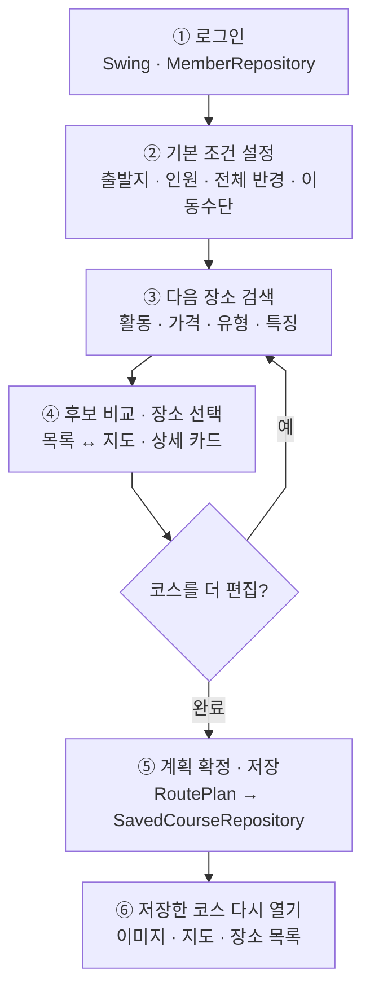

**왜 이렇게 나누는가:** 조건 입력·후보 탐색·확정·영구 저장을 구분해 편집 중인 초안과 저장된 코스를 분리한다. [화면별 코드](04-screens-and-map.md)

## 2. 기본 설정에서 앱 실행까지

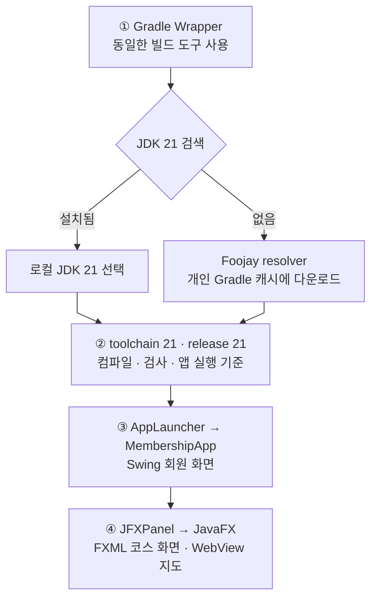

**왜 사용하는가:** Wrapper는 빌드 도구를 맞추고, toolchain은 요구 JDK를 선택하며, release는 대상 API·바이트코드를 제한한다. Gradle 자체 시작 JVM은 별도다. [버전·설정 파일](01-project-and-stack.md)

## 3. 모델이 화면·계산·저장을 연결하는 구조

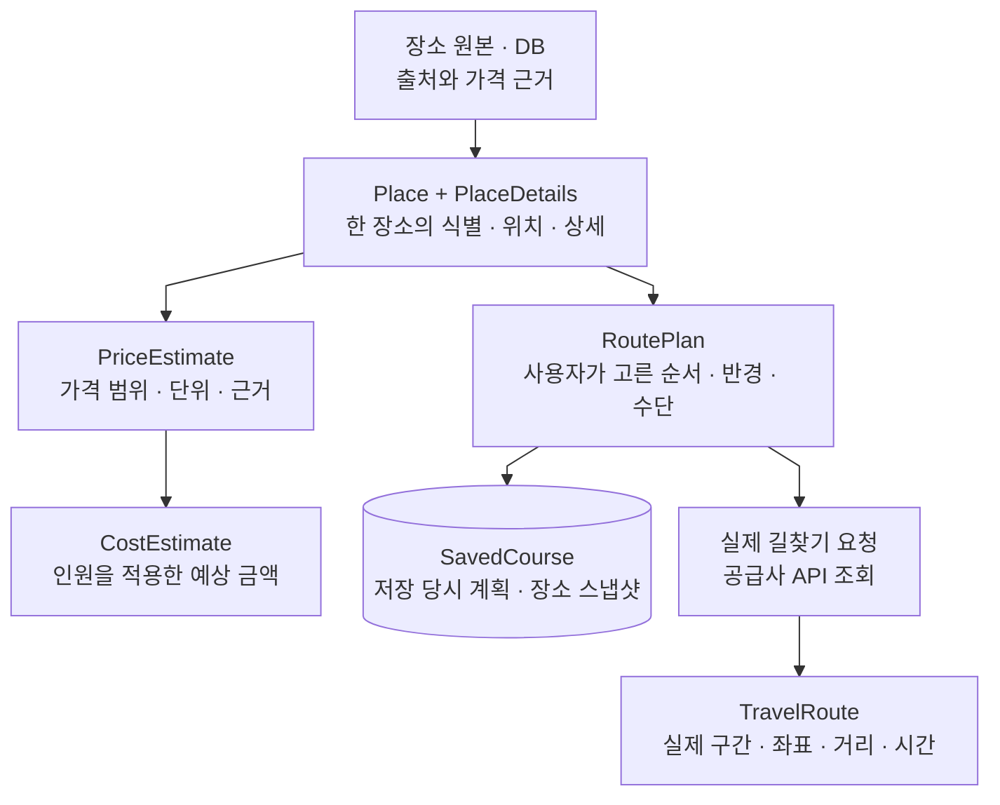

**왜 분리하는가:** 계획은 사용자의 선택이고 경로는 외부 조회 결과다. 가격은 미확인·추정을 보존해 알 수 없는 값을 확정 금액에 섞지 않는다. [모델 책임·불변성·동일성](02-models.md)

## 4. 다음 장소 추천 — 조건을 먼저, 표시 개수는 마지막에

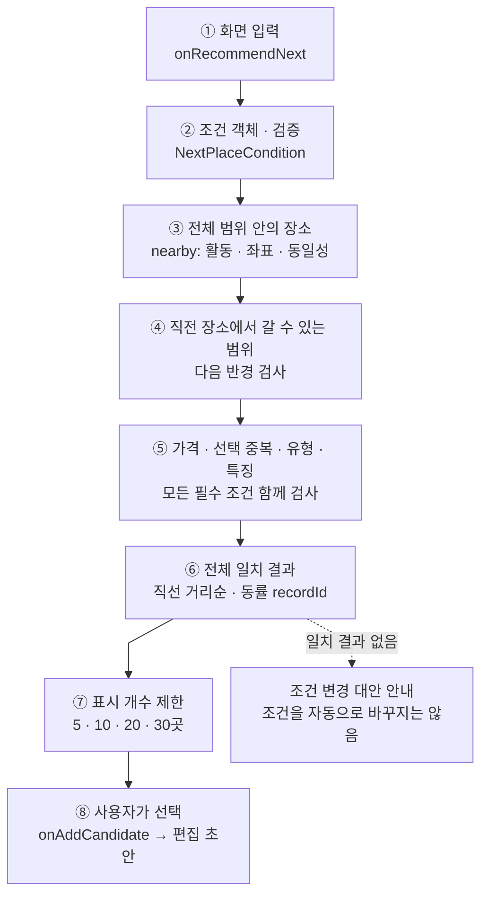

**왜 이 순서인가:** 가까운 일부를 먼저 자르면 그 뒤에 있는 조건 일치 장소를 놓칠 수 있다. 전체 후보에 조건을 적용한 뒤 화면 표시 수를 제한한다. **정렬은 직선 거리 기준**이며 실제 시간 최적화·개인화 학습은 아니다. [메서드·근거·회귀 검사](03-recommendation.md)

### 두 반경은 서로 다른 질문에 답한다

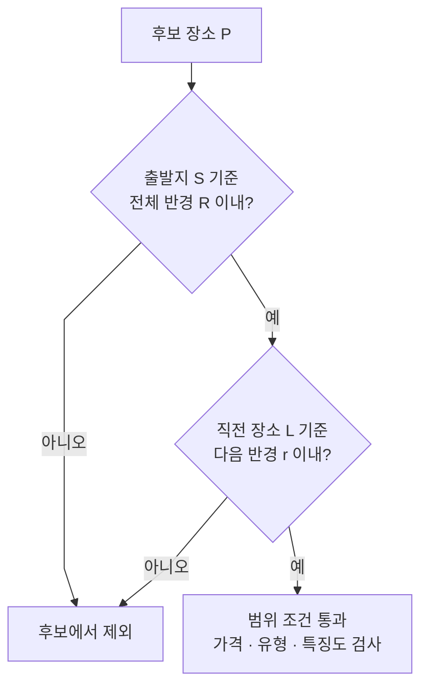

| 검사 | 막으려는 상황 | 예시 |
|---|---|---|
| 전체 반경 | 장소를 따라가며 출발지에서 계속 멀어짐 | 전체 2km인데 출발지에서 2.1km → 제외 |
| 다음 반경 | 한 구간을 지나치게 멀리 이동함 | 다음 500m인데 직전 장소에서 700m → 제외 |

두 조건의 **교집합**이다. 첫 장소는 직전 장소 대신 출발지를 기준으로 한다. 반경 안이라는 사실은 실제 도로 접근 가능성이나 짧은 이동시간을 보장하지 않는다.

## 5. 지도 표시와 실제 길찾기는 별도 흐름

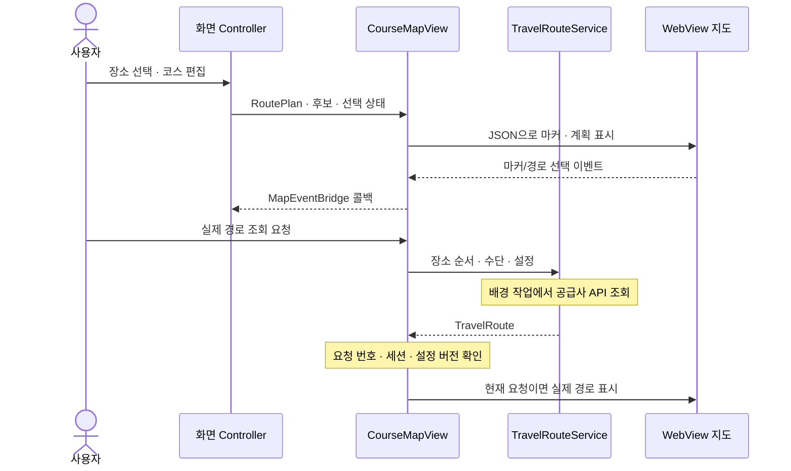

**왜 사용하는가:** WebView는 웹 지도 SDK를 JavaFX 화면에 넣고, 브리지는 Java와 JavaScript의 선택·표시를 연결한다. 요청 검사는 늦은 응답이 새 코스에 섞이는 것을 막는다. [지도 모듈·비동기·포커스](04-screens-and-map.md)

## 6. 로그인과 코스 저장

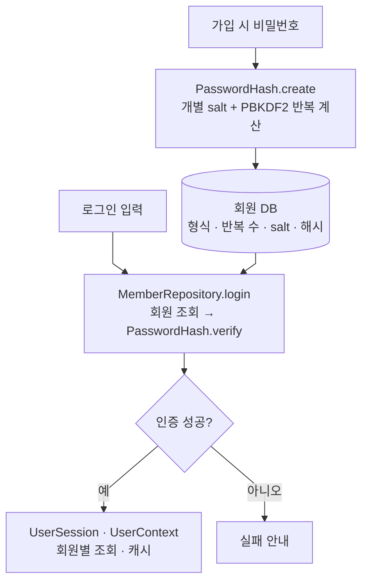

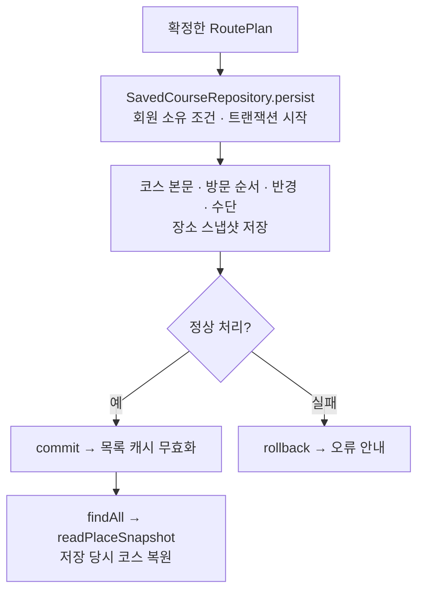

**왜 사용하는가:** JDBC 트랜잭션은 본문과 방문 목록이 일부만 저장되는 일을 막고, 스냅샷은 원본 변경과 별개로 저장 당시 정보를 복원한다. 현재 Planner는 `saveWithoutPreview`를 사용한다. [DB·해시·동시 편집 한계](05-storage-and-account.md)

### 저장 이미지와 지도 준비 상태

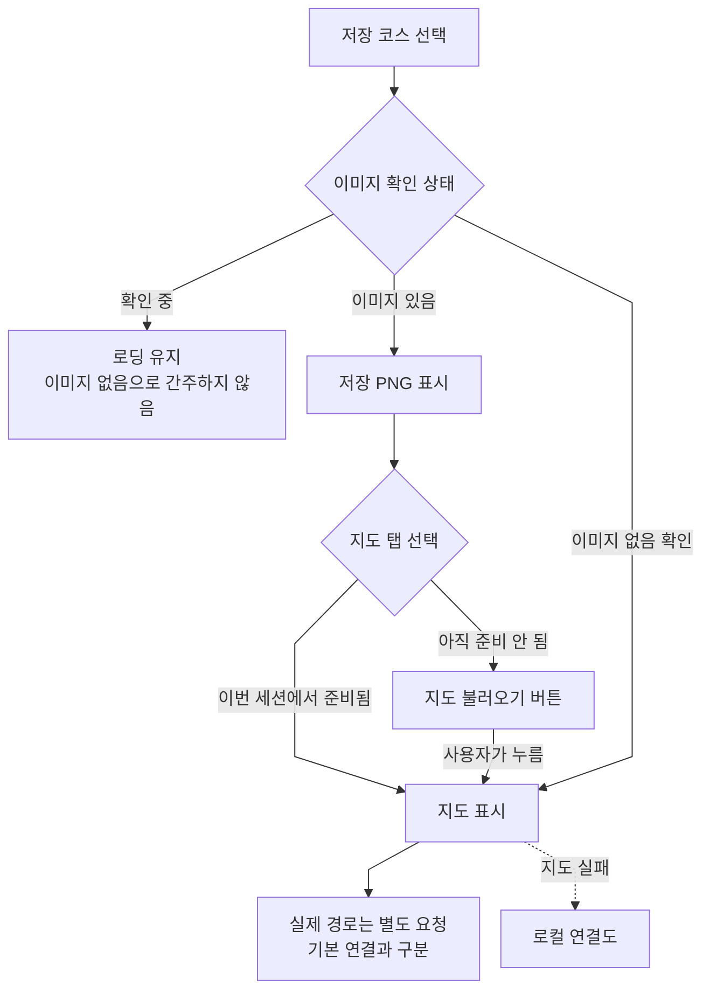

**DB에 저장한 PNG**, **로그인 세션의 지도 준비 여부**, **현재 요청의 실제 길찾기 결과**는 보관 위치와 수명이 다르다.

## 7. 공공 원본에서 추천에 쓰이는 자료까지

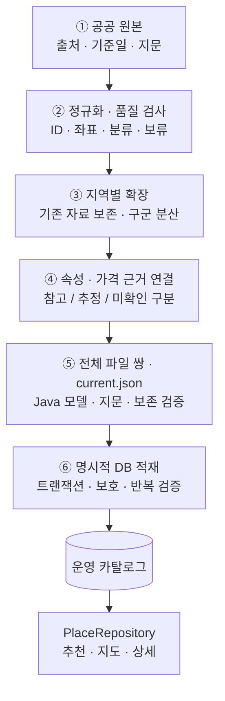

**왜 사용하는가:** 정규화는 서로 다른 원본을 같은 모델에 연결하고, 지문·보존 검사는 기존 자료와 이용자 데이터를 지키면서 확장한 근거를 남긴다. 파일 수정과 운영 DB 반영은 별도 작업이다. [데이터 도구·출처·표본 한계](06-data-and-operations.md)

## 8. 검증과 문서 공유

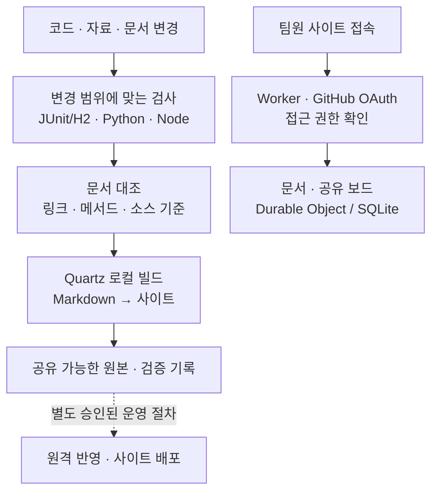

**왜 사용하는가:** 자동 검사는 규칙의 회귀를 확인하고, 문서는 코드와 기술 선택의 근거를 공유한다. 로컬 검사 통과·푸시·운영 배포는 각각 다른 사건이다. 팀 사이트 인증은 앱 회원 인증과 별개다. [검사 범위·사이트 역할](07-verification-and-team-site.md)

## 코드 설명으로 이어가기

| 시각 자료에서 확인한 내용 | 근거를 더 볼 곳 |
|---|---|
| 사용 기술 · 버전 · 설정 | [기본 설정·스택](01-project-and-stack.md) |
| 모델 책임 · 값의 의미 | [모델 논리](02-models.md) |
| 후보를 남기고 제외하는 이유 | [추천 논리](03-recommendation.md) |
| 특정 클래스의 대표 메서드 | [Java 전체 색인](08-class-index.md) |
| SQL · 도구 · 자료 · 자원 위치 | [프로젝트 전체 색인](09-project-index.md) |
