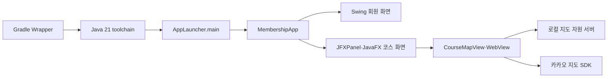

# 프로젝트 기본 설정과 사용 기술

[전체 길잡이](README.md). 버전은 현재 소스 선언값이며 최신성·보안성·제품 적합성을 보증하는 표가 아니다.

| 사용 요소 | 필요한 기능·구현상 사용 이유 | 실제 적용 |
|---|---|---|
| Java 21 | 레코드·컬렉션·표준 HTTP·JDBC·암호화·배경 작업 | compile/test/run toolchain 21, `options.release=21`로 대상 API·바이트코드도 제한 |
| Gradle Wrapper 9.6.0 | 빌드 도구·의존성·검사·실행 재현 | gradlew → build.gradle → class/resource/JAR/test 작업 |
| Foojay resolver 1.0.0 | 요구 JDK가 없을 때 설치 위치 해결 | 로컬 21 우선, 없으면 개인 Gradle 캐시로 자동 다운로드 |
| JavaFX 21.0.13.1 / plugin 0.1.0 | 컨트롤·FXML·WebView·Swing 연결 | controls/fxml/web/swing 모듈, 코스 화면·지도 |
| Swing·JFXPanel | 기존 회원·관리자 UI와 JavaFX 연결 | MembershipApp의 Swing 이벤트 → JavaFX 코스 화면 |
| HTML·CSS·JavaScript | 웹 지도 SDK의 DOM·이벤트·외관 | map.html/map.js, 상세 카드·카메라·포인터 모듈 |
| 카카오 지도 SDK | 지도·장소 검색·마커·카메라 | WebView에서 실행, Java 모델을 표시 객체로 연결 |
| TMAP 보행자 API | 실제 보행 좌표·거리·시간 | WalkingRouteService → 구간 요청·JSON 파싱 → TravelRoute |
| 카카오 경로 API | 자동차·대중교통 경로 | KakaoRouteService, 혼합은 TransitWalkingRouteService |
| JDK HttpClient / HttpServer | 외부 요청·로컬 지도 자원 제공 | 경로 HTTP 요청, MapPageServer의 127.0.0.1 자원 서버 |
| Jackson 2.17.0 | JSON과 Java 모델 연결 | API 응답·파일·DB payload·지도 전달 객체 |
| MySQL Connector/J 8.3.0 / JDBC | SQL·바인딩·트랜잭션 | Repository의 PreparedStatement와 commit/rollback |
| HikariCP 7.1.0 | 연결 재사용·연결 수·대기 제한 | DatabasePool의 최대 2·최소 유휴 1 연결 |
| PBKDF2WithHmacSHA256 / SecureRandom | 원문 대신 반복 해시·개별 salt | PasswordHash.create/verify |
| JUnit Jupiter 5.10.0 / H2 2.3.232 | 모델·저장·정책 자동 검증 | H2는 검사 DB, 운영 DB와 구분 |
| Python | 공공 자료·가격·품질·속성 생성 | tools의 유지보수. 일반 앱용 별도 Python 서버는 없음 |
| Node.js 22 이상 | 팀 사이트 빌드·검사·Worker 모듈 | docs/site의 test/build, 데스크톱 앱과 별도 |
| Quartz·Cloudflare Workers·Durable Objects SQLite | 문서 빌드·접근 제어·공유 상태 | 팀 사이트와 보드 지원. 앱 전체 DB 프록시는 아님 |

설정 근거: [build.gradle](../../build.gradle), [settings.gradle](../../settings.gradle), [gradle.properties](../../gradle.properties), [Wrapper](../../gradle/wrapper/gradle-wrapper.properties), [사이트 패키지](../site/package.json).

통합 진입점은 `AppLauncher.main → MembershipApp.main`이다. 별도 demo 진입점은 특정 화면·자료·연동 확인 용도다.

JDK 검색은 자동 설치 탐색과 `JDK21_HOME`·`JAVA_HOME_21_X64`·`JAVA_HOME` 후보에서 21을 선택한다. Gradle 자체를 시작하는 JVM과 앱 실행 toolchain은 구분된다. JDK나 개인 PC의 절대 설치 경로를 저장소에 넣는 방식은 아니다.

일반 실행·검사는 `./gradlew run`, `./gradlew test`이며 Windows는 `./gradlew.bat`다. 구조 준비·적재·실제 공급사 호출은 별도 명시적 작업이다. processResources/jar는 개인 DB·지도 설정을 제외하고 실행 중 설정을 읽는다.

Spring Boot·JPA·React를 사용했다고 설명하지 않는다. 현재 앱은 JDBC, 지도 UI는 JavaScript이며 Node·Python·팀 사이트는 개발/유지보수 영역이다. 라이브러리 사용과 그 라이브러리의 모든 기능을 구현한 것은 다르다.

현 코드에는 List.getFirst 같은 Java 21 API도 있다. record 문법 하나 때문에 반드시 21이라고 설명하기보다는 현재 사용하는 API와 toolchain/release 설정을 근거로 실행 기준을 설명한다.
