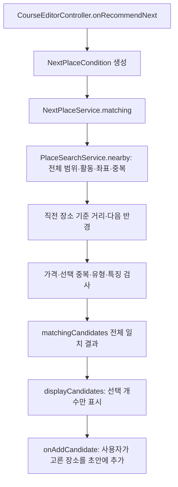

# 장소 추천: 실제 순서·논리·한계

[전체 길잡이](README.md) · [모델](02-models.md)

현재 편집 화면은 **조건에 맞는 후보를 직선 거리순으로 제공하고 사용자가 선택**한다. 전체 최적 코스·개인화 학습·실제 이동시간순 추천·미래 활동 자동 탐색이 구현됐다는 뜻은 아니다.

| 단계 | 무엇을 하는가 | 왜 필요한가 / 코드 근거 |
|---|---|---|
| 입력 검증 | 활동·가격·인원·반경·표시 수 확인 | 부적절한 값으로 계산하지 않도록 생성자·서비스에서 확인 |
| 전체 범위 | 출발지 기준 원 안의 장소만 남김 | 직전 장소만 따라가다 출발지에서 계속 멀어지는 후보 제한 |
| 기본 중복 | 공공 ID 우선의 동일성으로 대표 선택 | 이전 별칭의 중복을 줄임. 다른 공공 ID는 임의 병합하지 않음 |
| 다음 범위 | 처음은 출발지, 이후 직전 장소 기준 거리 검사 | 전체 범위와 다음 이동 범위는 중심과 목적이 다름 |
| 가격 상한 | 유한한 최대 금액이 상한 이하인지 확인 | 최소 금액만 싼 범위를 과도하게 통과시키지 않음 |
| 미확인 포함 | 사용자가 선택하면 상한 미확인 가격을 제한적으로 허용 | 미확인을 무료로 바꾸지 않음. 알려진 1인 최소값이 상한보다 높으면 제외 |
| 선택 중복 | 이미 고른 동일 장소 제외 | 같은 장소 반복 추가 차단 |
| 유형·특징 | 분류 묶음·원본 상세 업종·가격 근거·모든 선택 태그 확인 | 여러 태그는 AND. 임의로 조건을 완화하지 않음 |
| 표시 수 | 모든 조건을 적용한 뒤 5/10/20/30곳 제한 | 먼저 자른 뒤 필터링해서 맞는 후보를 놓치지 않음 |

편집 화면은 `matching` 전체 결과를 보관하고 `displayCandidates`에서 개수를 제한한다. 서비스 `candidates`도 matching 뒤에 limit를 둔다. `nearby` 내부의 공공 ID·가격 정렬은 **중복 대표 선택용**이며 최종 결과는 거리·recordId 순이다. 이를 가격순 추천으로 설명하지 않는다.

## 두 반경의 타당성

출발지 S, 마지막 장소 L, 후보 P, 전체 반경 R, 다음 반경 r이라면 `d(S,P) ≤ R`와 `d(L,P) ≤ r`를 모두 만족해야 한다. 첫 장소에서는 L 대신 S를 쓴다. 경계는 포함한다.

전체 2km·다음 500m라면, 직전 장소에서 300m여도 출발지에서 2.1km면 제외된다. 출발지에서 1km여도 직전 장소에서 700m면 제외된다. 두 원의 교집합이므로 코스가 전체 허용 지역을 벗어나거나 한 구간을 지나치게 멀리 이동하는 것을 각각 제한한다.

`PlaceCalculationService.calculateDistance`는 위·경도를 라디안으로 바꾸고 지구 반지름 6,371,000m의 구면 거리 공식을 사용한다. 단위는 m이고 삼각 함수·부동소수 오차 범위를 확인한다. 도로·횡단보도·강·고저차·실내 층 이동을 계산한 거리는 아니다.

`NextPlaceRadius.maximum`은 전체 반경+출발지에서 직전 장소까지 거리를 기준으로 100m 단위와 이동수단 상한을 적용한다. 삼각부등식상 전체 원의 반대편을 포함하면 그보다 큰 다음 원은 불필요하다. 도보 전체/구간 2km/2km, 자동차 30km/60km, 대중교통 20km/40km는 현재 구현 정책이며 최적값을 증명한 수치가 아니다.

## 실제 길찾기와 추천의 경계

후보 선택은 로컬 조건·좌표 계산이고 실제 길찾기는 `TravelRouteService`의 별도 공급사 조회다. 직선으로 가깝다고 실제 시간이 짧다는 보장은 없다. 혼합 이동은 **구간별** 빠른 도보/대중교통을 선택하며 코스 전체의 요금·환승·체류시간을 최적화하지 않는다.

| 근거 | 확인한 내용 | 의미하지 않는 것 |
|---|---|---|
| NextPlaceServiceTest·PlaceSearchServiceTest | 조건·중복·정렬·필터 후 개수 제한 | 영업·실제 이동시간 검증 |
| RouteRangeValidatorTest·거리 검사 | 전체/구간·경계·좌표 | 실제 도로 이용 가능성 |
| PriceEvidenceTest 등 | 미확인·추정·단위·가격 필터 | 현재 메뉴 가격 보증 |
| 확장 모의 코스 696조건 | 기존 후보 유지·범위·가격·단계 감소 없음 | 이용자 완료율·만족도 |
| 후보 탐색 후속 실험 | 일부 조건에 다른 선택 대안이 존재 | 현재 앱에서 연결성 추천 구현 완료 |

`PlaceSearchService.recommend(SearchCondition)`은 전체 예산·최소/최대 방문 수를 다루는 이전 일괄 방식이다. 현재 편집 이벤트는 `NextPlaceService.matching`을 호출하므로 두 방식을 섞어 설명하지 않는다.

현재 범위는 ‘등록된 자료 중 사용자가 정한 조건에 맞는 후보를 일관된 규칙으로 찾는다’다. 많은 추정·미확인 가격, 문화 원본의 공원·도서관 비중, 현재 분류 묶음의 제약도 함께 설명한다.

핵심 소스: [화면 이벤트](../../src/main/java/com/datecourse/page/_02step_editor/CourseEditorController.java), [다음 후보](../../src/main/java/com/datecourse/service/NextPlaceService.java), [범위·중복](../../src/main/java/com/datecourse/service/PlaceSearchService.java), [거리](../../src/main/java/com/datecourse/service/PlaceCalculationService.java), [반경 상한](../../src/main/java/com/datecourse/service/NextPlaceRadius.java), [코스 검사](../../src/main/java/com/datecourse/service/RouteRangeValidator.java), [결과 없음 안내](../../src/main/java/com/datecourse/service/CandidateRecoveryService.java).

수단별 상한이 기하학적 R+거리보다 작으면 다음 원이 전체 원을 모두 덮지는 않는다. NextPlaceService.matching 자체는 수단을 인수로 받지 않으므로 TravelMode의 수단별 UI 정책과 서비스의 공통 값 검증을 구분한다.

추천의 논리적 타당성을 확인하는 항목

| 논점 | 현재 코드로 설명할 수 있는 내용 |
|---|---|
| 가격 상한이 전체 예산인가 | 현재 추가할 장소의 1인 기준 상한이다. 코스 전체·그룹 전체 예산 최적화가 아님 |
| 인원이 순서를 바꾸는가 | 이 서비스에서는 인원 범위를 확인하고, 합계 계산에 반영한다. 좌석 수·정원·단체 적합성을 자동 추정하지 않음 |
| 여러 조건이 어떻게 결합되는가 | 전체/구간·가격·유형·가격 근거·특징 묶음은 함께 충족해야 한다. 유형 집합 안은 포함 여부, 여러 선택 태그는 모두 충족 |
| 결과가 없을 때 조건을 임의로 푸는가 | CandidateRecoveryService가 단일 조건 변경으로 후보가 생기는지 계산해 안내한다. 현재 조건을 몰래 변경하지 않음 |
| 필터를 왜 개수 제한보다 먼저 하는가 | 가까운 5곳이 조건에 안 맞더라도 더 뒤의 맞는 후보를 놓치지 않도록 하기 때문 |
| 최단 실제 시간인가 | 현재 정렬은 직선거리와 동률 recordId다. 실제 도로·시간·요금 최적화와 구분 |
| 정확성을 무엇으로 입증하는가 | 명시한 조건·경계·중복·단위 검사를 코드/회귀 검사와 대조한다. 테스트만으로 사용자 만족도나 모든 현장 조건을 증명하지 않음 |

