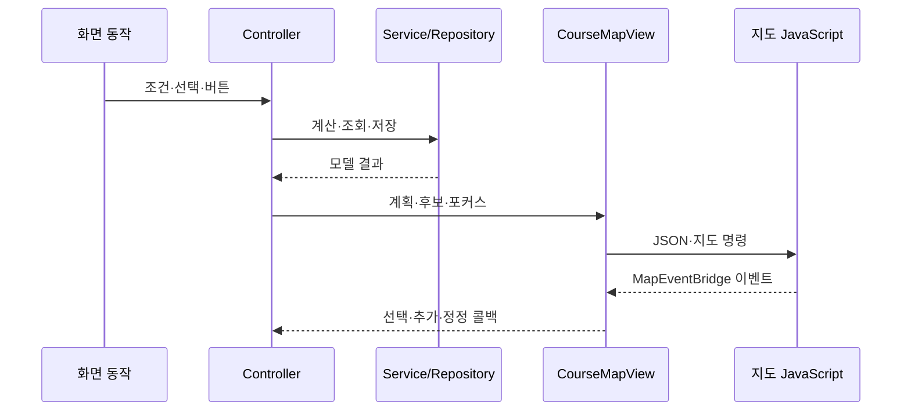

# 화면 동작과 핵심 클래스 연결

[전체 길잡이](README.md). 화면은 동작을 조율하고 모델·서비스·저장소는 값·계산·데이터 접근을 담당한다.

| 화면 동작 | 중심 클래스·메서드 | 사용 요소·필요 기능 | 처리 흐름 |
|---|---|---|---|
| 조건 설정·편집 진입 | CoursePlannerController.onRecommendClick/openEditor | JavaFX/FXML의 입력·이벤트, RoutePlan | 출발지·인원·범위·수단 → 계획 스냅샷 → 편집 |
| 후보 검색·추가 | CourseEditorController.onRecommendNext/onAddCandidate | NextPlaceCondition·NextPlaceService | 화면 조건 → 검색 → 일치 목록 → 선택 장소를 draft에 추가 |
| 순서·반경 변경 | CourseEditorController·RouteRangeValidator | 편집 리스트·도착 반경 맵 | 초안 변경 → 지도·합계 → 확정 계획 전달 |
| 실제 경로 | CourseMapView.requestWalkingRoute | Task·TravelRouteService | stop·수단·설정 → 배경 조회 → 최신 요청 확인 → JS 표시 |
| 지도 선택·상세 | CourseMapView.showDetail·MapEventBridge | WebView Java–JS 연결 | Java payload → DOM, 지도 이벤트 → Java 콜백 |
| 저장 목록 | SavedCourseController.configure/loadCourses | UserContext Future·Repository | 회원 목록 → 선택 코스의 표·이미지/지도 |
| 이미지/지도 전환 | SavedCourseController·UserContext.isMapPrepared | 세션 메모리·명시적 지도 준비 | 이미지 전용 코스는 지도 탭에서 불러오기 선택, 준비 상태는 로그인 세션에만 기억 |
| 로딩·실패 표시 | BasePageController.runWork/showFuture·PageFeedback | Task·CompletableFuture·UI 스레드 | 배경 DB/HTTP 작업 → UI 결과·상태 종료 |

소스: [Planner](../../src/main/java/com/datecourse/page/_01step_planner/CoursePlannerController.java), [Editor](../../src/main/java/com/datecourse/page/_02step_editor/CourseEditorController.java), [Saved](../../src/main/java/com/datecourse/page/_03step_saved/SavedCourseController.java), [MapView](../../src/main/java/com/datecourse/page/common/map/CourseMapView.java), [Bridge](../../src/main/java/com/datecourse/page/common/map/MapEventBridge.java), [공통 작업](../../src/main/java/com/datecourse/page/common/BasePageController.java).

## 지도 기술의 사용 이유

웹 지도 SDK는 웹 문서·JavaScript에서 동작한다. CourseMapView는 JavaFX WebView에 지도를 넣고 Java 모델을 JSON으로 전달한다. MapPageServer는 JDK HttpServer로 자원을 127.0.0.1에 제공해 별도 Python 서버를 요구하지 않는다. 외부 사용자의 DB 요청을 받는 백엔드 서버는 아니다.

| 자원 | 무엇을 구현하는가 | 확인 요소 |
|---|---|---|
| [map.html](../../src/main/resources/map/map.html) | 지도·검색·전환·안내 DOM | 구조·스크립트 연결 |
| [map.js](../../src/main/resources/map/map.js) | SDK·검색·핀·범위·경로·캡처 | 입력 우선순위·브리지·상태 |
| [itinerary-rail.js](../../src/main/resources/map/itinerary-rail.js) | 방문 목록·왼쪽 상세·포커스 복귀 | 단일 상세·버튼·키보드 |
| [pin-pointer-gesture.js](../../src/main/resources/map/pin-pointer-gesture.js) | 마커 포인터 조작 | 마커 우선 입력 |
| [map-viewport.js](../../src/main/resources/map/map-viewport.js) | 보이는 영역·더 큰 렌더링 영역 보정 | 크롭·투영·SDK 출처 배치 |
| [camera-motion.js](../../src/main/resources/map/camera-motion.js)·[CameraMotionPolicy](../../src/main/java/com/datecourse/service/CameraMotionPolicy.java) | 선택·반경·전체 맞춤 이동 | 의도·화면 거리·넘침 비율 |
| [instant-zoom.js](../../src/main/resources/map/instant-zoom.js) | 확대 동작 | 보이는 화면 좌표 기준 확대 |
| FXML·CSS | 화면 배치·입력 연결·외관 | fx:controller·onAction과 컨트롤러 연결 |

## 비동기·포커스·표시 수명

배경 작업을 쓴다고 오래된 응답이 자동으로 무효가 되는 것은 아니다. 화면 요청 번호·현재 세션, 지도 작업·코스 조건·도보 설정 버전을 확인한다. 다른 코스로 바꾼 뒤 늦은 이미지/경로가 새 화면에 섞이는 것을 막는 부분이다. 취소가 이미 진행 중인 DB·HTTP 동작을 항상 즉시 종료한다는 뜻은 아니다.

MapViewportLifecycle은 숨긴 WebView의 임시 크기가 아니라 실제 표시 크기에서 재배치하도록 돕는다. 여유 렌더링은 짧은 이동의 공백을 줄이려는 구현이며 모든 타일 로딩·네트워크 지연을 없애지 않는다.

마커·경로는 기본 반투명, 호버·포커스 때 강조한다. 짧은 호버는 하나이고 상세는 명시적 선택으로 연다. 목록 Enter·상세 종료 포커스·이미지 확대 Tab 처리도 있다. 실제 손 입력·모니터 이동·느린 네트워크 전체 검증과 자동 검사는 구분한다.
