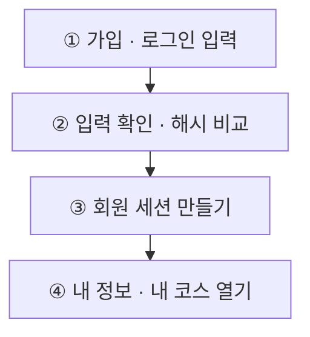

# 회원 가입·로그인·내 정보

**회원으로 로그인하고 내 정보와 내 코스를 같은 로그인 상태에서 이용한다.**

[기능별 목차](README.md) · [짧은 전체 흐름](../00-flow-map.md) · 사용자 기능

## 한눈에 보는 동작

## 예시로 이해하기

가상 상황: A 회원이 로그인해 내 정보를 보고 로그아웃한 뒤 B 회원이 로그인한다. B에게는 B의 회원 정보·저장 목록을 요청하며 A의 세션 캐시를 이어 쓰지 않는다.

## 무엇을 사용했고 왜 필요한가

| 사용하는 기술·클래스 | 필요한 기능 | 실제 처리 |
|---|---|---|
| Swing · JavaFX | 회원 입력 화면과 코스 화면 연결 | MembershipApp이 로그인 결과를 코스 화면으로 전달한다. |
| JDBC · PBKDF2 | 회원 조회와 원문 대신 비밀번호 검증 | MemberRepository가 조회하고 PasswordHash가 개별 salt·반복 계산 결과를 비교한다. |
| UserSession · UserContext | 어느 회원의 데이터인지 유지 | 회원 식별과 조회 캐시를 함께 관리하고 로그아웃 시 닫는다. |

핵심 코드와 연결해서 보기

| 동작 | 중심 코드 | 핵심 처리 |
|---|---|---|
| 가입 | [MemberRepository · register()](../../../src/main/java/com/datecourse/db/MemberRepository.java) | 회원 입력을 검증하고 비밀번호 해시와 회원 정보를 저장 |
| 로그인 | [MemberRepository · login()](../../../src/main/java/com/datecourse/db/MemberRepository.java) | 조회·비교 후 회원 또는 관리자 로그인 결과 반환 |
| 내 정보 | [MyPageController · configure()](../../../src/main/java/com/datecourse/page/account/MyPageController.java) | 현재 UserContext의 프로필을 비동기로 표시 |
| 로그아웃 | [CoursePlannerController · onLogout()](../../../src/main/java/com/datecourse/page/_01step_planner/CoursePlannerController.java) | 사용자 컨텍스트와 화면 상태 정리 |

## 현재 구현의 범위

내 정보 화면은 현재 프로필 조회 중심이다. 모든 프로필 수정·비밀번호 찾기를 구현했다고 설명하지 않는다. 앱 회원 인증과 팀 사이트 GitHub 인증은 별개다. 해시의 실제 값·설정은 근거 문서에서 확인하며 모든 공격에 안전하다는 주장은 하지 않는다.

관련 설명: [회원·코스 저장·정정·DB](../05-storage-and-account.md) · [모델: 값과 책임을 왜 분리했는가](../02-models.md)

소스 기준 `a0d9436` · 문서 확인 2026-11-25. 설명용 예시는 새 API 호출·운영 DB 검증 결과와 구분한다.

다음 기능: [기본 조건 설정·코스 편집](02-planning.md)
