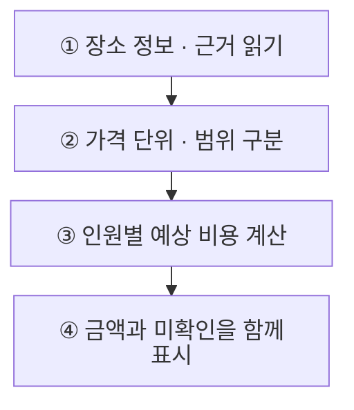

# 장소 상세·가격 근거·예상 비용

**장소의 상세와 출처를 표시하고 참고·추정·미확인 가격을 구분해 인원별 예상 비용을 계산한다.**

[기능별 목차](README.md) · [짧은 전체 흐름](../00-flow-map.md) · 사용자 기능 · 모델

## 한눈에 보는 동작

## 예시로 이해하기

가상 상황: 1인 8,000원 장소와 가격 미확인 장소를 2명이 방문한다. 계산 가능한 금액은 16,000원이지만 미확인 1곳을 함께 표시한다. 전체 코스 가격을 16,000원으로 확정하지 않는다.

## 무엇을 사용했고 왜 필요한가

| 사용하는 기술·클래스 | 필요한 기능 | 실제 처리 |
|---|---|---|
| Place · PlaceDetails | 식별·좌표와 상세·근거를 같은 장소로 연결 | 추천·지도·저장이 같은 장소 값을 주고받는다. |
| PriceEstimate · FactState | 미확인·무료·추정과 특징 상태 구분 | 금액뿐 아니라 단위·근거·기준일을 보존한다. |
| CostEstimate · Presenter | 계산 결과와 사용자 문구 분리 | 인원에 따른 범위·추정/미확인 개수를 표시한다. |

핵심 코드와 연결해서 보기

| 동작 | 중심 코드 | 핵심 처리 |
|---|---|---|
| 가격 상한 | [PriceEstimate · withinCap()](../../../src/main/java/com/datecourse/model/PriceEstimate.java) | 유한한 가격 범위와 상한 비교 |
| 비용 계산 | [CostEstimate · of(), display(), exactTotal()](../../../src/main/java/com/datecourse/model/CostEstimate.java) | 인원 적용·미확인/추정 표시·확정 합계 가능 여부 구분 |
| 동일 장소 | [Place · stableKey(), sameIdentityAs()](../../../src/main/java/com/datecourse/model/Place.java) | 공공 ID 우선 식별, 서로 다른 공공 ID 임의 병합 방지 |

## 현재 구현의 범위

한 숫자여도 통계 추정일 수 있다. 1인 1잔·성인 1매 같은 자료 단위 가정이며 실제 주문량·연령별 요금·주차·교통비까지 포함한 지출은 아니다. 출처가 있다는 것과 현재 영업·가격이 새로 검증됐다는 것은 다르다.

관련 설명: [모델: 값과 책임을 왜 분리했는가](../02-models.md) · [원본·카탈로그·가격·운영 도구](../06-data-and-operations.md)

소스 기준 `a0d9436` · 문서 확인 2026-11-25. 설명용 예시는 새 API 호출·운영 DB 검증 결과와 구분한다.

다음 기능: [지도 탐색·마커·장소와 경로 상세](05-map.md)
