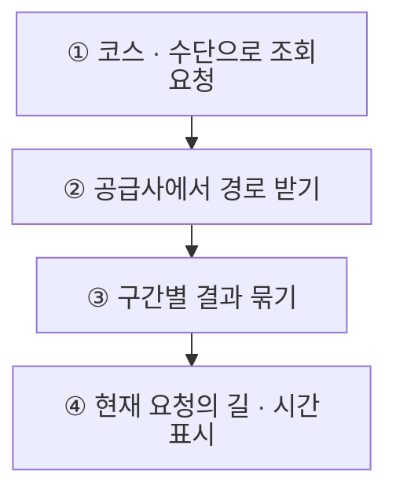

# 실제 경로·이동수단·이동시간

**사용자가 고른 방문 순서에 대해 도보·자동차·대중교통과 도보 경로를 조회하고 구간별 거리·시간·이동 안내를 보여준다.**

[기능별 목차](README.md) · [짧은 전체 흐름](../00-flow-map.md) · 사용자 기능

## 한눈에 보는 동작

## 예시로 이해하기

가상 비교: 같은 구간에서 도보가 12분, 대중교통이 18분으로 응답하면 혼합 모드는 도보를 선택한다. 이 숫자는 설명용이며 실제 API 조회 결과가 아니다. 다음 구간은 별도로 비교한다.

## 무엇을 사용했고 왜 필요한가

| 사용하는 기술·클래스 | 필요한 기능 | 실제 처리 |
|---|---|---|
| TravelRouteService · 수단 분기 | 화면이 공급사별 요청 형식을 직접 다루지 않게 연결 | 도보·자동차·혼합 경로 서비스로 전달한다. |
| TMAP · 카카오 · JDK HttpClient | 실제 도로 좌표·거리·시간 조회 | 도보는 TMAP, 자동차·대중교통은 카카오 요청을 사용한다. |
| TravelRoute · 요청 버전 확인 | 계획과 조회 결과 분리·늦은 응답 차단 | 구간 결과를 모델로 묶고 현재 코스에 해당할 때 표시한다. |

핵심 코드와 연결해서 보기

| 동작 | 중심 코드 | 핵심 처리 |
|---|---|---|
| 화면 요청 | [CourseMapView · requestWalkingRoute()](../../../src/main/java/com/datecourse/page/common/map/CourseMapView.java) | 기존 메서드 이름을 유지하며 선택 수단·설정으로 실제 경로 요청 |
| 수단 선택 | [TravelRouteService · route()](../../../src/main/java/com/datecourse/service/TravelRouteService.java) | 선택 수단에 맞는 공급사/혼합 서비스 호출 |
| 혼합 비교 | [TransitWalkingRouteService · route()](../../../src/main/java/com/datecourse/service/TransitWalkingRouteService.java) | 구간별 도보와 대중교통 시간을 비교해 선택 |

## 현재 구현의 범위

구간별 비교이며 코스 전체 요금·환승·체류시간 최적화는 아니다. 대중교통 경로 없음에는 도보를 선택할 수 있지만 인증·쿼터·일반 통신 실패까지 정상 도보 결과로 숨기지는 않는다.

관련 설명: [화면 동작과 핵심 클래스 연결](../04-screens-and-map.md) · [장소 추천: 실제 순서·논리·한계](../03-recommendation.md)

소스 기준 `a0d9436` · 문서 확인 2026-11-25. 설명용 예시는 새 API 호출·운영 DB 검증 결과와 구분한다.

다음 기능: [코스 저장·목록 관리·이미지와 지도](07-saved-courses.md)

## 2026-11-27 반영

편집 화면의 로딩은 `CourseMapView.isRoutePending()`으로 판단. 안내 문구의 표현과 대중교통이라는 단어에 따라 로딩 상태가 바뀌지 않는다.

> 2026-11-27 확인 · `c65c157`: 역할·판단 근거·연결 클래스의 한국어 주석 보완. 실행 코드 동일, 최신 선언 위치·지문은 클래스 색인 기준.
