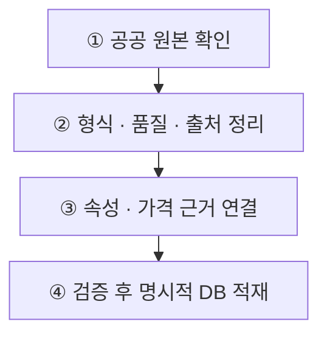

# 장소 데이터 수집·가격 보완·카탈로그

**공공 자료를 같은 장소 모델로 맞추고 출처·속성·가격 근거를 보존하며 지역별로 카탈로그를 확장한다.**

[기능별 목차](README.md) · [짧은 전체 흐름](../00-flow-map.md) · 자료 준비 · 운영 지원

## 한눈에 보는 동작

## 예시로 이해하기

가상 처리 예: 새 지역 장소를 추가할 때 이전 ID·장소와 사용자 코스를 보존하고 좌표·분류·출처·지문을 검사한다. 메뉴 참고값을 찾지 못했다면 미확인으로 남기거나 근거 있는 통계 추정으로 구분한다.

## 무엇을 사용했고 왜 필요한가

| 사용하는 기술·클래스 | 필요한 기능 | 실제 처리 |
|---|---|---|
| Python · CSV/JSON · SHA | 서로 다른 원본 정규화와 지문 확인 | 지역별 확장·품질 보류·가격 단위/근거를 파일로 관리한다. |
| Java 모델 · PublicPlaceFacts | 장소와 속성 파일 쌍 연결 | ID·지문·태그·기준일을 확인해 타입 있는 속성을 붙인다. |
| JDBC · 적재 정책 · 변경 이력 | 기존 데이터 보존과 반복 적재 검증 | 명시적 도구가 기준본·보호 데이터·payload·이력을 확인한다. |

핵심 코드와 연결해서 보기

| 동작 | 중심 코드 | 핵심 처리 |
|---|---|---|
| 운영 장소 읽기 | [PlaceRepository · findAll()](../../../src/main/java/com/datecourse/db/PlaceRepository.java) | 공공 카탈로그 우선 조회와 이전 자료 대체 경로 |
| 파일 쌍 검사 | [PublicPlaceFacts · read()](../../../src/main/java/com/datecourse/service/PublicPlaceFacts.java) | 장소·속성 파일의 연결과 근거 확인 |
| 카탈로그 적재 | [PlaceCatalogRepository · synchronize()](../../../src/main/java/com/datecourse/db/PlaceCatalogRepository.java) | 출처·버전·payload·활성 상태·변경 이력 처리 |

관련 자원: [tools/build_district_expansion.py](../../../tools/build_district_expansion.py)

관련 자원: [tools/place_data_quality.py](../../../tools/place_data_quality.py)

관련 자원: [tools/supplement_place_prices.py](../../../tools/supplement_place_prices.py)

관련 자원: [data/places/expansion/current.json](../../../data/places/expansion/current.json)

## 현재 구현의 범위

현재 운영 기준본은 16개 구군 5,628곳이며 참고 23·추정 3,092·미확인 2,513곳이다. 현재 영업·가격을 전부 새로 조사한 대표 표본이 아니다. Google 대조 파일럿·후속 후보 탐색 실험·보관 코드는 일반 앱의 실시간 기능과 구분한다. 문서 읽기나 파일 수정만으로 DB 적재를 실행하지 않는다.

관련 설명: [원본·카탈로그·가격·운영 도구](../06-data-and-operations.md) · [장소 추천: 실제 순서·논리·한계](../03-recommendation.md)

소스 기준 `a0d9436` · 문서 확인 2026-11-25. 설명용 예시는 새 API 호출·운영 DB 검증 결과와 구분한다.

다음 기능: [프로젝트 실행·공통 설정·DB 연결과 준비](11-runtime-db.md)
