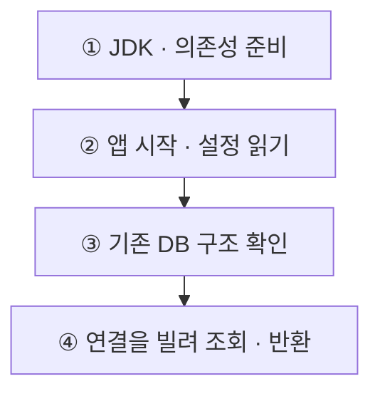

# 프로젝트 실행·공통 설정·DB 연결과 준비

**개발 PC마다 Java 실행 기준을 맞추고 공통 키·DB 설정을 받아 연결을 재사용하며 구조 준비를 일반 실행과 분리한다.**

[기능별 목차](README.md) · [짧은 전체 흐름](../00-flow-map.md) · 실행 기반 · 유지보수

## 한눈에 보는 동작

## 예시로 이해하기

가상 상황: PC에 JDK 17과 25만 있다면 Gradle 시작 JVM과 별개로 요구되는 21을 찾아, 없으면 개인 Gradle 캐시에 준비한다. 앱 실행 중 테이블 누락은 확인·안내 대상으로 다루고 임의 생성하지 않는다.

## 무엇을 사용했고 왜 필요한가

| 사용하는 기술·클래스 | 필요한 기능 | 실제 처리 |
|---|---|---|
| Gradle Wrapper · Foojay · Java 21 toolchain | 팀원의 빌드·검사·실행 기준 일치 | 설치된 21을 우선 선택하고 필요 시 캐시에 다운로드, release 21로 대상 API 제한. |
| TeamApiKeys · 실행 시 설정 | 개인 비밀값을 공유 소스에 넣지 않고 사용 | 인증된 설정 전달 경로에서 공급사 키·DB 설정을 받아 메모리에서 사용한다. |
| HikariCP · JDBC · PreparedStatement | 연결 재사용·대기 제한·SQL 값 바인딩 | 최대 2·최소 유휴 1 연결 정책으로 저장소 작업 후 연결 반환. |
| DatabaseSetup · SQL | 구조 변경을 명시적 관리 작업으로 분리 | 일반 initialize는 구조 확인, 별도 setupDatabase는 준비 작업. |

핵심 코드와 연결해서 보기

| 동작 | 중심 코드 | 핵심 처리 |
|---|---|---|
| 통합 시작 | [AppLauncher · main()](../../../src/main/java/com/datecourse/app/AppLauncher.java) | MembershipApp으로 통합 진입 |
| DB 연결 풀 | [DatabasePool](../../../src/main/java/com/datecourse/db/DatabasePool.java) | Repository가 사용할 DataSource와 연결 재사용 정책 |
| 구조 확인 | [MemberRepository · initialize()](../../../src/main/java/com/datecourse/db/MemberRepository.java) | 일반 실행에서 필요한 DB 구조 확인 |
| 명시적 준비 | [DatabaseSetup · main()](../../../src/main/java/com/datecourse/maintenance/DatabaseSetup.java) | 구조 준비·관리자 초기 등록 등 관리 명령 진입 |

관련 자원: [build.gradle](../../../build.gradle)

관련 자원: [settings.gradle](../../../settings.gradle)

관련 자원: [gradle.properties](../../../gradle.properties)

관련 자원: [data/sql/](../../../data/sql/)

## 현재 구현의 범위

현재 앱은 DB·공급사에 직접 연결한다. 팀 사이트 Worker가 모든 DB 작업을 대신하는 서버는 아니다. 키를 Git/JAR에 넣지 않는 것과 클라이언트가 DB 자격증명에 접근할 수 없는 구조는 다르다. 설정 캐시는 서버의 변경을 즉시 반영하지 않을 수 있다. 실제 접속 값은 문서에 복제하지 않는다.

관련 설명: [프로젝트 기본 설정과 사용 기술](../01-project-and-stack.md) · [회원·코스 저장·정정·DB](../05-storage-and-account.md)

소스 기준 `a0d9436` · 문서 확인 2026-11-25. 설명용 예시는 새 API 호출·운영 DB 검증 결과와 구분한다.

다음 기능: [팀 문서·공유 보드·자동 검증](12-team-and-checks.md)
