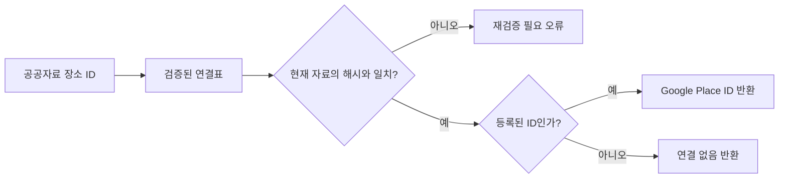

# 장소 ID 바인딩 결과와 코드 읽는 순서

> 이 문서는 첫 5곳 대조·2곳 연결의 작업 기록이다. 후속 24곳 검사와 현재 Java 데모의 8곳 연결은 [최신 확대 검증 결과](place-binding-evaluation-2026-11-13.md)를 참고한다. 아래 데모 출력은 첫 구현 당시 기준이다.

2026-11-13 검증. **공공자료의 장소 ID를 확인된 Google Place ID에 연결하는 단계**를 구현했다. 현재 앱의 추천 자료 교체·가격 범위·리뷰 화면 연결은 이번 범위에 포함하지 않았다.

## 바인딩은 무엇인가?

우리 자료의 `SBIZ:…`와 Google의 `ChIJ…`가 같은 가게를 가리킨다는 연결표다. 이름·지점이 확인되지 않으면 연결하지 않는다. DB의 숫자 `recordId`나 상호만으로 대신 찾지 않는다.



## 실제 대조 결과

보유 자료의 표본 5곳을 검색 5회 + 상세 5회, 총 10회 요청했다. 상세 필드는 이름·주소·좌표·유형·영업 상태·ID로 제한했다. 이번에는 가격·평점·리뷰를 요청하지 않았다.

아래 이름은 우리 공공자료의 이름이다. Google 이름·주소·좌표 원문은 파일에 보관하지 않았다.

| 우리 자료의 장소 | 결과 | 사유 |
|---|---|---|
| 대모골 | 연결 등록 | 이름·도로명/건물번호·부산진구 주소·200m 이내 좌표·영업 상태·활동 유형 조건 충족 |
| 파노라믹커피부산 | 연결 등록 | 같은 조건 충족 |
| 부잣집밀면 | 검토 대기 | 이름 또는 지점 표기 차이. 오타인지 다른 가게인지 확정하지 않음 |
| 스타벅스 / 서면역 | 검토 대기 | 이름·지점 차이, 200m 초과 위치, 도로명/건물번호 차이 |
| 부산포민속박물관 | 검토 대기 | 도로명/건물번호 차이, 운영 상태 미확인. 폐업으로 단정하지 않음 |

공백·기호와 마지막 ‘점’ 표기 차이만 정규화한다. 비슷한 이름이라는 이유로 자동 승인하지 않는다. 서로 다른 우리 장소가 같은 Google ID로 연결되는 경우에도 자동 병합하지 않고 전부 검토 대상으로 남긴다.

이 결과는 검색으로 대조한 것이며 현장 방문 검증은 아니다. 200m는 이름·주소 등 다른 조건과 함께 사용하는 보조 기준이다. 영업 여부도 조회 시점의 API 상태이며 이후 실제 영업을 보장하지 않는다.

## 기존 앱 자료에는 바로 붙이지 않는 이유

현재 앱은 DB에서 `integrated_places.csv` 출처의 `MEAL_…`·`CAFE_…` ID를 읽는다. 공공자료는 `SBIZ:…`·`STD:…` 등 다른 ID를 쓴다.

이번 표본 중 이름이 같은 기존 자료는 파노라믹커피부산의 `CAFE_0464` 한 건을 찾았지만, 그것만으로 같은 지점·좌표라고 확정하지 않았다. 따라서 `googlePlaceId("CAFE_0464")`는 빈 결과를 반환한다. 공공자료를 앱에 도입하거나 기존 자료를 별도로 검증할 때 ID 대응을 마련해야 한다.

실제 앱의 `PlaceRepository`, `NextPlaceService`, 지도·상세창에는 이번 조회기를 호출하는 코드를 추가하지 않았다. 저장 코스의 장소 ID도 바꾸지 않았다.

## 파일과 역할

| 파일 | 하는 일 |
|---|---|
| `tools/place-data-pilot/bind.py` | 표본 5곳 검색·대조 후 확인/검토 대상 구분 |
| `tools/place-data-pilot/test_binding.py` | 지점·주소·좌표·운영·중복 조건 검사 |
| `data/places/pilot/seomyeon-jeonpo-2026-11-13/google-bindings.json` | 확인된 2곳의 ID 연결표와 자료 해시 |
| 같은 폴더의 `google-binding-review.json` | 미확정 3곳의 후보 ID와 검토 사유 |
| `src/main/java/com/datecourse/service/PlaceBindingCatalog.java` | 연결표 검증·읽기·정확한 ID 조회 |
| `src/main/java/com/datecourse/demo/PlaceBindingDemo.java` | API·DB 없이 연결 결과 확인 |
| `src/test/java/com/datecourse/service/PlaceBindingCatalogTest.java` | 정상 연결, 다른 자료, 중복·잘못된 표, 실제 표본 검사 |

## 실행 확인

프로젝트 최상단에서 실행한다. 아래 명령은 외부 API와 실제 DB를 호출하지 않는다.

```powershell
.\gradlew.bat runPlaceBindingDemo
.\gradlew.bat test --tests "*PlaceBindingCatalogTest"
python -m unittest discover -s tools/place-data-pilot -p "test_*.py" -v
```

데모 예상 결과:

```text
확인된 Google 장소 연결: 2곳
대모골 연결: true
검토 중인 부잣집밀면 연결: false
기존 앱 CAFE_0464 연결: false
```

## 코드 읽는 순서와 핵심 메서드

1. `bind.py → match_evidence`: 우리 자료와 외부 응답을 비교하고 미확정 사유를 모은다.
2. `bind.py → create_catalog`: 사유가 없는 장소만 연결표에 넣고 중복 Google ID는 검토 대상으로 돌린다.
3. `PlaceBindingCatalog.load`: JSON 형식·확인일·자료 SHA-256·중복 ID를 확인한 뒤 읽는다. 잘못된 표는 일부만 쓰지 않고 오류로 처리한다.
4. `PlaceBindingCatalog.googlePlaceId`: 정확한 우리 ID가 등록되어 있을 때만 Google ID를 반환한다. `Place`를 받는 형태도 제공한다.
5. `PlaceBindingDemo.main`: 위 두 메서드를 사용한 가장 작은 실행 예제다.

SHA-256은 파일 내용의 지문이다. 자료가 수정되면 지문이 달라져, 바뀐 가게에 예전 연결을 적용하는 일을 막는다. 현재는 파일 전체를 비교하므로 관련 없는 행 하나가 바뀌어도 연결표를 다시 검증해야 한다. 작은 시연 자료용으로 단순하게 구성했다.

Java의 `Optional<String>`은 ‘ID가 있거나 없음’을 나타낸다. `isPresent()`로 여부를 확인하고, 이름으로 다시 검색하는 등의 자동 대체는 하지 않는다. `Map.copyOf`는 읽은 연결표를 실행 중 실수로 수정하지 못하게 한다. `throws IOException`은 파일 누락·잘못된 표·자료 변경을 호출한 쪽에서 처리하도록 전달한다.

## 보관과 호출 범위

Google은 Place ID 보관·재사용을 허용한다. 이번에는 그 ID와 자체 연결 검증 정보만 저장했다. Google의 상호·주소·좌표·가격·리뷰를 영구 데이터셋에 복사한 것이 아니다. ID 역시 시간이 지나면 바뀔 수 있어 오래된 ID나 조회 실패는 재검증 대상이다. [공식 Place ID 안내](https://developers.google.com/maps/documentation/places/web-service/place-id), [보관·표시 정책](https://developers.google.com/maps/documentation/places/web-service/policies)

실제 대조는 `.local/place-data-binding-live.lock`으로 재실행을 차단했다. 기존 `pilot.py live`의 잠금과 결과도 유지했다. 이번 10회는 앞선 가능성 검증의 10회와 별도이며 이 두 실행을 합쳐 20회 요청했다. 계정 전체 청구액·다른 프로그램의 요청량은 확인하지 않았다.

기존 장소 CSV·SQL·DB는 변경하지 않았다. 다음 단계에서는 시연 코스에 쓸 공공자료와 가격 단위를 먼저 확정하고 앱의 `Place`·추천·합계·저장 모델에 연결하는 것이 좋다.
