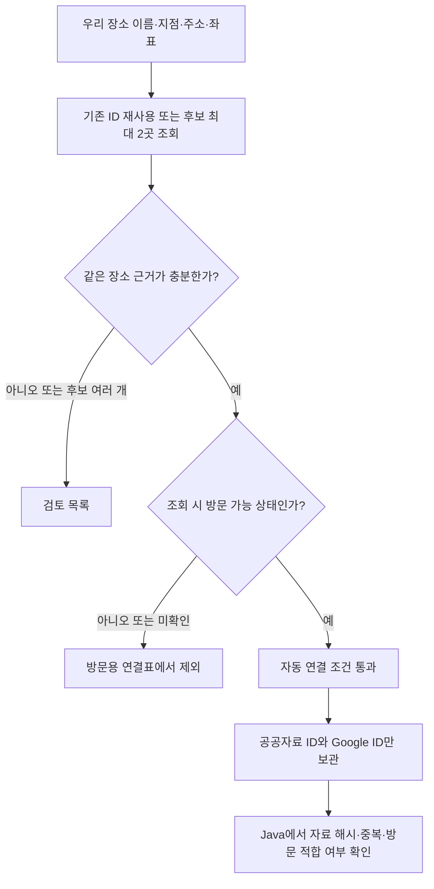

# 장소 연결 개선과 24곳 검증 결과

검증일: 2026-11-13. **8곳은 자동 연결 조건 통과, 15곳은 검토 필요, 1곳은 방문 제외다. 연결률 약 33%라 전체 데이터에 바로 적용하기에는 부족하다.**

현재 앱·DB·원본 CSV는 유지했다. 이전 2곳 연결표도 보존했고, 새 연결표와 검토 목록을 별도로 만들었다. Java 데모는 새 연결표를 읽는다. 실제 추천·상세 화면에서 Google API를 호출하는 기능은 아직 연결하지 않았다.

## 결과를 어떻게 읽어야 할까?

| 활동 | 검사 | 자동 연결 조건 통과 | 검토 필요 | 방문 제외 |
|---|---:|---:|---:|---:|
| 식사 | 8 | 5 | 3 | 0 |
| 카페 | 8 | 2 | 6 | 0 |
| 문화 | 8 | 1 | 6 | 1 |
| 합계 | 24 | **8** | **15** | **1** |

자동 조건 통과 8곳: 대모골, 부잣집밀면, 파노라믹커피부산, 바램, 전포히카루, 통영아구찜, 스타벅스 서면문화로, 연지동작은도서관.

이름·주소·좌표·유형 등이 맞는다는 규칙을 통과했다는 뜻이다. 현장 방문이나 독립적인 정답 목록으로 오연결률까지 측정한 것은 아니다. **‘8곳 모두 정확함’이나 ‘나머지 16곳은 틀린 데이터’로 해석하면 안 된다.**

이번 표본은 기존 5곳을 포함하고, 식사는 세부 업종을 분산했으며 문화는 박물관 3·도서관 3·공원 2곳을 골랐다. 결과를 보기 전에 `binding-sample-v2.json`에 목록을 고정했다. 나머지는 고정 시드의 ID 해시 순서를 사용했다. 부산 전체를 대표하는 무작위 표본은 아니다.

## 처음 2/5였던 이유

| 초기 미연결 장소 | 확인한 원인 | 처리 |
|---|---|---|
| 부잣집밀면 | 상호 뒤의 구분 기호와 부가 설명 때문에 이름 전체 비교 실패 | 설명을 분리하되 주소 일치·50m 이내 좌표를 요구해 자동 연결 |
| 스타벅스 서면역 | 다른 지점이 검색됨 | 업종·위치 기준으로 다시 검색했지만 여전히 불확실해 검토 유지 |
| 부산포민속박물관 | 도로명 대신 원본에 있는 지번으로 응답. 조회 시 임시 휴업 상태 | 같은 장소인지와 방문 가능한지를 나눠 판단. 방문용 연결표에서 제외 |

초기 5곳만 다시 보면 자동 연결 3, 검토 1, 방문 제외 1이다. 박물관까지 단순히 ‘매칭 실패’로 세는 것은 원인을 가린다. 그렇다고 같은 장소라는 이유만으로 휴업 가능 장소를 추천에 넣지도 않는다.

## 추가로 드러난 문제

- **주소 표기:** 부전동과 부전제1동 같은 법정동·행정동 표기 차이를 확인했다. 이번 지역의 명시적인 대응만 적용하고 지번 번호는 그대로 비교한다.
- **영문 병기:** 이름 뒤 영문 병기와 혼합 언어 주소가 있다. 영문 괄호 설명은 같은 이름·정확한 주소·50m 이내 위치가 있을 때만 허용했다. 한글 지점명은 임의로 버리지 않는다.
- **검색 대상:** 상호 검색에 건물 주소 자체가 반환되기도 했다. 추가 조회에서는 업종 필터와 원본 좌표 기반 검색 편향을 사용했다. 검색 편향은 반경 제한이나 정확성 보장이 아니므로 결과를 다시 대조한다.
- **시설 범위:** 미술관과 같은 건물의 복합문화공간은 이름·좌표가 가까워도 같은 대상이라고 단정하지 않았다.
- **자료 오류 가능성:** 도로명 오타로 의심되는 원본과 주소가 다른 결과가 있었다. Google만 보고 원본 좌표·주소를 수정하지 않았다.

Google 수록 범위·언어·검색 방식 문제와 우리 원본 문제를 이번 자동 검사만으로 모두 구분할 수는 없다. 그래서 판정을 유지하고 원 출처·시설 공식 안내로 확인할 작업 목록을 만들었다.

## 바뀐 처리 흐름



이름은 정확한 일치를 우선하고, `|` 뒤의 설명이나 영문 괄호 병기는 더 엄격한 거리 조건을 적용한다. 도로명/건물번호 또는 지번이 원본과 일치해야 한다. 단순 이름 유사도 점수로 승인하지 않는다. 다른 지점, 여러 외부 ID가 함께 맞는 경우, 여러 원본이 같은 외부 ID를 공유하는 경우는 검토 대상으로 남긴다.

장소 일치와 방문 가능 여부를 분리했다. 휴업·폐업·운영 상태 미확인을 서로 섞어 ‘같은 장소가 아님’이라고 처리하지 않는다. 방문용 연결표에는 조회 시 `OPERATIONAL`이고 동일성 조건도 통과한 것만 넣는다. 이후 영업 상태를 계속 보장하는 값은 아니다.

## 개선 효과와 한계

동일한 24곳의 1차 응답에 예전 판정 규칙을 적용하면 5곳이 통과했고, 설명·지번 대조와 복수 후보 처리를 추가한 1차 개선에서 6곳이 통과했다. 이어 원인이 분명한 4곳만 추가 점검해 2곳을 더 연결했다. 최종 연결표는 8곳이다.

이 마지막 보완은 **같은 표본을 보고 조정한 결과**다. 새 표본에 대한 독립 검증이 아니므로 일반화된 정확도 향상 수치로 주장하지 않는다. 같은 장소명을 무작정 느슨하게 맞추지 않고, 어떤 근거로 승인·보류했는지 남겼다는 점이 이번 개선의 핵심이다.

카페와 문화 연결률은 여전히 낮다. 대규모 자동 바인딩이나 데이터 전면 교체보다, 과제 시연용 소수 장소를 원 출처·공식 안내로 검증하는 것이 효율적이다. 외부 정보가 없는 장소에서도 앱의 기본 흐름은 동작하도록 설계하는 것이 좋다.

## 결과 파일

모두 `data/places/pilot/seomyeon-jeonpo-2026-11-13/` 안에 있다.

| 파일 | 용도 |
|---|---|
| `google-bindings.json` | 이전 2곳 연결표. 회귀 검사·이력용으로 보존 |
| `binding-sample-v2.json` | 조회 전에 정한 24곳과 표본 선정 기준 |
| `google-binding-evaluation-v2.json` | 첫 확대 검증, 판정·후보 ID·근거 코드·요청 수 |
| `google-bindings-v2.json` | 첫 확대 검증의 6곳 |
| `google-binding-refinement-v3.json` | 4곳 보완 이력과 나머지 기존 판정을 합친 결과 |
| **`google-bindings-v3.json`** | **Java 데모에서 사용하는 최신 8곳** |
| **`binding-review-v3.csv`** | **검토 15곳 + 방문 제외 1곳. 한국어 사유·우리 원본 주소·후보 링크** |

검토 CSV는 Excel에서 열 수 있는 UTF-8 BOM 형식이다. Google의 이름·주소·좌표·가격·리뷰를 복사한 파일이 아니다. 표시한 상호·주소는 우리 공공 원본이며 링크는 저장 가능한 Google ID로 구성했다. 검토 파일을 고친다고 승인되는 것은 아니다. 근거를 확인한 뒤 별도 재검증을 거쳐야 한다.

## 실행 확인과 읽는 순서

```powershell
# 프로젝트 최상단에서 실행. API·실제 DB 호출 없음.
.\gradlew.bat runPlaceBindingDemo
.\gradlew.bat test --tests "*PlaceBindingCatalogTest"
python -m unittest discover -s tools/place-data-pilot -p "test_*.py" -v
```

데모 출력은 연결 8곳, 대모골·부잣집밀면 연결 true, 방문 제외 박물관·기존 앱 `CAFE_0464` 연결 false다.

코드는 다음 순서로 읽는다.

1. `matching.py → name_method / address_method`: 인정하는 이름·주소 표기 차이.
2. `matching.py → assess`: 같은 장소인지와 방문 적합 여부를 분리해서 검사.
3. `matching.py → decide / block_shared_ids`: 복수 후보·중복 외부 ID를 보류.
4. `evaluate.py → plan / live`: 고정된 표본에서 첫 비교를 실행. 원문은 프로세스 메모리에만 유지.
5. `refine.py → main / write_review_queue`: 4곳 후속 확인과 한국어 검토 목록 생성.
6. Java `PlaceBindingCatalog.load / googlePlaceId`: 새 연결표의 형식·자료 해시·중복·`ELIGIBLE_AT_CHECK`를 확인하고 정확한 ID만 조회.

Java의 `Map<Integer, String>`은 연결표 버전별로 허용하는 규칙 이름을 정리한 표다. 버전과 규칙이 맞지 않으면 읽지 않는다. `Optional<String>`의 빈 결과는 연결 미확정이라는 뜻이며, 같은 이름의 다른 가게로 대체하지 않는다.

## 요청량과 보관

이번 작업에서는 **총 69회** 요청했다. 초기 미연결 진단 3회 + 확대 검증 48회 + 원인 대조 10회 + 표적 보완 8회다. 모두 가격·평점·리뷰 필드를 제외했다. 각 실행은 별도 잠금 파일과 횟수 제한을 두었고 자동 재시도는 하지 않았다. 이전 작업의 20회와 별도 수치다. 계정 전체 청구액은 조회하지 않았다.

Google 응답 원문은 파일로 저장하지 않고 ID와 자체 검증 판정만 남겼다. Place ID 보관 허용과 상호·리뷰 등 결과 보관 허용은 다르다. [공식 보관 정책](https://developers.google.com/maps/documentation/places/web-service/policies), [검색의 유형·위치 조건](https://developers.google.com/maps/documentation/places/web-service/text-search)

## 다음 구현의 기준

우선 자동 조건을 통과한 장소를 시연 후보로 삼고, 가격의 인당 기준과 실제 사용할 활동을 확인해야 한다. 현재 8곳은 식당 5·카페 2·도서관 1곳으로, 다양한 문화 활동이나 완성된 데이트 코스를 보장하지 않는다.

그다음 가격 범위 모델과 공공자료 로딩을 앱에 연결한다. Google 조회는 상세정보의 선택적 보강 수단으로 두고, 가격 미확인을 0원으로 합산하거나 외부 조회 실패를 코스 편집 실패로 만들지 않는 방향이 적합하다.
