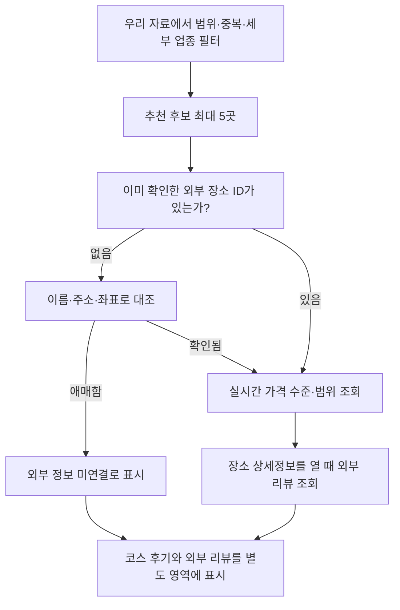

# 장소 데이터 개선 가능성 테스트 결과

검증일: 2026-11-13 21:11 KST. 기존 앱·DB와 분리해서 실행했다.

**세부 분류와 외부 리뷰 조회는 가능하다. 다만 Google 검색 결과를 기존 장소에 자동 연결하고, 그 가격을 인당 코스 비용으로 계산하는 단계는 아직 준비되지 않았다.**

## 실제로 확인한 결과

Google Places API (New)에 검색 5회, 상세 조회 5회, 총 10회를 요청했다. 오류 없이 약 3.23초에 완료됐다. 이 시간은 이번 한 번의 순차 실행 결과이며 앱 응답 속도를 보장하는 수치는 아니다.

표본은 보유 공공자료에서 고른 식사 2곳·카페 2곳·박물관 1곳이다. 공개 메뉴가 연결된 식당과 문화시설을 함께 시험하기 위한 선택이며, **현재 앱 추천 알고리즘의 상위 5곳이 아니다.**

| 확인 항목 | 상세 응답 5건 전체 | 이름·주소·좌표 모두 일치한 2건만 |
|---|---:|---:|
| 가격 범위 제공 | 3 | 1 |
| 가격 정보 미제공 | 2 | 1 |
| 평점 제공 | 5 | 2 |
| 세부 분류 제공 | 5 | 2 |
| 영업 상태 필드 제공 | 5 | 2 |
| 리뷰 제공 | 5 | 2 |
| 받은 리뷰 수 합계 | 22 | 7 |
| 본문·작성자명·작성자 링크가 있는 리뷰 | 22 | 7 |
| Google Maps 원문 링크 제공 | 5 | 2 |

**5건 모두 우리 장소와 같은 가게라고 확정한 것은 아니다.** 보수적인 비교에서 2건이 통과하고 3건은 수동 검토 대상으로 남았다. 표기 차이인지, 위치 오류인지, 다른 지점인지 구분할 개별 진단 자료는 이번 집계에 보관하지 않았다. 따라서 3건이 실제 오매칭이라고 단정하지도 않는다. 추가 요청 없이 이번 검증을 마쳤다.

키와 요청 헤더, Google 응답 원문·상호·주소·좌표·가격·리뷰 본문은 파일에 저장하지 않았다. 로컬 `build/place-data-pilot/live-summary.json`에는 위 제공 여부의 집계만 있다. Google Cloud 청구 화면이나 남은 크레딧을 확인하지 않았으므로 실제 과금액을 확정하지 않는다.

## 공공자료로 만든 별도 후보

`data/places/pilot/seomyeon-jeonpo-2026-11-13/places.csv`에 2,669행을 생성했다. 식사 2,182, 카페 467, 문화 20행이다. 문화는 행정동이 비어 있어 부산진구 주소와 서면역 기준 2km 범위를 함께 사용했다.

- 식사는 원본 업종으로 냉면·밀면, 국수·칼국수, 회·초밥 등 세분화할 수 있다.
- 문화는 도서관 8, 공원 9, 박물관·미술관 3행으로 나눴다.
- 카페 467행의 원본 업종은 모두 ‘카페’라 분위기·디저트·공부 적합성까지 알 수는 없다.
- 공개 메뉴 65행이 장소 27곳에 연결되지만 전부 분량 미확인이다. 인당 가격으로 변환하지 않았다.
- 성인 관람료 근거는 3행뿐이다. 원본상 무료 2행·유료 1행이며 나머지 2,666행은 가격 미확인이다. 현재 가격을 재확인한 값은 아니다.

기존 `integrated_places.csv`, 교체 SQL, `PlaceRepository.java`, 부산 공공자료 CSV 3개는 실행 전후 SHA-256이 같았다. 앱이 읽는 자료와 DB 스키마·내용은 바꾸지 않았다.

## 앱에 넣을 때의 흐름



추천 단계에서는 가격·평점 같은 가벼운 필드만 조회하고, 리뷰는 사용자가 상세정보를 열 때 요청하는 구성이 적합하다. 네트워크 요청은 UI 스레드 밖에서 실행하고, 사용자가 조건을 바꾼 뒤 도착한 이전 결과는 버려야 한다. 위 흐름은 다음 Java 구현안이며 아직 앱에 들어가 있지 않다.

Google 범위는 해당 장소의 가격 정보다. 실제 선택 메뉴·분량·통화·인당 기준을 확인하기 전에는 인원수와 바로 곱하지 않는다. 수준만 있으면 ‘보통 가격대’처럼 표시하고 원화 금액을 만들지 않는다. ‘가격 미확인’을 0원으로 합산하지 않는다.

예상 총비용 예시: 식사 1인 10,000~15,000원 + 음료 4,000~6,000원, 2명 → **28,000~42,000원**. 이는 테스트용 가상 금액이다. 다른 장소 한 곳의 가격을 모르면 **확인된 비용 28,000~42,000원 + 미확인 1곳**으로 표시한다.

## 리뷰는 어떻게 연결할까?

| 영역 | 연결 기준 | 이번 확인 수준 |
|---|---|---|
| 이 장소가 포함된 코스 후기 | 우리 장소 ID가 후기 대상 코스에 포함되는지 확인 | 가상 데이터로 규칙 검사. 실제 후기 DB 연동은 미구현 |
| Google 외부 리뷰 | 확인된 Google Place ID로 상세 조회 | 실응답에서 본문·작성자·링크 제공 확인 |

현재 Java의 `Review`는 가게가 아니라 코스 전체에 대한 후기다. 코스 별점을 가게 별점처럼 표시하면 안 된다. 새 공공자료의 ID와 기존 코스의 장소 ID를 대응시키는 작업도 필요하다.

## 다음 구현의 우선순위

1. **시연에 쓸 소수 장소의 ID·지점·주소부터 검증.** 모호한 검색 결과를 자동 연결하지 않는다. 확인된 Google Place ID를 재사용하면 반복 검색도 줄일 수 있다.
2. **가격 범위 모델과 비용 계산을 Java에 도입.** 미확인·무료·상한 없음·인당/그룹 단위를 구분하고, 추천 필터·합계·저장 스냅샷을 함께 맞춘다. 우선 공공자료·확인한 메뉴로 검증 가능한 작은 코스를 만드는 것이 좋다.
3. **검증된 장소만 실시간 상세 조회에 연결.** 실패하면 우리 기본 정보와 원문 링크로 안내하고, 리뷰는 상세 화면에서 불러온다.

Google 데이터의 보관 및 지도 결합 조건은 별도로 지켜야 한다. 이번 실험은 카카오 지도에 Google 정보·마커를 표시하지 않았다. 앱 화면에 넣을 때는 지도 없이 보여주는 상세 화면의 허용 범위, Google 로고·작성자·원문 링크 표시를 먼저 정해야 한다. [공식 정책](https://developers.google.com/maps/documentation/places/web-service/policies)

검색 요청은 ID 필드만 사용했다. 상세 요청에는 가격·평점·리뷰가 포함되어 Place Details Enterprise + Atmosphere 등급이 적용된다. API 키가 유효하다는 것은 확인했지만 계정 전체 사용량과 청구액은 별도다. [검색 필드](https://developers.google.com/maps/documentation/places/web-service/text-search), [상세 필드](https://developers.google.com/maps/documentation/places/web-service/place-details), [요금표](https://developers.google.com/maps/billing-and-pricing/pricing)

## 실행 확인과 코드 읽는 순서

```powershell
python -m unittest discover -s tools/place-data-pilot -p test_pilot.py -v
```

11개 테스트가 통과했다. 가격 미확인·분량 불명·상한 초과·상한 없음·다른 주소·후기 출처 분리·실제 요청 횟수 제한을 검사한다. Google 실호출은 테스트에 포함되지 않는다.

`tools/place-data-pilot/pilot.py`에서 `prepare` → `GoogleProbe.request` → `match_status` → `live` 순서로 읽으면 된다. 비용 규칙은 `public_price`, `total_cost`, `within_budget`, 후기 구분은 `review_sections`에 있다. 모두 별도 실험용 Python 코드로, Java 앱에는 반영하지 않았다.

이미 생성된 자료는 덮어쓰지 않으며, 실호출은 로컬 잠금 파일로 재실행을 차단했다. 전체 실행 설명은 `tools/place-data-pilot/README.md`에 있다. 신규 공공 API 키가 필요한 TourAPI·부산맛집 API 등은 이번에 실호출하지 않았다.
