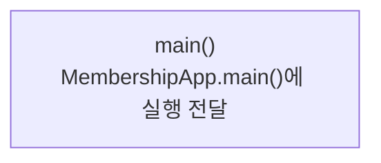

> [!info] 개발 중인 코드
> 2026-11-11 작업본 기준이다. 확정 설계가 아니며, 코드가 바뀌면 이 노트도 새 내용으로 바꿔요.

## 한눈에 보기

앱을 실행했을 때 가장 먼저 들어오는 시작 지점이에요. 이 파일이 로그인 화면을 직접 만드는 것은 아니고, 화면과 로그인 흐름을 담당하는 MembershipApp에 실행을 넘겨줘요.

- **현재 위치:** 현재 사용
- **원본:** `src/main/java/com/datecourse/app/AppLauncher.java`
- **전체 안내:** [[전체_동작_흐름|전체_동작_흐름]] · [[목차|목차]]

## 사용 장면과 읽는 순서

IDE에서 AppLauncher를 실행한다고 생각해 보세요. AppLauncher의 main()이 시작되고, 바로 MembershipApp.main(args)를 부르면서 로그인 앱 준비가 이어져요.

1. `main()`이 실행 인자 `args`를 받아요. 실행 인자는 앱을 시작할 때 밖에서 넘길 수 있는 값이에요.
2. `MembershipApp.main(args)`에 같은 인자를 넘겨요. 이후의 창 만들기와 회원 기능은 MembershipApp 노트에서 이어 읽으면 돼요.

모르는 용어는 [[문서_읽는법|문서 읽는 법과 용어 설명]]에서 찾아볼 수 있어요.

## 동작 순서

```text
Gradle run → main() → MembershipApp.main() → 로그인 준비
```

## 주요 메서드

| 메서드 | 하는 일 |
|---|---|
| `main()` | MembershipApp을 실행한다. |
| `MembershipApp.main()` | Swing 화면 스레드에서 앱을 시작하고 종료 시 DB 풀을 닫는다. |

## 사용한 Java 라이브러리·API

아래 표는 가져다 쓴 도구, 이 클래스에서 만나는 함수, 사용하는 이유를 연결해 보여줘요. JDK 기본은 Java에 포함된 기능이고, 별도 라이브러리는 프로젝트가 추가로 준비하는 도구예요. 처음에는 도구 이름을 외우기보다 마지막 열의 역할부터 읽어 보세요.

| 라이브러리·API | 사용 메서드/위치 | 여기서 하는 일 |
|---|---|---|
| JDK 기본 자료형·record | 생성자·자동 접근 메서드 | 별도 외부 라이브러리 없이 값이나 실행 진입점만 정의한다. 호출한 다른 클래스가 쓰는 라이브러리와 구분해요. |

외부 라이브러리 버전과 전체 사용 위치: [[라이브러리_사용_안내|라이브러리 사용 안내]]

## 클래스 내부 함수 흐름도



## 핵심 코드

원본 9행 부근의 실제 코드다.

```java
public static void main(String[] args) {
    MembershipApp.main(args);
}
```

## 핵심 코드를 풀어서 읽기

`public static void main(String[] args)`는 Java 실행 시작 함수예요. 함수 안의 `MembershipApp.main(args);` 한 줄이 다른 클래스에 실행을 넘기는 부분이에요.

## 변경할 때 주의할 점

실행 위치가 바뀌면 build.gradle의 mainClass도 함께 확인해요.

## 함께 읽기

[[05_회원_DB/MembershipApp|MembershipApp]]
