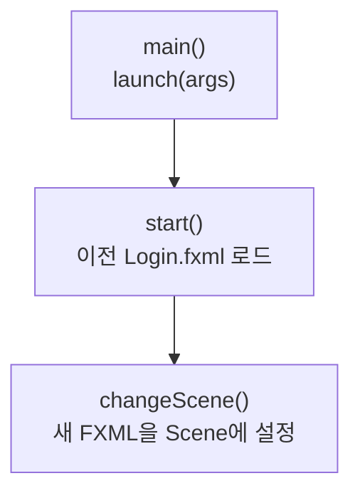

> [!info] 개발 중인 코드
> 2026-11-11 작업본 기준이다. 확정 설계가 아니며, 코드가 바뀌면 이 노트도 새 내용으로 바꿔요.

## 한눈에 보기

예전에 사용하던 JavaFX 로그인 화면의 시작 코드예요. 현재 통합 앱은 AppLauncher로 시작하므로, 처음 프로젝트를 실행할 때 이 파일을 선택하면 현재 앱의 흐름과 달라질 수 있어요.

- **현재 위치:** 이전 코드
- **원본:** `src/main/java/com/datecourse/app/MainApp.java`
- **전체 안내:** [[전체_동작_흐름|전체_동작_흐름]] · [[목차|목차]]

## 사용 장면과 읽는 순서

화면 파일의 위치를 받아 기존 창 안의 내용을 다른 화면으로 바꾸는 방식을 살펴볼 때 참고해요. 이 코드가 찾는 예전 Login.fxml·Main.fxml은 현재 리소스에 없어요.

1. `main()`에서 JavaFX 실행을 시작하면 JavaFX가 `start()`를 호출해요.
2. `start()`는 예전 로그인 화면 파일을 읽으려고 해요.
3. 다른 화면으로 바꾸는 요청이 있을 때 `changeScene()`이 화면 내용을 교체해요. 세 함수가 사용자의 동작 없이 계속 반복 호출되는 것은 아니에요.

모르는 용어는 [[문서_읽는법|문서 읽는 법과 용어 설명]]에서 찾아볼 수 있어요.

## 동작 순서

```text
main() → launch() → start() → 이전 로그인 FXML 로드
changeScene() → 새 FXML을 현재 Scene의 root로 교체
```

## 주요 메서드

| 메서드 | 하는 일 |
|---|---|
| `start()` | 이전 로그인 화면을 읽어 와요. |
| `changeScene()` | FXML 경로를 받아 화면 내용을 바꿔요. |
| `main()` | JavaFX 실행을 시작한다. |
| `launch()` | JavaFX 런타임을 시작하고 Application.start()를 호출하게 한다. |

## 사용한 Java 라이브러리·API

아래 표는 가져다 쓴 도구, 이 클래스에서 만나는 함수, 사용하는 이유를 연결해 보여줘요. JDK 기본은 Java에 포함된 기능이고, 별도 라이브러리는 프로젝트가 추가로 준비하는 도구예요. 처음에는 도구 이름을 외우기보다 마지막 열의 역할부터 읽어 보세요.

| 라이브러리·API | 사용 메서드/위치 | 여기서 하는 일 |
|---|---|---|
| JavaFX FXML<br/>별도 JavaFX 21: javafx.fxml<br/>FXMLLoader | start(), changeScene() | FXML 화면 파일을 읽고 @FXML 필드·이벤트를 컨트롤러와 연결해요. |
| JavaFX 창·애니메이션<br/>별도 JavaFX 21: javafx.graphics<br/>Application, Parent, Scene, Stage | start(), changeScene() | 화면/창을 만들거나 같은 창의 전환·이동·투명도 애니메이션을 실행한다. |
| 파일·문자 입출력<br/>JDK 기본: java.io / java.nio<br/>IOException | changeScene() | 설정·아이디 기록·SQL 파일을 읽거나 저장해요. 테스트에서는 화면 이미지를 파일로 남긴다. |

외부 라이브러리 버전과 전체 사용 위치: [[라이브러리_사용_안내|라이브러리 사용 안내]]

## 클래스 내부 함수 흐름도



이 그림에는 서로 다른 버튼·요청에서 시작하는 흐름도 함께 있어요. 모든 함수가 위에서 아래로 무조건 한 번씩 실행된다는 뜻은 아니에요.

## 핵심 코드

원본 23행 부근의 실제 코드다.

```java
public void changeScene(String fxml) throws IOException {
    Parent pane = FXMLLoader.load(getClass().getResource(fxml));
    stg.getScene().setRoot(pane);
}
```

## 변경할 때 주의할 점

현재 /fxml/Login.fxml 및 /fxml/Main.fxml은 리소스에 없다. 통합 앱은 AppLauncher로 시작한다.
