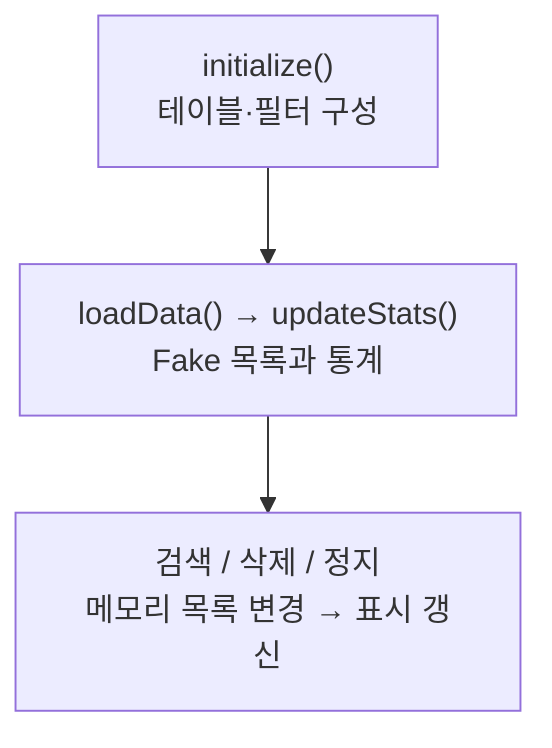

> [!info] 개발 중인 코드
> 2026-11-11 작업본 기준이다. 확정 설계가 아니며, 코드가 바뀌면 이 노트도 새 내용으로 바꿔요.

## 한눈에 보기

회원 목록과 후기를 표로 보여주는 예제 관리자 화면이에요. 여기의 회원·후기는 실제 저장소를 읽은 결과가 아니라 미리 만든 예시 데이터예요.

- **현재 위치:** 예제 화면
- **원본:** `src/main/java/com/datecourse/controller/AdminController.java`
- **전체 안내:** [[전체_동작_흐름|전체_동작_흐름]] · [[목차|목차]]

## 사용 장면과 읽는 순서

예제 창에서 후기 한 개를 지우면 화면 목록이 바뀌어요. 이 동작만 보고 실제 회원의 후기가 DB에서도 삭제됐다고 생각하면 안 돼요.

1. `initialize()`와 표 준비 함수들이 어떤 항목을 보여줄지 정해요.
2. `loadData()`가 예제 회원·후기를 넣고, `updateStats()`가 회원 수와 평균 별점 등을 다시 계산해요.
3. 삭제·회원 정지 버튼을 누르면 해당 이벤트 함수가 예제 목록을 바꿔요. 실제 관리자 인증과 DB 관리는 별도 연결이 필요해요.

모르는 용어는 [[문서_읽는법|문서 읽는 법과 용어 설명]]에서 찾아볼 수 있어요.

## 동작 순서

```text
initialize() → 테이블 열 구성 → loadData() → 예제 회원/리뷰 → updateStats()
검색 → FilteredList 필터 / 삭제·정지 → 메모리 목록 갱신
```

## 주요 메서드

| 메서드 | 하는 일 |
|---|---|
| `setupReviewTable()` | 리뷰 열과 검색 필터를 연결해요. |
| `setupMemberTable()` | 회원 열을 보여줘요. |
| `updateStats()` | 회원 수·리뷰 수·평균 별점을 계산해요. |
| `onDeleteReviewClick()` | 확인 후 예제 리뷰를 지워요. |
| `onToggleSuspendClick()` | 예제 일반 회원 정지 여부를 바꿔요. |
| `initialize()` | 예제 관리자 화면의 리뷰·회원 표를 구성하고 초기 목록을 불러온다. |
| `loadData()` | 예제 리뷰·회원 데이터를 목록에 넣고 통계를 새 내용으로 바꿔요. |

## 사용한 Java 라이브러리·API

아래 표는 가져다 쓴 도구, 이 클래스에서 만나는 함수, 사용하는 이유를 연결해 보여줘요. JDK 기본은 Java에 포함된 기능이고, 별도 라이브러리는 프로젝트가 추가로 준비하는 도구예요. 처음에는 도구 이름을 외우기보다 마지막 열의 역할부터 읽어 보세요.

| 라이브러리·API | 사용 메서드/위치 | 여기서 하는 일 |
|---|---|---|
| JavaFX 화면·입력<br/>별도 JavaFX 21: javafx.controls<br/>Label, TextField, TableView, TableColumn, Alert | setupReviewTable(), setupMemberTable(), updateStats(), onReviewSearchReset(), onDeleteReviewClick(), onToggleSuspendClick() | 화면 요소 생성·배치, 입력값 읽기/쓰기, 버튼 활성화와 클릭 이벤트 연결에 사용해요. |
| JavaFX FXML<br/>별도 JavaFX 21: javafx.fxml<br/>FXML, Initializable | 필드·생성자·record 값 또는 이벤트 연결 | FXML 화면 파일을 읽고 @FXML 필드·이벤트를 컨트롤러와 연결해요. |
| JavaFX 작업·이벤트<br/>별도 JavaFX 21<br/>ObservableList, FXCollections, FilteredList, SimpleStringProperty | setupReviewTable(), setupMemberTable(), loadData(), updateStats(), onDeleteReviewClick(), onToggleSuspendClick() | 화면 스레드 전환, 백그라운드 작업 결과 반영, 변경 가능한 UI 목록과 키/휠 이벤트에 사용해요. |
| 목록·대응표<br/>JDK 기본: java.util<br/>List, Optional, ResourceBundle | initialize(), onDeleteReviewClick() | 장소 목록·ID별 반경·정렬·중복 제거·문자열 설정을 관리한다. stream/filter/map은 목록을 고르고 변환하는 데 사용해요. |
| 화면 파일 주소<br/>JDK 기본: java.net<br/>URL | initialize() | 화면 초기화에 전달되는 파일 위치 같은 주소를 표현하는 Java 타입이에요. URL 타입을 받는다는 것만으로 외부 브라우저를 실행하는 것은 아니에요. |

외부 라이브러리 버전과 전체 사용 위치: [[라이브러리_사용_안내|라이브러리 사용 안내]]

## 클래스 내부 함수 흐름도



## 핵심 코드

원본 132행 부근의 일부 발췌다. 아래 코드만 따로 복사해 실행하는 예제는 아니다.

```java
private void onToggleSuspendClick() {
    Member selected = memberTable.getSelectionModel().getSelectedItem();
    if (selected == null) {
        memberMessageLabel.setText("회원을 선택해주세요.");
        return;
    }
    if ("ADMIN".equals(selected.role())) {
        memberMessageLabel.setText("관리자는 정지할 수 없어요.");
        return;
    }

    // TODO: 백엔드에 정지/해제 요청 (selected.memberId())
    Member updated = new Member(selected.memberId(), selected.name(), selected.role(),
            selected.joinedAt(), !selected.suspended());
    int index = members.indexOf(selected);
    members.set(index, updated);
    memberTable.getSelectionModel().select(index);
    memberMessageLabel.setText(updated.name() + "님을 "
// ... 이후 코드는 원본 참고
```

## 변경할 때 주의할 점

MembershipApp의 Swing 관리자 화면과 다른 코드다. Fake 데이터와 권한 확인 TODO를 사용하므로 실제 관리자 인증·DB 관리로 보지 않는다.

## 함께 읽기

[[06_데모/FakeMemberData|FakeMemberData]] · [[06_데모/FakeReviewData|FakeReviewData]] · [[04_데이터/Member|Member]] · [[04_데이터/Review|Review]]
