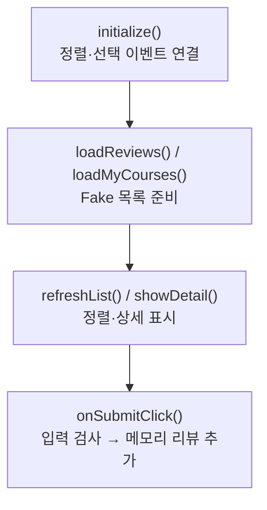

> [!info] 개발 중인 코드
> 2026-11-11 작업본 기준이다. 확정 설계가 아니며, 코드가 바뀌면 이 노트도 새 내용으로 바꿔요.

## 한눈에 보기

코스 후기 목록을 보고 정렬하거나 새 후기를 입력해 보는 예제 화면이에요. 현재 이 클래스의 작성자 정보와 저장 처리를 실제 로그인·DB 기능이 완성된 것으로 읽으면 안 돼요.

- **현재 위치:** 예제 화면
- **원본:** `src/main/java/com/datecourse/controller/CommunityController.java`
- **전체 안내:** [[전체_동작_흐름|전체_동작_흐름]] · [[목차|목차]]

## 사용 장면과 읽는 순서

후기를 쓸 코스를 고르고 별점과 내용을 입력하는 모습을 확인할 수 있어요. 예제 목록에 추가되는 것과 앱을 껐다 켜도 남도록 저장하는 것은 다른 작업이에요.

1. `loadReviews()`와 `loadMyCourses()`로 예제 후기와 선택 가능한 예제 코스를 준비해요.
2. `refreshList()`가 최신순·별점순으로 보여주고, 항목을 고르면 `showDetail()`이 코스를 설명해요.
3. `onSubmitClick()`은 코스 선택·별점·글 길이를 확인한 뒤 후기를 추가해요. 실제 회원 정보와 저장소 연결 여부는 따로 확인해야 해요.

모르는 용어는 [[문서_읽는법|문서 읽는 법과 용어 설명]]에서 찾아볼 수 있어요.

## 동작 순서

```text
initialize() → 예제 리뷰/코스 로드 → refreshList()
리뷰 선택 → showDetail()
작성 → onSubmitClick() → 입력 검사 → 메모리 Review 추가 → 정렬/선택 갱신
```

## 주요 메서드

| 메서드 | 하는 일 |
|---|---|
| `loadReviews()` | 예제 리뷰를 가져온다. |
| `loadMyCourses()` | 예제 코스를 작성 선택지로 넣는다. |
| `refreshList()` | 최신순 또는 별점순으로 보여줘요. |
| `showDetail()` | 리뷰 대상 코스를 보여 준다. |
| `onSubmitClick()` | 코스·별점·내용 길이를 검사하고 리뷰를 추가한다. |
| `initialize()` | 정렬·평점 입력과 리뷰 목록의 표시·선택 이벤트를 준비해요. |

## 사용한 Java 라이브러리·API

아래 표는 가져다 쓴 도구, 이 클래스에서 만나는 함수, 사용하는 이유를 연결해 보여줘요. JDK 기본은 Java에 포함된 기능이고, 별도 라이브러리는 프로젝트가 추가로 준비하는 도구예요. 처음에는 도구 이름을 외우기보다 마지막 열의 역할부터 읽어 보세요.

| 라이브러리·API | 사용 메서드/위치 | 여기서 하는 일 |
|---|---|---|
| JavaFX 화면·입력<br/>별도 JavaFX 21: javafx.controls<br/>Button, Label, ComboBox, ListView, ListCell, TextArea, VBox 등 | initialize(), setupReviewCell(), updateItem(), setupCourseBox(), loadMyCourses(), refreshList() 외 2개 | 화면 요소 생성·배치, 입력값 읽기/쓰기, 버튼 활성화와 클릭 이벤트 연결에 사용해요. |
| JavaFX FXML<br/>별도 JavaFX 21: javafx.fxml<br/>FXML, Initializable | 필드·생성자·record 값 또는 이벤트 연결 | FXML 화면 파일을 읽고 @FXML 필드·이벤트를 컨트롤러와 연결해요. |
| 목록·대응표<br/>JDK 기본: java.util<br/>List, ArrayList, Comparator, UUID, ResourceBundle | initialize(), loadReviews(), loadMyCourses(), refreshList(), showDetail(), onSubmitClick() | 장소 목록·ID별 반경·정렬·중복 제거·문자열 설정을 관리한다. stream/filter/map은 목록을 고르고 변환하는 데 사용해요. |
| 화면 파일 주소<br/>JDK 기본: java.net<br/>URL | initialize() | 화면 초기화에 전달되는 파일 위치 같은 주소를 표현하는 Java 타입이에요. URL 타입을 받는다는 것만으로 외부 브라우저를 실행하는 것은 아니에요. |
| 날짜<br/>JDK 기본: java.time<br/>LocalDate | onSubmitClick() | 예제 코스·리뷰 날짜와 기본 코스 이름의 날짜를 만들어요. |

외부 라이브러리 버전과 전체 사용 위치: [[라이브러리_사용_안내|라이브러리 사용 안내]]

## 클래스 내부 함수 흐름도



## 핵심 코드

원본 192행 부근의 일부 발췌다. 아래 코드만 따로 복사해 실행하는 예제는 아니다.

```java
private void onSubmitClick() {
    Course course = courseBox.getValue();
    Integer rating = ratingBox.getValue();
    String content = contentArea.getText().trim();

    if (course == null) {
        messageLabel.setText("리뷰를 남길 코스를 선택해주세요.");
        return;
    }
    if (rating == null) {
        messageLabel.setText("별점을 선택해주세요.");
        return;
    }
    if (content.length() < 5) {
        messageLabel.setText("내용을 5자 이상 입력해주세요.");
        return;
    }

// ... 이후 코드는 원본 참고
```

## 변경할 때 주의할 점

작성자는 현재 고정값이며 로그인 세션 연동과 DB 등록은 미완성이다.

## 함께 읽기

[[04_데이터/Course|Course]] · [[04_데이터/CoursePlace|CoursePlace]] · [[06_데모/FakeCourseData|FakeCourseData]] · [[06_데모/FakeReviewData|FakeReviewData]] · [[04_데이터/Review|Review]]
