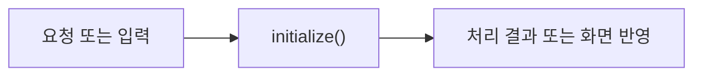

# ConditionController

> 개발 중인 코드예요. `ea2242b` 기준이며, 후속 커밋에서 동작이 바뀔 수 있어요.

## 한눈에 보기

홈·편집·저장 목록·내 페이지의 이동과 현재 코스를 관리해요. 편집 완료와 DB 저장은 다른 동작이에요.

## 코드 읽기

아래 선언부터 읽고 함수표의 순서로 찾아보세요. 전체 코드는 [기준 커밋의 원본](https://github.com/2egn/DateCourseApp/blob/ea2242b/src/main/java/com/datecourse/controller/ConditionController.java)에서 확인해요.

```java
public class ConditionController extends BasePageController {
```

## 주요 함수

| 함수 | 하는 일 |
|---|---|
| `initialize()` | 화면과 공통 알림, 지도 이벤트를 연결해요. |
| `onSaveCourse()` | 이름을 입력받아 신규 저장 또는 같은 코스 갱신을 요청해요. |
| `restoreSavedCourse()` | 장소 순서·가격 상태를 복원하고 도보 경로를 계산해요. |
| `onMyPage()` | 회원 정보 화면으로 이동해요. |
| `onLogout()` | 미저장 내용을 확인하고 세션·지도 작업을 정리해요. |

## 동작 흐름

사용자 요청 또는 다른 클래스의 호출로 시작해요. 자세한 분기는 위 함수표와 원본 코드를 함께 봐요.



## 사용하는 라이브러리

| 도구 | 이 코드에서 필요한 이유 |
|---|---|
| JavaFX | 이벤트·화면·백그라운드 작업 |
| Java 컬렉션·함수 | 목록 복사·조건 처리·전달할 동작 |

라이브러리가 쓰이는 구체적인 위치는 위 함수표와 원본의 해당 함수 본문에서 확인해요. 화면 작업과 DB 작업을 같은 스레드에서 섞지 않는 것이 중요해요.

관련 안내: [[현재_구현_흐름|현재 전체 흐름]] · [[업데이트_내역|이번 변경]]
