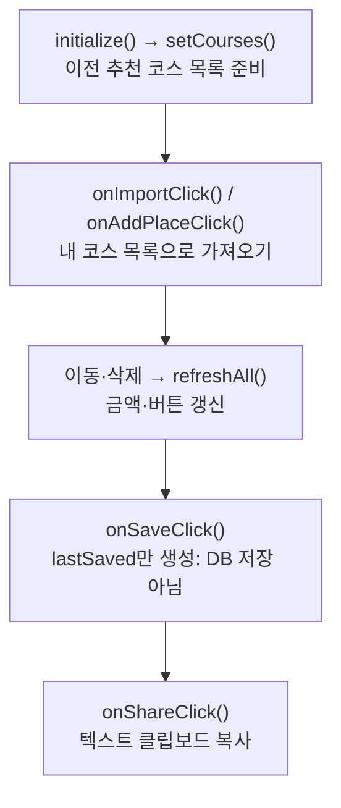

> [!info] 개발 중인 코드
> 2026-11-11 작업본 기준이다. 확정 설계가 아니며, 코드가 바뀌면 이 노트도 새 내용으로 바꿔요.

## 한눈에 보기

예전 방식으로 추천 코스 전체를 가져오거나 장소를 합치던 편집 화면이에요. 지금 장소를 하나씩 고르는 편집 화면은 RouteEditorController이므로, 두 파일의 저장·가격 규칙을 섞지 않아야 해요.

- **현재 위치:** 이전 화면
- **원본:** `src/main/java/com/datecourse/controller/CourseEditController.java`
- **전체 안내:** [[전체_동작_흐름|전체_동작_흐름]] · [[목차|목차]]

## 사용 장면과 읽는 순서

추천 코스 하나를 통째로 내 목록에 복사해 보는 예전 화면을 이해할 때 읽어요. 여기서 ‘저장’을 눌러도 회원별 코스를 DB에 영구 저장하는 기능이 완성됐다는 뜻은 아니에요.

1. `setCourses()` 또는 `setRecommendedCourse()`가 예전 화면에 보여줄 코스 정보를 받아요.
2. `onImportClick()`은 코스 전체를, `onAddPlaceClick()`은 장소 한 곳을 목록에 넣어요.
3. `onSaveClick()`은 실행 중인 화면의 저장 결과를 만들고, `onShareClick()`은 코스 설명을 복사할 텍스트로 만들어요.

모르는 용어는 [[문서_읽는법|문서 읽는 법과 용어 설명]]에서 찾아볼 수 있어요.

## 동작 순서

```text
initialize() → setCourses() → 후보 코스 선택
onImportClick()/onAddPlaceClick() → myPlaces 편집
순서·삭제 → refreshAll() → 총액/예산 표시
onSaveClick() → lastSaved만 생성 / onShareClick() → 텍스트 클립보드 복사
```

## 주요 메서드

| 메서드 | 하는 일 |
|---|---|
| `setCourses()` | 예전 후보 코스 목록과 예산을 받아요. |
| `setRecommendedCourse()` | 추천된 순서대로 내 목록에 채운다. |
| `onImportClick()` | 선택 코스 전체를 내 목록으로 복사한다. |
| `onAddPlaceClick()` | 중복 ID를 막으며 장소를 하나 추가한다. |
| `onSaveClick()` | 화면 메모리에 저장 결과를 만들어요. |
| `onShareClick()` | 코스 정보를 공유용 텍스트로 복사한다. |
| `initialize()` | 이전 편집 화면의 목록·버튼·금액 표시를 연결해요. |
| `refreshAll()` | 이전 편집본의 장소 목록·합계·선택 상태를 다시 보여줘요. |

## 사용한 Java 라이브러리·API

아래 표는 가져다 쓴 도구, 이 클래스에서 만나는 함수, 사용하는 이유를 연결해 보여줘요. JDK 기본은 Java에 포함된 기능이고, 별도 라이브러리는 프로젝트가 추가로 준비하는 도구예요. 처음에는 도구 이름을 외우기보다 마지막 열의 역할부터 읽어 보세요.

| 라이브러리·API | 사용 메서드/위치 | 여기서 하는 일 |
|---|---|---|
| JavaFX 화면·입력<br/>별도 JavaFX 21: javafx.controls<br/>Button, Label, TextField, ListView, ListCell, Clipboard, ClipboardContent 등 | useAsPanel(), initialize(), setCourses(), setRecommendedCourse(), showCandidatePlaces(), refreshAll() 외 10개 | 화면 요소 생성·배치, 입력값 읽기/쓰기, 버튼 활성화와 클릭 이벤트 연결에 사용해요. |
| JavaFX FXML<br/>별도 JavaFX 21: javafx.fxml<br/>FXML, Initializable | 필드·생성자·record 값 또는 이벤트 연결 | FXML 화면 파일을 읽고 @FXML 필드·이벤트를 컨트롤러와 연결해요. |
| JavaFX 작업·이벤트<br/>별도 JavaFX 21<br/>ObservableList, FXCollections | initialize(), setCourses(), total(), refreshAll(), updateButtons(), onImportClick() 외 8개 | 화면 스레드 전환, 백그라운드 작업 결과 반영, 변경 가능한 UI 목록과 키/휠 이벤트에 사용해요. |
| 목록·대응표<br/>JDK 기본: java.util<br/>List, ArrayList, Collections, UUID, ResourceBundle | initialize(), setCourses(), setRecommendedCourse(), onMoveUpClick(), onMoveDownClick(), buildCourse() | 장소 목록·ID별 반경·정렬·중복 제거·문자열 설정을 관리한다. stream/filter/map은 목록을 고르고 변환하는 데 사용해요. |
| 화면 파일 주소<br/>JDK 기본: java.net<br/>URL | initialize() | 화면 초기화에 전달되는 파일 위치 같은 주소를 표현하는 Java 타입이에요. URL 타입을 받는다는 것만으로 외부 브라우저를 실행하는 것은 아니에요. |
| 날짜<br/>JDK 기본: java.time<br/>LocalDate, DateTimeFormatter | resolveTitle() | 예제 코스·리뷰 날짜와 기본 코스 이름의 날짜를 만들어요. |

외부 라이브러리 버전과 전체 사용 위치: [[라이브러리_사용_안내|라이브러리 사용 안내]]

## 클래스 내부 함수 흐름도



## 핵심 코드

원본 276행 부근의 일부 발췌다. 아래 코드만 따로 복사해 실행하는 예제는 아니다.

```java
private void onSaveClick() {
    if (myPlaces.isEmpty()) {
        messageLabel.setText("가게가 하나 이상 있어야 저장할 수 있어요.");
        return;
    }
    String title = resolveTitle();
    if (title.length() > MAX_TITLE_LENGTH) {
        messageLabel.setText("코스 이름은 " + MAX_TITLE_LENGTH + "자 이하로 입력해주세요.");
        return;
    }

    // TODO: 백엔드에 저장 요청 (title, 가게 순서의 placeId 목록)
    lastSaved = buildCourse(title);
    titleField.setText(title);

    String msg = "'" + title + "' 코스를 저장했어요. (지금은 화면에서만 저장돼요)";
    if (budget > 0 && lastSaved.totalPrice() > budget) {
        msg += "\n예산을 " + won(lastSaved.totalPrice() - budget) + " 초과한 코스예요.";
// ... 이후 코드는 원본 참고
```

## 변경할 때 주의할 점

현재 메인 편집 화면은 RouteEditorController다. 이 화면의 저장·예산·공유 동작은 별도 이전 기능이며 실제 회원별 DB 저장이 아니다.

## 함께 읽기

[[04_데이터/Course|Course]] · [[04_데이터/CoursePlace|CoursePlace]]
