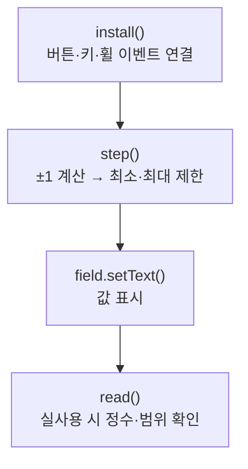

> [!info] 개발 중인 코드
> 2026-11-11 작업본 기준이다. 확정 설계가 아니며, 코드가 바뀌면 이 노트도 새 내용으로 바꿔요.

## 한눈에 보기

숫자 입력란에서 화살표·방향키·마우스 휠을 같은 방식으로 사용할 수 있게 하는 공통 도구예요. 허용 범위보다 크거나 작은 값이 들어오지 않도록 도와줘요.

- **현재 위치:** 현재 사용
- **원본:** `src/main/java/com/datecourse/controller/NumberStepper.java`
- **전체 안내:** [[전체_동작_흐름|전체_동작_흐름]] · [[목차|목차]]

## 사용 장면과 읽는 순서

가격 입력란에 2가 보이면 이 도구는 숫자 2를 다뤄요. 그것을 2만원으로 해석해 10000을 곱하는 일은 이 도구를 사용하는 화면에서 해요.

1. `install()`이 입력란과 버튼·키·휠 동작을 연결해요.
2. 사용자가 값을 올리거나 내리면 `step()`이 값을 바꾸고 최솟값·최댓값 안으로 맞춰요.
3. 사용자가 직접 입력한 값을 쓸 때는 `read()`로 확인해요. 숫자가 잘못됐으면 호출한 화면이 안내할 수 있도록 오류를 알려줘요.

모르는 용어는 [[문서_읽는법|문서 읽는 법과 용어 설명]]에서 찾아볼 수 있어요.

## 동작 순서

```text
install() → 입력 이벤트 연결 → step() → 최소/최대 사이로 값 제한
실제 사용 시 read() → 정수·범위 확인 → 숫자 반환 또는 예외
```

## 주요 메서드

| 메서드 | 하는 일 |
|---|---|
| `install()` | 여러 입력 방식과 버튼 활성 상태를 연결해요. |
| `step()` | 현재 값에 1 또는 -1을 더하고 범위 안으로 제한한다. |
| `read()` | 사용자가 직접 쓴 값을 검사하고 잘못되면 안내용 예외를 던진다. |
| `field.setText()` | 범위와 표시 형식을 적용한 숫자를 입력란에 다시 보여줘요. |

## 사용한 Java 라이브러리·API

아래 표는 가져다 쓴 도구, 이 클래스에서 만나는 함수, 사용하는 이유를 연결해 보여줘요. JDK 기본은 Java에 포함된 기능이고, 별도 라이브러리는 프로젝트가 추가로 준비하는 도구예요. 처음에는 도구 이름을 외우기보다 마지막 열의 역할부터 읽어 보세요.

| 라이브러리·API | 사용 메서드/위치 | 여기서 하는 일 |
|---|---|---|
| JavaFX 화면·입력<br/>별도 JavaFX 21: javafx.controls<br/>Button, TextField | install(), value(), step(), read() | 화면 요소 생성·배치, 입력값 읽기/쓰기, 버튼 활성화와 클릭 이벤트 연결에 사용해요. |
| JavaFX 작업·이벤트<br/>별도 JavaFX 21<br/>KeyCode, ScrollEvent | install() | 화면 스레드 전환, 백그라운드 작업 결과 반영, 변경 가능한 UI 목록과 키/휠 이벤트에 사용해요. |
| 비동기·콜백<br/>JDK 기본: java.lang / java.util.concurrent / java.util.function<br/>Runnable | install() | 오래 걸리는 작업을 분리하고 완료 동작을 넘겨줘요. 테스트에서는 작업 완료를 기다리거나 결과를 보관해요. |

외부 라이브러리 버전과 전체 사용 위치: [[라이브러리_사용_안내|라이브러리 사용 안내]]

## 클래스 내부 함수 흐름도



## 핵심 코드

원본 48행 부근의 실제 코드다.

```java
static int read(TextField field, int minimum, int maximum, String label) {
    try {
        int value = Integer.parseInt(field.getText().trim());
        if (value >= minimum && value <= maximum) return value;
    } catch (NumberFormatException ignored) { }
    throw new IllegalArgumentException(label + "은(는) " + minimum + "~" + maximum + " 사이의 정수로 입력해 주세요.");
}
```

## 변경할 때 주의할 점

단위는 호출 화면이 정한다. 가격 입력 2는 2원이 아니라 2만원이며, 컨트롤러에서 10000을 곱한다.
