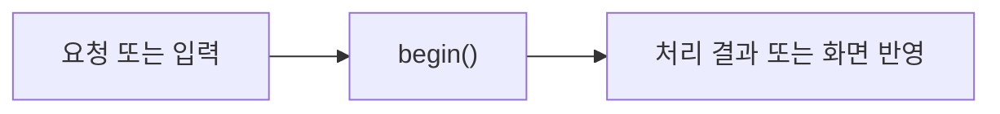

# RouteEditorController

> 개발 중인 코드예요. `ea2242b` 기준이며, 후속 커밋에서 동작이 바뀔 수 있어요.

## 한눈에 보기

추천 후보 최대 5곳 중 하나씩 선택해 편집 초안을 만들어요. 돌아가도 초안은 앱 안에 남아요.

## 코드 읽기

아래 선언부터 읽고 함수표의 순서로 찾아보세요. 전체 코드는 [기준 커밋의 원본](https://github.com/2egn/DateCourseApp/blob/ea2242b/src/main/java/com/datecourse/controller/RouteEditorController.java)에서 확인해요.

```java
public final class RouteEditorController extends BasePageController {
```

## 주요 함수

| 함수 | 하는 일 |
|---|---|
| `begin()` | 새 편집본과 후보 자료를 받아요. |
| `resume()` | 이전 초안·조건·선택을 유지해 다시 열어요. |
| `onRecommendNext()` | 전체 범위와 이전 장소 범위가 겹치는 후보를 찾아요. |
| `onFinish()` | 범위 위반이 없는지 확인한 뒤 메인으로 전달해요. |
| `resetDraft()` | 초안의 장소·후보를 비우며 DB 코스는 지우지 않아요. |

## 동작 흐름

사용자 요청 또는 다른 클래스의 호출로 시작해요. 자세한 분기는 위 함수표와 원본 코드를 함께 봐요.



## 사용하는 라이브러리

| 도구 | 이 코드에서 필요한 이유 |
|---|---|
| JavaFX | 이벤트·화면·백그라운드 작업 |
| Java 컬렉션·함수 | 목록 복사·조건 처리·전달할 동작 |

라이브러리가 쓰이는 구체적인 위치는 위 함수표와 원본의 해당 함수 본문에서 확인해요. 화면 작업과 DB 작업을 같은 스레드에서 섞지 않는 것이 중요해요.

관련 안내: [[현재_구현_흐름|현재 전체 흐름]] · [[업데이트_내역|이번 변경]]
