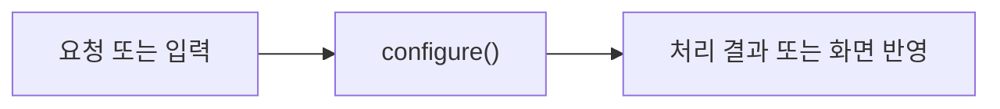

# SavedCourseController

> 개발 중인 코드예요. `ea2242b` 기준이며, 후속 커밋에서 동작이 바뀔 수 있어요.

## 한눈에 보기

예제 데이터 대신 로그인 회원이 DB에 저장한 코스를 보여줘요. 최근 수정 시각은 한국 시간이에요.

## 코드 읽기

아래 선언부터 읽고 함수표의 순서로 찾아보세요. 전체 코드는 [기준 커밋의 원본](https://github.com/2egn/DateCourseApp/blob/ea2242b/src/main/java/com/datecourse/controller/SavedCourseController.java)에서 확인해요.

```java
public class SavedCourseController extends BasePageController {
```

## 주요 함수

| 함수 | 하는 일 |
|---|---|
| `configure()` | 저장소와 현재 회원, 불러오기 동작을 연결해요. |
| `onRefreshClick()` | 실제 DB 목록을 다시 읽어요. |
| `showDetail()` | 장소 순서·인원·가격 상태·수정 시각을 보여줘요. |
| `onOpenClick()` | 선택한 저장 코스를 홈에 전달해요. |
| `onRenameClick()` | 이름을 바꾸고 목록을 갱신해요. |
| `onDeleteClick()` | 확인 후 DB 코스를 삭제해요. |

## 동작 흐름

사용자 요청 또는 다른 클래스의 호출로 시작해요. 자세한 분기는 위 함수표와 원본 코드를 함께 봐요.



## 사용하는 라이브러리

| 도구 | 이 코드에서 필요한 이유 |
|---|---|
| JavaFX | 이벤트·화면·백그라운드 작업 |
| Java 컬렉션·함수 | 목록 복사·조건 처리·전달할 동작 |
| Java 시간 | 수정 시각 보관·표시 |

라이브러리가 쓰이는 구체적인 위치는 위 함수표와 원본의 해당 함수 본문에서 확인해요. 화면 작업과 DB 작업을 같은 스레드에서 섞지 않는 것이 중요해요.

관련 안내: [[현재_구현_흐름|현재 전체 흐름]] · [[업데이트_내역|이번 변경]]
