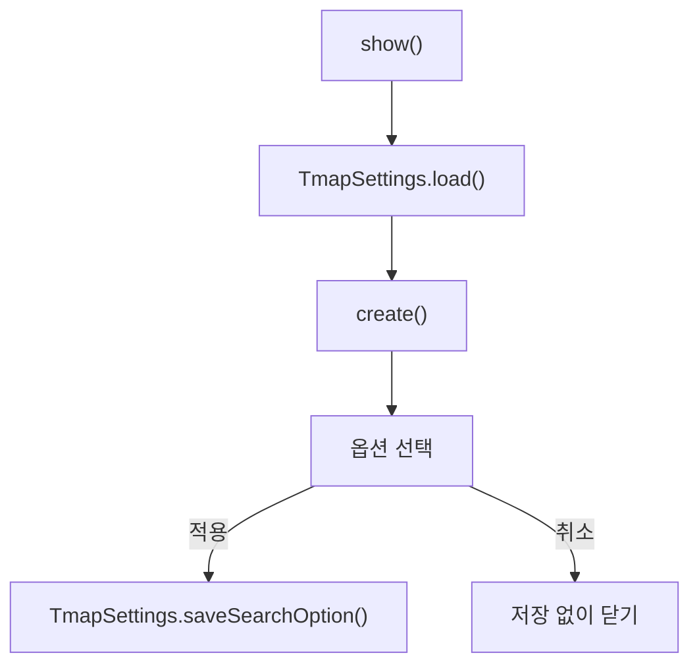

> **문서 기준:** `d32bc76` 리뷰 대상 소스. 개발 중이며 [[업데이트_내역|업데이트 내역]]에서 기존 노트와의 버전 차이를 확인해요.

## 한눈에 보기

걷는 길을 찾을 때 ‘추천·대로 우선·최단·계단 제외’ 중 어떤 방식을 쓸지 고르는 설정 창이에요. 일반 사용자에게 서비스 키를 입력받는 창은 아니에요.

## 사용 장면과 읽는 순서

사용자가 ‘계단 제외’를 고르고 적용하면 선택한 방식이 로컬 설정에 저장돼요. 저장된 옵션과 두 지도에 보이는 길이 같아야 하지만, d32bc76 리뷰에서는 그 연결에 남은 문제도 확인됐어요.

1. `show()`가 현재 선택값으로 창을 열어요.
2. `create()`가 선택 항목과 적용 동작을 준비해요.
3. 적용하면 `TmapSettings.saveSearchOption()`이 선택한 방식을 저장해요. 이후 지도 경로도 새 옵션으로 다시 요청하는지 함께 확인해야 해요.

모르는 용어는 [[문서_읽는법|문서 읽는 법과 용어 설명]]에서 찾아볼 수 있어요.

## 주요 메서드

| 메서드·생성자 | 하는 일 |
|---|---|
| `show()` | 현재 옵션으로 창을 열고 적용 여부를 돌려줘요. |
| `create()` | 추천·대로 우선·최단·계단 제외 선택지와 적용 처리를 구성해요. |
| `TmapSettings.load()` | 서비스 설정·로컬 파일·환경변수를 읽고 키와 옵션을 확인해요. |
| `TmapSettings.saveSearchOption()` | 사용자가 선택한 탐색 옵션을 .local/tmap-route.properties에 저장해요. |

## 사용한 Java 라이브러리·API

| 라이브러리·API | 사용 위치 | 역할 |
|---|---|---|
| JavaFX Dialog·RadioButton·ToggleGroup | create | 옵션 선택과 적용·취소 UI를 만들어요. |
| TmapSettings·WalkingSearchOption | show·create | 현재 설정을 읽고 선택한 옵션을 저장해요. |

## 클래스 내부 함수 흐름도



화살표는 함수가 다른 함수에 일이나 값을 넘기는 주요 흐름이에요. 창을 열 때, 버튼을 누를 때, 종료할 때의 시작 지점이 다르므로 모든 가지가 한꺼번에 실행되지는 않아요.

## 핵심 코드

실제 소스 일부 발췌다. 긴 메서드는 원본에서 이어서 읽어요.

```java
    static boolean show(Window owner) {
        int selected;
        try { selected = TmapSettings.load().searchOption(); }
        catch (IOException | IllegalArgumentException failure) { selected = 0; }
        return create(owner, selected).showAndWait().filter(ButtonType.APPLY::equals).isPresent();
    }

    static Dialog<ButtonType> create(Window owner, int selected) {
        return create(owner, selected, TmapSettings::saveSearchOption);
    }

    static Dialog<ButtonType> create(Window owner, int selected, OptionSaver saver) {
```

## 변경할 때 주의할 점

옵션을 바꾸면 메인·편집 양쪽 경로도 새 옵션 기준이어야 한다. 해당 동기화 문제는 리뷰에서 발견됐으며 수정 완료 상태가 아니다.

[기준 커밋의 원본 코드](https://github.com/2egn/DateCourseApp/blob/d32bc764dea8aec3c630f528b5e59eb1703c708e/src/main/java/com/datecourse/controller/TmapSettingsDialog.java) · [[리뷰_및_구현_방향|리뷰와 다음 구현 방향]]
