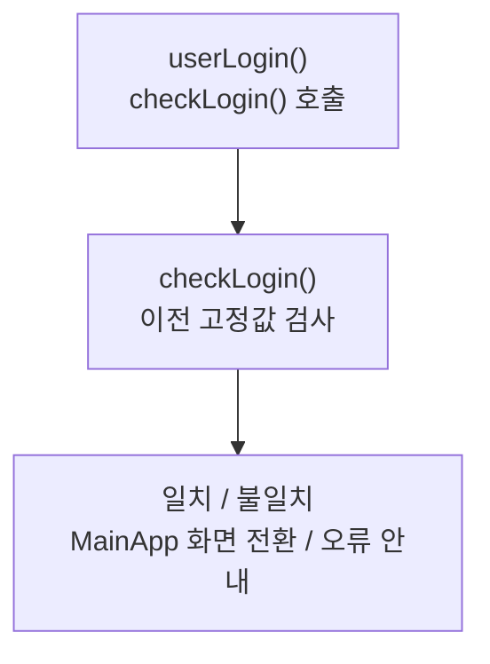

> [!info] 개발 중인 코드
> 2026-11-11 작업본 기준이다. 확정 설계가 아니며, 코드가 바뀌면 이 노트도 새 내용으로 바꿔요.

## 한눈에 보기

예전 JavaFX 로그인 화면에서 입력을 확인하던 컨트롤러예요. 현재 실제 DB 로그인은 MembershipApp과 MemberRepository가 담당해요.

- **현재 위치:** 이전 코드
- **원본:** `src/main/java/com/datecourse/controller/login.java`
- **전체 안내:** [[전체_동작_흐름|전체_동작_흐름]] · [[목차|목차]]

## 사용 장면과 읽는 순서

이 파일에 고정된 아이디 검사 코드가 있어도 현재 앱의 실제 로그인 규칙으로 사용하면 안 돼요. 현재 흐름을 공부한다면 MembershipApp부터 읽는 편이 좋아요.

1. 예전 로그인 버튼을 누르면 `userLogin()`이 실행돼요.
2. `checkLogin()`이 당시의 고정값 인증과 화면 전환을 처리해요. 현재 사용하지 않는 FXML 경로가 있다는 점을 함께 확인해요.

모르는 용어는 [[문서_읽는법|문서 읽는 법과 용어 설명]]에서 찾아볼 수 있어요.

## 동작 순서

```text
userLogin() → checkLogin() → 고정 입력값 비교 → MainApp.changeScene() 또는 오류 표시
```

## 주요 메서드

| 메서드 | 하는 일 |
|---|---|
| `userLogin()` | 버튼 이벤트를 로그인 검사에 넘겨줘요. |
| `checkLogin()` | 예전 고정값 인증과 화면 전환을 실행해요. |

## 사용한 Java 라이브러리·API

아래 표는 가져다 쓴 도구, 이 클래스에서 만나는 함수, 사용하는 이유를 연결해 보여줘요. JDK 기본은 Java에 포함된 기능이고, 별도 라이브러리는 프로젝트가 추가로 준비하는 도구예요. 처음에는 도구 이름을 외우기보다 마지막 열의 역할부터 읽어 보세요.

| 라이브러리·API | 사용 메서드/위치 | 여기서 하는 일 |
|---|---|---|
| JavaFX 화면·입력<br/>별도 JavaFX 21: javafx.controls<br/>Button, Label, TextField, PasswordField | checkLogin() | 화면 요소 생성·배치, 입력값 읽기/쓰기, 버튼 활성화와 클릭 이벤트 연결에 사용해요. |
| JavaFX FXML<br/>별도 JavaFX 21: javafx.fxml<br/>FXMLLoader, FXML | 필드·생성자·record 값 또는 이벤트 연결 | FXML 화면 파일을 읽고 @FXML 필드·이벤트를 컨트롤러와 연결해요. |
| JavaFX 창·애니메이션<br/>별도 JavaFX 21: javafx.graphics<br/>Parent, Stage | 필드·생성자·record 값 또는 이벤트 연결 | 화면/창을 만들거나 같은 창의 전환·이동·투명도 애니메이션을 실행한다. |
| 파일·문자 입출력<br/>JDK 기본: java.io / java.nio<br/>IOException | userLogin(), checkLogin() | 설정·아이디 기록·SQL 파일을 읽거나 저장해요. 테스트에서는 화면 이미지를 파일로 남긴다. |

외부 라이브러리 버전과 전체 사용 위치: [[라이브러리_사용_안내|라이브러리 사용 안내]]

## 클래스 내부 함수 흐름도



## 핵심 코드

원본 28행 부근의 실제 코드다.

```java
public void userLogin(ActionEvent event) throws IOException{
    checkLogin();
}
```

## 변경할 때 주의할 점

현재 DB 로그인은 MembershipApp + MemberRepository다. 이전 FXML 경로는 현재 리소스에 없고, 이 코드의 고정값 인증을 실제 로그인으로 사용하지 않는다.

## 함께 읽기

[[01_시작/MainApp|MainApp]]
