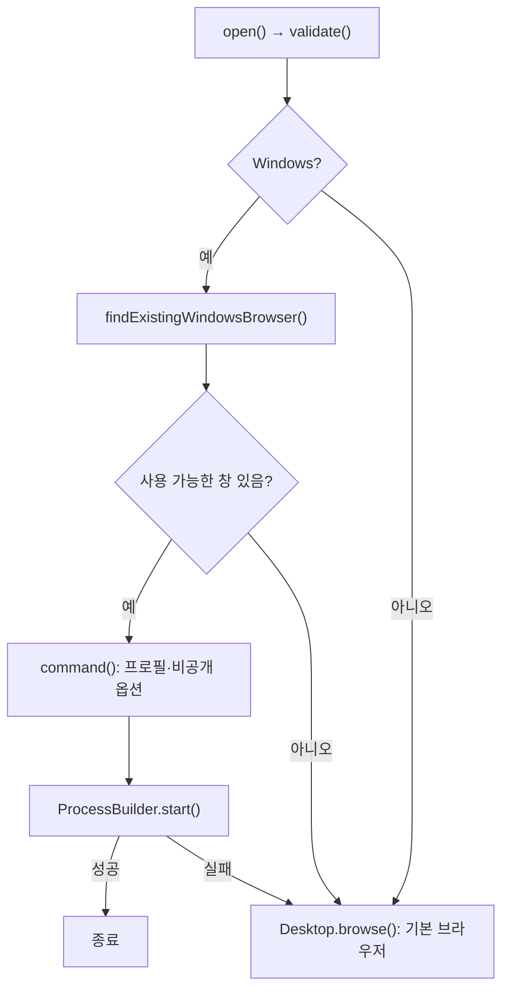

> [!info] 개발 중인 코드
> 2026-11-11 작업본 기준이다. 확정 설계가 아니며, 코드가 바뀌면 이 노트도 새 내용으로 바꿔요.

## 한눈에 보기

장소 상세 링크를 앱 안의 작은 지도 화면이 아니라 Chrome·Edge 같은 외부 브라우저에서 열어주는 도구예요. 주소를 확인하고, 사용 가능한 브라우저의 실행 방법을 골라요.

- **현재 위치:** 현재 사용
- **원본:** `src/main/java/com/datecourse/service/ExternalBrowser.java`
- **전체 안내:** [[전체_동작_흐름|전체_동작_흐름]] · [[목차|목차]]

## 사용 장면과 읽는 순서

장소의 ‘카카오 지도에서 보기’를 눌렀을 때 현재 사용 중인 브라우저 환경을 활용해 상세 페이지를 열려고 해요. 환경에 따라 운영체제의 기본 브라우저로 열릴 수도 있어요.

1. `validate()`가 웹 주소로 열 수 있는 HTTP·HTTPS 주소인지 확인해요.
2. `findExistingWindowsBrowser()` 등으로 실행 중인 브라우저와 프로필·비공개 창 여부를 살펴봐요.
3. `command()`가 실행할 항목을 목록으로 만들고 `open()`이 주소를 열어요. 허용 도메인을 더 좁히는 검사는 MapBridge 쪽도 함께 읽어요.

모르는 용어는 [[문서_읽는법|문서 읽는 법과 용어 설명]]에서 찾아볼 수 있어요.

## 동작 순서

```text
open() → URL 검사 → Windows의 열린 브라우저 탐색
찾으면 실행 경로·프로필·비공개 옵션으로 새 URL 전달
찾지 못하거나 실행 실패 → OS 기본 브라우저로 열기
```

## 주요 메서드

| 메서드 | 하는 일 |
|---|---|
| `open()` | 사용 가능한 외부 브라우저로 주소를 넘겨줘요. |
| `findExistingWindowsBrowser()` | 창이 있는 브라우저 프로세스를 찾아요. |
| `profileArguments()` | 프로필 관련 인자만 추린다. |
| `command()` | 브라우저별 실행 인자 목록을 만들어요. |
| `isPrivateWindow()` | 제목·인자로 비공개 창 여부를 판단한다. |
| `validate()` | 정상 HTTP·HTTPS 주소인지 확인해요. |
| `ProcessBuilder.start()` | 구성한 브라우저 실행 명령으로 새 프로세스를 시작한다. |
| `Desktop.browse()` | 운영체제의 기본 브라우저로 검증된 주소를 연다. |

## 사용한 Java 라이브러리·API

아래 표는 가져다 쓴 도구, 이 클래스에서 만나는 함수, 사용하는 이유를 연결해 보여줘요. JDK 기본은 Java에 포함된 기능이고, 별도 라이브러리는 프로젝트가 추가로 준비하는 도구예요. 처음에는 도구 이름을 외우기보다 마지막 열의 역할부터 읽어 보세요.

| 라이브러리·API | 사용 메서드/위치 | 여기서 하는 일 |
|---|---|---|
| Swing·AWT UI<br/>JDK 기본: java.desktop<br/>Desktop | open() | 로그인/가입 UI를 만들고 그리며 EDT에서 화면을 새 내용으로 바꿔요. Desktop은 기본 브라우저 열기에도 쓰인다. |
| 목록·대응표<br/>JDK 기본: java.util<br/>List, ArrayList, Set, Optional, Arrays, Locale | open(), BrowserTarget(), findExistingWindowsBrowser(), profileArguments(), command(), isPrivateWindow() | 장소 목록·ID별 반경·정렬·중복 제거·문자열 설정을 관리한다. stream/filter/map은 목록을 고르고 변환하는 데 사용해요. |
| 파일·문자 입출력<br/>JDK 기본: java.io / java.nio<br/>Files, Path, IOException, StandardCharsets | open(), BrowserTarget(), findExistingWindowsBrowser(), command() | 설정·아이디 기록·SQL 파일을 읽거나 저장해요. 테스트에서는 화면 이미지를 파일로 남긴다. |
| Jackson JSON<br/>외부: jackson-databind 2.17.0<br/>ObjectMapper | findExistingWindowsBrowser() | DB JSON을 Place로 읽거나 RoutePlan을 지도에 넘길 JSON 문자열로 바꿔요. |
| 비동기·콜백<br/>JDK 기본: java.lang / java.util.concurrent / java.util.function<br/>TimeUnit | findExistingWindowsBrowser() | 오래 걸리는 작업을 분리하고 완료 동작을 넘겨줘요. 테스트에서는 작업 완료를 기다리거나 결과를 보관해요. |
| 주소·외부 프로세스<br/>JDK 기본: java.net / java.lang<br/>URI, ProcessBuilder, ProcessHandle, Process | open(), findExistingWindowsBrowser(), command(), validate() | 웹 주소를 검사하거나 브라우저 실행 프로세스를 시작·조회한다. |

외부 라이브러리 버전과 전체 사용 위치: [[라이브러리_사용_안내|라이브러리 사용 안내]]

## 클래스 내부 함수 흐름도



## 핵심 코드

원본 27행 부근의 실제 코드다.

```java
public static void open(URI address) throws IOException, InterruptedException {
    validate(address);
    if (System.getProperty("os.name", "").toLowerCase(Locale.ROOT).startsWith("windows")) {
        Optional<BrowserTarget> existing = findExistingWindowsBrowser();
        if (existing.isPresent()) {
            try {
                new ProcessBuilder(command(existing.get(), address))
                        .redirectOutput(ProcessBuilder.Redirect.DISCARD)
                        .redirectError(ProcessBuilder.Redirect.DISCARD).start();
                return;
            } catch (IOException unavailable) { /* Browser may have closed; use the default handler. */ }
        }
    }
    if (!Desktop.isDesktopSupported() || !Desktop.getDesktop().isSupported(Desktop.Action.BROWSE))
        throw new IOException("Browser is unavailable");
    Desktop.getDesktop().browse(address);
}
```

## 변경할 때 주의할 점

내부 BrowserTarget은 실행 파일·프로필·비공개 여부를 한데 묶어요. 환경에 따라 기본 브라우저로 열릴 수 있다. 도메인 허용 검사는 MapBridge가 추가로 담당한다.

## 이 파일 안의 내부 타입

| 내부 타입 | 역할 |
|---|---|
| `BrowserTarget` | 브라우저 실행 경로·프로필 인자·비공개 여부를 한데 묶어요. |
