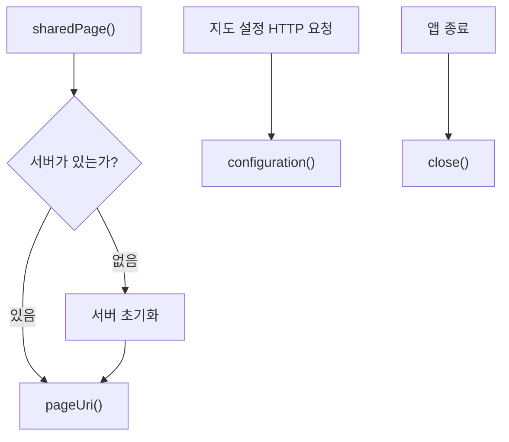

> **문서 기준:** `d32bc76` 리뷰 대상 소스. 개발 중이며 [[업데이트_내역|업데이트 내역]]에서 기존 노트와의 버전 차이를 확인해요.

## 한눈에 보기

앱 안의 웹 지도 파일을 같은 PC의 지도 화면에 전달하는 작은 서버예요. 메인 지도와 편집 지도가 각각 서버를 켜는 대신 하나를 함께 사용해요.

## 사용 장면과 읽는 순서

앱에서 지도를 열면 지도 페이지 주소가 필요해요. d32bc76에서는 이 클래스가 서버가 없는 경우 직접 시작하므로, 사용자가 별도 Python 서버를 켤 필요가 없어요.

1. `sharedPage()`가 사용할 서버를 확인하고, 없으면 시작한 뒤 지도 주소를 알려줘요.
2. `configuration()`이 개인 설정에서 읽은 카카오 키를 지도 실행에 필요한 설정으로 준비해요.
3. 앱을 마칠 때 `close()`로 서버와 작업을 정리해요. 서버를 공유해도 두 지도의 코스 편집 상태를 공유하는 것은 아니에요.

모르는 용어는 [[문서_읽는법|문서 읽는 법과 용어 설명]]에서 찾아볼 수 있어요.

## 주요 메서드

| 메서드·생성자 | 하는 일 |
|---|---|
| `sharedPage()` | 서버가 없으면 시작하고 두 지도가 사용할 페이지 주소를 돌려줘요. |
| `configuration()` | 환경변수·개인 설정에서 카카오 키를 읽어 지도 설정 응답을 만들어요. |
| `pageUri()` | 이 서버의 지도 페이지 URI를 돌려줘요. |
| `close()` | 서버와 작업 스레드를 종료한다. |

## 사용한 Java 라이브러리·API

| 라이브러리·API | 사용 위치 | 역할 |
|---|---|---|
| JDK HttpServer·ExecutorService | 공유 서버 준비·close | 127.0.0.1:8080에 지도 파일만 제공하고 두 지도에서 재사용해요. |
| Files·Properties·Jackson | configuration | 개인 키 설정을 읽고 JavaScript에 전달할 문자열을 안전하게 만들어요. |

## 클래스 내부 함수 흐름도



화살표는 함수가 다른 함수에 일이나 값을 넘기는 주요 흐름이에요. 창을 열 때, 버튼을 누를 때, 종료할 때의 시작 지점이 다르므로 모든 가지가 한꺼번에 실행되지는 않아요.

## 핵심 코드

실제 소스 일부 발췌다. 긴 메서드는 원본에서 이어서 읽어요.

```java
    public static synchronized URI sharedPage() throws IOException {
        if (shared == null) shared = new MapPageServer(PORT, Path.of(""), System.getenv());
        return shared.pageUri();
    }

    MapPageServer(int port, Path root, Map<String, String> environment) throws IOException {
        this.root = root;
        this.environment = Map.copyOf(environment);
        Map<String, byte[]> resources = new java.util.HashMap<>();
        for (String path : ASSETS.keySet()) {
            try (InputStream input = MapPageServer.class.getResourceAsStream("/map" + path)) {
                if (input == null) throw new IOException("지도 리소스를 찾을 수 없습니다: " + path);
```

## 변경할 때 주의할 점

서버 시작·파일 제공 → 두 지도 공유 → 앱 종료 시 정리. 개인 키는 문서에 적지 않는다.

[기준 커밋의 원본 코드](https://github.com/2egn/DateCourseApp/blob/d32bc764dea8aec3c630f528b5e59eb1703c708e/src/main/java/com/datecourse/service/MapPageServer.java) · [[리뷰_및_구현_방향|리뷰와 다음 구현 방향]]
