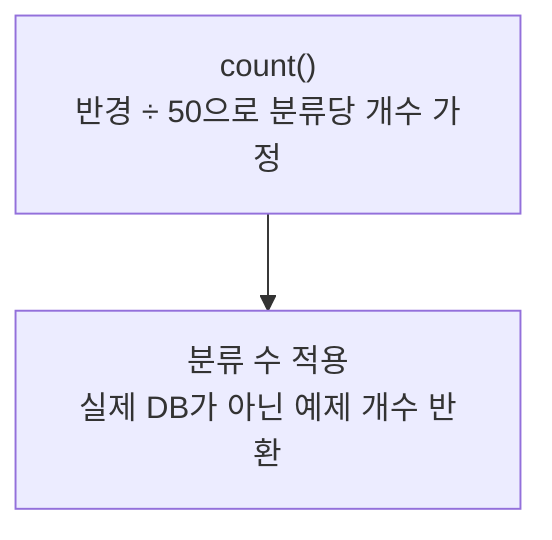

> [!info] 개발 중인 코드
> 2026-11-11 작업본 기준이다. 확정 설계가 아니며, 코드가 바뀌면 이 노트도 새 내용으로 바꿔요.

## 한눈에 보기

예전 예제 화면에서 장소 수를 대략 보여주기 위해 만든 임시 계산 도구예요. 실제 저장소에 몇 개의 장소가 있는지 세는 기능은 아니에요.

- **현재 위치:** 예제/이전 보조
- **원본:** `src/main/java/com/datecourse/service/PlaceCountService.java`
- **전체 안내:** [[전체_동작_흐름|전체_동작_흐름]] · [[목차|목차]]

## 사용 장면과 읽는 순서

범위나 분류를 바꿨을 때 숫자가 달라져도 실제 식당 수가 그만큼 있다는 뜻은 아니에요. 현재 추천 결과의 개수를 알고 싶다면 실제 후보 목록을 확인해야 해요.

1. `count()`가 예제 계산에 필요한 조건을 받아요.
2. 실제 DB를 검색하지 않고 임시 숫자를 돌려줘요. 현재 장소 추천의 핵심 흐름에서는 사용하지 않아요.

모르는 용어는 [[문서_읽는법|문서 읽는 법과 용어 설명]]에서 찾아볼 수 있어요.

## 동작 순서

```text
count() → 반경/50으로 분류당 수를 가정 → 분류 수만큼 곱함
```

## 주요 메서드

| 메서드 | 하는 일 |
|---|---|
| `count()` | 실제 DB 조회가 아닌 예제 개수를 돌려줘요. |

## 사용한 Java 라이브러리·API

아래 표는 가져다 쓴 도구, 이 클래스에서 만나는 함수, 사용하는 이유를 연결해 보여줘요. JDK 기본은 Java에 포함된 기능이고, 별도 라이브러리는 프로젝트가 추가로 준비하는 도구예요. 처음에는 도구 이름을 외우기보다 마지막 열의 역할부터 읽어 보세요.

| 라이브러리·API | 사용 메서드/위치 | 여기서 하는 일 |
|---|---|---|
| 목록·대응표<br/>JDK 기본: java.util<br/>List | count() | 장소 목록·ID별 반경·정렬·중복 제거·문자열 설정을 관리한다. stream/filter/map은 목록을 고르고 변환하는 데 사용해요. |

외부 라이브러리 버전과 전체 사용 위치: [[라이브러리_사용_안내|라이브러리 사용 안내]]

## 클래스 내부 함수 흐름도



## 핵심 코드

원본 9행 부근의 실제 코드다.

```java
public int count(double lat, double lng, int radiusMeter, List<String> categories) {
    // 가짜 계산: 반경이 넓을수록, 카테고리를 많이 고를수록 많아짐
    int perCategory = Math.max(1, radiusMeter / 50);
    return categories.isEmpty() ? perCategory * 3 : perCategory * categories.size();
}
```

## 변경할 때 주의할 점

실제 장소 수가 아니며 현재 DB 후보 추천 경로에서 사용하지 않는다.
