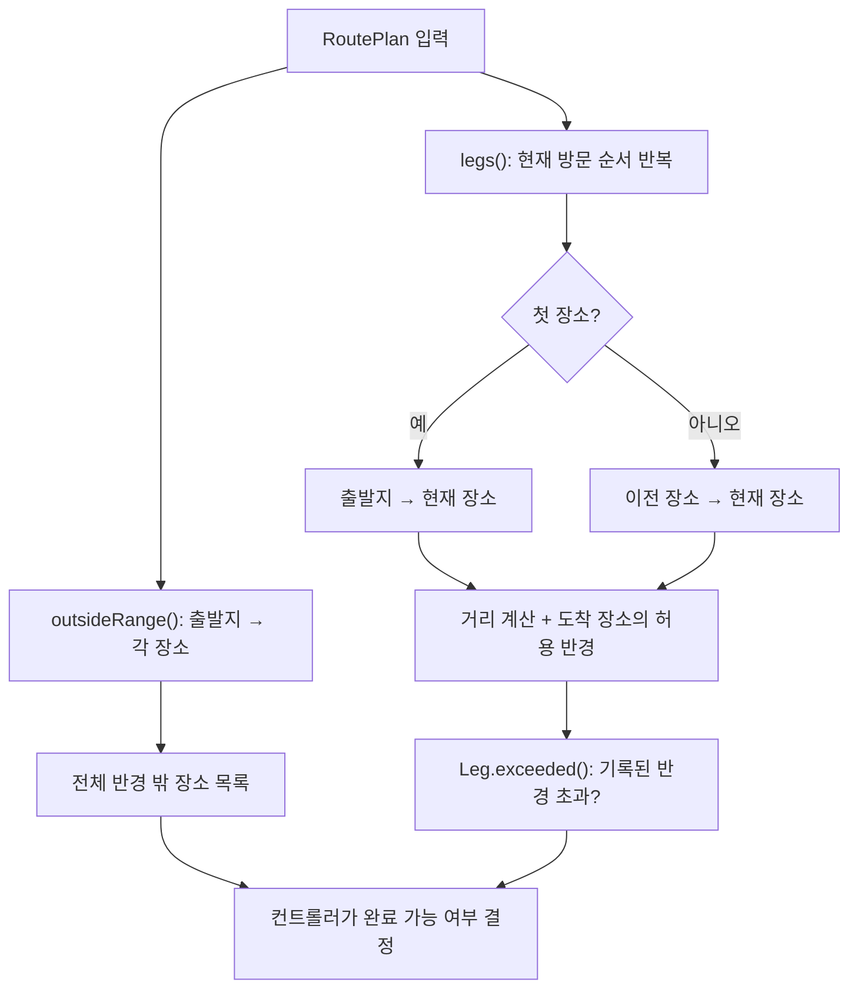

> [!info] 개발 중인 코드
> 2026-11-11 작업본 기준이다. 확정 설계가 아니며, 코드가 바뀌면 이 노트도 새 내용으로 바꿔요.

## 한눈에 보기

편집한 코스가 거리 제한을 여전히 지키는지 다시 확인하는 검사 담당자예요. 처음 추가할 때 통과했더라도 순서를 바꾸거나 중간 장소를 지우면 새로 검사해야 해요.

- **현재 위치:** 현재 사용
- **원본:** `src/main/java/com/datecourse/service/RouteRangeValidator.java`
- **전체 안내:** [[전체_동작_흐름|전체_동작_흐름]] · [[목차|목차]]

## 사용 장면과 읽는 순서

A→B→C에서 B를 지우면 이제 A→C로 이동해요. C에 기록된 허용 거리를 A부터 다시 계산해야 하므로, 예전에 B→C가 통과했다는 결과를 그대로 쓰면 안 돼요.

1. `outsideRange()`가 출발지 중심의 전체 범위 밖 장소를 찾아요.
2. `legs()`가 현재 방문 순서대로 출발·도착 구간을 새로 만들어요. 첫 구간의 출발은 코스 출발지예요.
3. 각 구간의 `exceeded()`가 실제 직선 거리와 도착 장소에 붙은 허용 거리를 비교해요. 화면은 그 결과로 완료 가능 여부를 판단해요.

모르는 용어는 [[문서_읽는법|문서 읽는 법과 용어 설명]]에서 찾아볼 수 있어요.

## 그림으로 보는 두 거리 조건

출발지 중심 전체 범위와 이전 장소 중심 범위에 모두 들어오는 장소만 거리 조건을 통과해요. 실제 추천은 활동·가격·중복 조건도 확인해요.

<div class="learning-demo" data-learning="ranges"></div>

## 동작 순서

```text
outsideRange(plan) → 출발지에서 각 장소 거리 → 전체 반경 밖 장소 반환
legs(plan) → 첫 구간은 출발지, 이후 구간은 이전 장소 → 거리+허용 반경으로 Leg 생성
Leg.exceeded() → 허용 반경이 기록되어 있고 실제 거리가 더 길면 위반
```

## 주요 메서드

| 메서드 | 하는 일 |
|---|---|
| `outsideRange()` | 전체 범위 밖의 장소를 찾아요. |
| `legs()` | 현재 순서에서 실제로 이어질 이동 구간을 만들어요. 순서를 바꿨다면 새 이전 장소로 계산해요. |
| `exceeded()` | 해당 구간의 직선 거리가 도착 장소에 기록된 허용 거리를 넘었는지 확인해요. |
| `Leg.exceeded()` | 해당 구간의 직선 거리가 도착 장소에 기록된 허용 거리를 넘었는지 확인해요. |

## 사용한 Java 라이브러리·API

아래 표는 가져다 쓴 도구, 이 클래스에서 만나는 함수, 사용하는 이유를 연결해 보여줘요. JDK 기본은 Java에 포함된 기능이고, 별도 라이브러리는 프로젝트가 추가로 준비하는 도구예요. 처음에는 도구 이름을 외우기보다 마지막 열의 역할부터 읽어 보세요.

| 라이브러리·API | 사용 메서드/위치 | 여기서 하는 일 |
|---|---|---|
| 목록·대응표<br/>JDK 기본: java.util<br/>List, ArrayList | legs(), outsideRange() | 장소 목록·ID별 반경·정렬·중복 제거·문자열 설정을 관리한다. stream/filter/map은 목록을 고르고 변환하는 데 사용해요. |

외부 라이브러리 버전과 전체 사용 위치: [[라이브러리_사용_안내|라이브러리 사용 안내]]

## 클래스 내부 함수 흐름도



그림에는 처리 함수와 내부 데이터 묶음(record)의 관계가 함께 나와요. 화살표가 있다고 모든 함수가 항상 한 번에 실행되는 것은 아니에요.

## 핵심 코드

원본 15행 부근의 실제 코드다.

```java
public List<Leg> legs(RoutePlan plan) {
    List<Leg> result = new java.util.ArrayList<>();
    for (int index = 0; index < plan.places().size(); index++) {
        Place current = plan.places().get(index);
        Place previous = index == 0 ? null : plan.places().get(index - 1);
        double distance = calculation.calculateDistance(previous == null ? plan.startLat() : previous.lat(),
                previous == null ? plan.startLng() : previous.lng(), current.lat(), current.lng());
        result.add(new Leg(index, previous == null ? "출발지" : previous.name(), current, distance,
                plan.arrivalRadii().get(current.recordId())));
    }
    return List.copyOf(result);
}
```

`stream()`은 목록을 순서대로 처리하는 출발점이다. `filter`는 조건에 맞는 항목만 남기고, `map`은 값을 변환하며, `toList()`는 결과를 목록으로 모은다.

## 변경할 때 주의할 점

허용 반경은 도착 장소에 붙는다. 순서 변경·중간 삭제 후 새 이전 장소를 기준으로 다시 계산해요. 미기록 반경은 임의로 추정하지 않으며 경계는 포함한다.

## 함께 읽기

[[04_데이터/Place|Place]] · [[03_처리/PlaceCalculationService|PlaceCalculationService]] · [[04_데이터/RoutePlan|RoutePlan]]

## 이 파일 안의 내부 타입

| 내부 타입 | 역할 |
|---|---|
| `Leg` | 한 이동 구간의 번호·출발 이름·도착 장소·실제 거리·허용 반경을 묶고 exceeded()로 위반 여부를 판단한다. |
