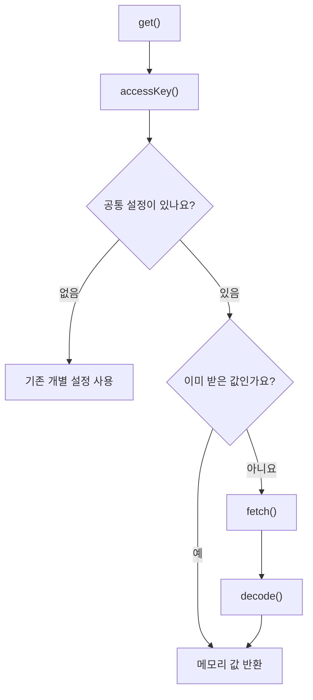

# TeamApiKeys

**목적:** 팀원이 API 키 세 개를 각각 설정하는 대신, 공통 접속 키 하나로 서버에서 받아 메모리에 보관해요. DB 접속 정보는 `database()`에서 별도로 조회해요.

| 함수 | 하는 일 |
|---|---|
| `database()` | DB 주소·사용자명·비밀번호를 별도 조회하고 메모리에서 재사용해요 |
| `get()` | 키가 없으면 조회하고, 이미 받았으면 메모리 값을 돌려줘요 |
| `accessKey()` | 환경변수 또는 `.local/team-access.properties`를 읽어요 |
| `fetch()` | 고정 HTTPS 주소에 POST로 요청해요. 인증은 헤더에만 넣어요 |
| `decode()` | 응답 버전·크기·세 API 키 형식을 확인해요 |

`TmapSettings.load()`와 `MapPageServer.configuration()`에서 사용해요. `DbSettings.load()`는 `database()`를 호출해 기존 JDBC 연결을 준비해요. Google 검증 도구는 같은 역할을 Python `team_keys.py`로 처리해요.

- `static` 필드: 같은 앱 실행 중 조회 결과를 공유해요.
- `synchronized`: 지도와 경로가 동시에 요청해도 한 번씩 차례로 처리해요.
- `HttpURLConnection`: 요청 헤더·시간 제한을 설정하고 리디렉션은 따르지 않아요.
- Jackson `ObjectMapper`: JSON 응답을 Java에서 읽어요.
- `Properties`: 공통 접속 키 파일을 읽어요. 받은 API 키는 파일에 쓰지 않아요.

설정과 오류 해결은 [[공통_접속_키|공통 접속 키 설정]]을 보세요. 개발 중인 코드라 변경 가능성이 있어요.
