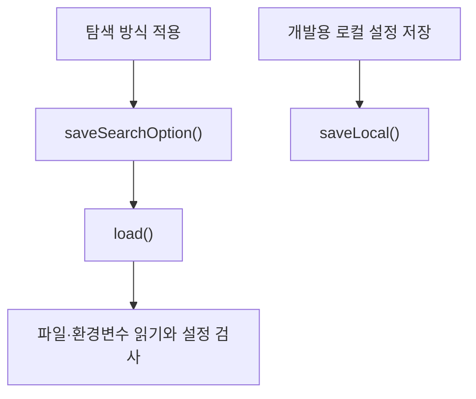

> **문서 기준:** `d32bc76` 리뷰 대상 소스. 개발 중이며 [[업데이트_내역|업데이트 내역]]에서 기존 노트와의 버전 차이를 확인해요.

## 한눈에 보기

도보 길찾기에 필요한 서비스 키와 ‘어떤 길을 우선할지’ 설정을 읽는 도구예요. 설정을 읽는 것과 실제로 길을 요청하는 것은 별도 역할이에요.

## 사용 장면과 읽는 순서

‘계단 제외’를 선택하면 다음 실행에서도 그 선택을 기억하도록 옵션을 저장해요. 서비스 키는 개발자가 준비하는 접속 설정이고 일반 사용자의 옵션 선택과 구분해요.

1. `load()`가 설정 파일·환경변수 등에서 서비스 키와 옵션을 읽고 확인해요.
2. `saveSearchOption()`은 사용자의 경로 선택을 .local/tmap-route.properties에 남겨요.
3. `saveLocal()`은 개발용 로컬 설정 저장, `toString()`은 키 원문을 드러내지 않는 설명 출력용이에요.

모르는 용어는 [[문서_읽는법|문서 읽는 법과 용어 설명]]에서 찾아볼 수 있어요.

## 주요 메서드

| 메서드·생성자 | 하는 일 |
|---|---|
| `load()` | 서비스 설정·로컬 파일·환경변수를 읽고 키와 옵션을 확인해요. |
| `saveSearchOption()` | 사용자가 선택한 탐색 옵션을 .local/tmap-route.properties에 저장해요. |
| `saveLocal()` | 개발용 키와 옵션을 로컬 설정 파일에 저장해요. |
| `toString()` | 키 원문 대신 설정 유무만 출력한다. |

## 사용한 Java 라이브러리·API

| 라이브러리·API | 사용 위치 | 역할 |
|---|---|---|
| Properties·Files·Path | load·saveSearchOption·saveLocal | 파일·환경변수 설정을 읽고 임시 파일을 거쳐 저장해요. |
| JDK record·Set | 생성자 | 설정을 값으로 묶고 허용 옵션 0·4·10·30을 확인해요. |

## 클래스 내부 함수 흐름도



화살표는 함수가 다른 함수에 일이나 값을 넘기는 주요 흐름이에요. 창을 열 때, 버튼을 누를 때, 종료할 때의 시작 지점이 다르므로 모든 가지가 한꺼번에 실행되지는 않아요.

## 핵심 코드

실제 소스 일부 발췌다. 긴 메서드는 원본에서 이어서 읽어요.

```java
    public static TmapSettings load() throws IOException {
        Properties service = new Properties();
        try (InputStream input = TmapSettings.class.getResourceAsStream("/tmap-service.properties")) {
            if (input != null) service.load(input);
        }
        return load(Path.of(""), System.getenv(), service);
    }

    static TmapSettings load(Path root, Map<String, String> environment) throws IOException {
        return load(root, environment, new Properties());
    }

```

## 변경할 때 주의할 점

사용자 UI는 키 입력이 아니라 탐색 옵션 선택을 제공한다. 키 값은 Git·노트에 보관하지 않는다.

[기준 커밋의 원본 코드](https://github.com/2egn/DateCourseApp/blob/d32bc764dea8aec3c630f528b5e59eb1703c708e/src/main/java/com/datecourse/service/TmapSettings.java) · [[리뷰_및_구현_방향|리뷰와 다음 구현 방향]]
