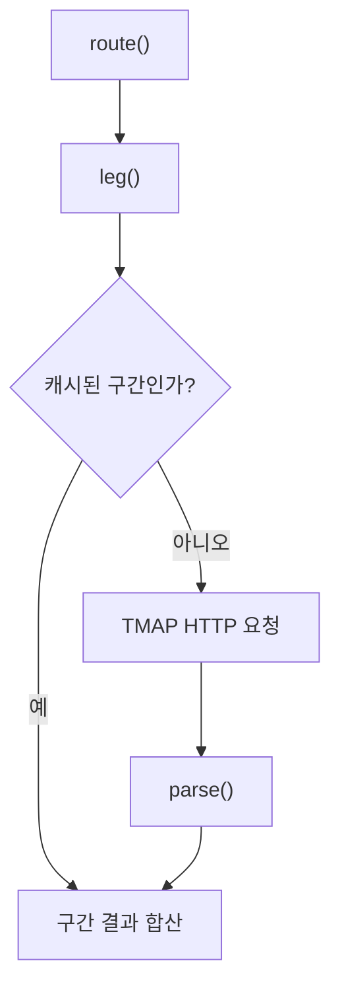

> **문서 기준:** `d32bc76` 리뷰 대상 소스. 개발 중이며 [[업데이트_내역|업데이트 내역]]에서 기존 노트와의 버전 차이를 확인해요.

## 한눈에 보기

방문할 장소를 순서대로 이어 실제 걷는 길을 요청하는 도구예요. 지도에 선을 바로 그리는 대신 TMAP에 구간별 길을 물어보고, 거리·시간·안내를 하나의 결과로 모아요.

## 사용 장면과 읽는 순서

출발지→식당→카페라면 출발지에서 식당까지, 식당에서 카페까지를 각각 조회한 뒤 더해요. 직선 거리 제한을 통과한 장소라도 실제 도보 시간은 이 요청 결과를 봐야 알 수 있어요.

1. `route()`가 방문 순서를 읽고 인접한 두 지점씩 구간을 만들어요.
2. `leg()`가 같은 키·옵션·지점 조합의 이전 결과가 있으면 재사용하고, 없으면 TMAP에 요청해요. 이전 결과를 잠시 보관하는 것을 캐시라고 해요.
3. `parse()`가 받은 JSON 응답을 Java에서 쓸 좌표·거리·시간·안내로 바꾸고, `route()`가 전체 결과로 합쳐요.

모르는 용어는 [[문서_읽는법|문서 읽는 법과 용어 설명]]에서 찾아볼 수 있어요.

## 그림으로 보는 늦게 도착한 이전 응답

식당을 요청한 뒤 카페로 선택을 바꿨다면, 늦게 온 식당 응답을 지금 카페 화면에 적용하면 안 돼요. 응답을 반영하기 전 현재 선택과 같은 요청인지 확인해요.

<div class="learning-demo" data-learning="async"></div>

## 주요 메서드

| 메서드·생성자 | 하는 일 |
|---|---|
| `route()` | 출발지와 방문 장소를 순서대로 연결해 전체 거리·시간·구간을 돌려줘요. |
| `leg()` | 두 지점 사이 걷는 길을 구해요. 같은 키·옵션·두 지점의 이전 조회 결과가 있으면 재사용해요. |
| `parse()` | TMAP에서 받은 JSON 글자를 지도 좌표·거리·시간·길 안내로 나누어 읽어요. |
| `nonnegative()` | 거리나 시간이 0 이상인 정상 숫자인지 확인해요. 음수인 값은 정상 거리·시간으로 쓰면 안 돼요. |
| `coordinate()` | JSON에서 읽은 위치를 정상 범위의 위도·경도로 바꿔요. |

## 사용한 Java 라이브러리·API

| 라이브러리·API | 사용 위치 | 역할 |
|---|---|---|
| JDK HttpClient·HttpRequest | leg | TMAP 도보 API에 Java HTTP 요청을 보내며 키는 브라우저에 전달하지 않는다. |
| Jackson ObjectMapper·JsonNode | parse·coordinate | JSON 응답에서 경로와 안내 정보를 읽어요. |
| List·Map·record | route·leg | 구간 목록과 옵션별 요청 결과를 다룬다. |

## 클래스 내부 함수 흐름도



화살표는 함수가 다른 함수에 일이나 값을 넘기는 주요 흐름이에요. 창을 열 때, 버튼을 누를 때, 종료할 때의 시작 지점이 다르므로 모든 가지가 한꺼번에 실행되지는 않아요.

## 핵심 코드

실제 소스 일부 발췌다. 긴 메서드는 원본에서 이어서 읽어요.

```java
    public WalkingRoute route(List<Stop> stops, TmapSettings settings) throws IOException, InterruptedException {
        stops = List.copyOf(stops);
        if (stops.size() < 2) throw new IllegalArgumentException("출발 위치와 방문할 장소를 선택해 주세요.");
        if (settings.appKey().isEmpty()) throw new IOException("도보 경로 서비스가 설정되지 않았어요. 앱 제공자에게 문의해 주세요.");
        List<Leg> legs = new ArrayList<>();
        long distance = 0, time = 0;
        for (int index = 1; index < stops.size(); index++) {
            if (Thread.currentThread().isInterrupted()) throw new InterruptedException();
            Stop from = stops.get(index - 1), to = stops.get(index);
            Leg leg = from.lat() == to.lat() && from.lng() == to.lng()
                    ? new Leg(from, to, 0, 0, List.of(), List.of()) : leg(from, to, settings);
            legs.add(leg);
```

## 핵심 코드를 풀어서 읽기

`for (int index = 1; ...)` 반복문은 두 번째 지점부터 보면서 ‘바로 이전 지점→현재 지점’ 구간을 만들어요. `distance`, `time`은 구간 결과를 더할 누적값이에요. 화면을 멈추지 않게 호출하는 방식은 PlannerMap 쪽도 함께 읽어야 해요.

## 변경할 때 주의할 점

비동기 실행과 늦은 응답 차단은 호출하는 PlannerMap도 함께 읽어요. 도보 조회 실패가 추천·완료를 막아서는 안 된다.

[기준 커밋의 원본 코드](https://github.com/2egn/DateCourseApp/blob/d32bc764dea8aec3c630f528b5e59eb1703c708e/src/main/java/com/datecourse/service/WalkingRouteService.java) · [[리뷰_및_구현_방향|리뷰와 다음 구현 방향]]
