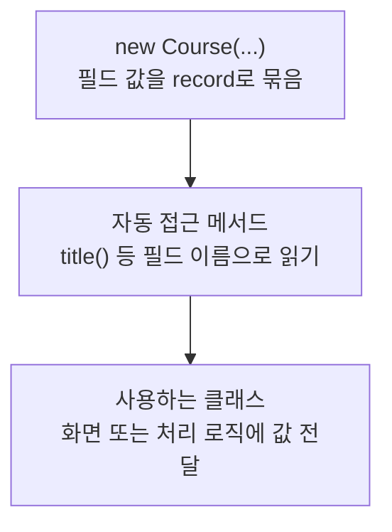

> [!info] 개발 중인 코드
> 2026-11-11 작업본 기준이다. 확정 설계가 아니며, 코드가 바뀌면 이 노트도 새 내용으로 바꿔요.

## 한눈에 보기

예전 코스 편집 화면과 예제 저장 목록·커뮤니티에서 코스 정보를 묶어 전달하는 데이터예요. 현재 장소별 추천·편집에 쓰는 RoutePlan과는 다른 형태예요.

- **현재 위치:** 이전/예제 모델
- **원본:** `src/main/java/com/datecourse/model/Course.java`
- **전체 안내:** [[전체_동작_흐름|전체_동작_흐름]] · [[목차|목차]]

courseId, title, 방문 순서의 coursePlaces, totalPrice를 담는다.

## 사용 장면과 읽는 순서

코스 제목과 방문 장소 목록, 총금액을 한 번에 화면에 넘기고 싶을 때 Course 한 개로 묶어요. 이 객체가 있다는 것만으로 DB 저장이 되는 것은 아니에요.

1. `Course()` 생성자가 코스 번호·제목·장소 목록·총액을 받아 묶어요.
2. 화면은 `title()` 같은 읽기 함수를 통해 필요한 값을 꺼내요.
3. record는 값 묶음을 짧게 만드는 문법이에요. 안에 든 List까지 자동으로 복사하거나 수정 불가능하게 만드는 것은 아니에요.

모르는 용어는 [[문서_읽는법|문서 읽는 법과 용어 설명]]에서 찾아볼 수 있어요.

## 동작 순서

```text
FakeCourseData/RecommendedCourseMapper → 이전 화면 컨트롤러
```

## 주요 메서드와 흐름도 호출

| 메서드 | 하는 일 |
|---|---|
| `Course()` | 예전 화면용 코스 번호·이름·방문 순서·총액을 하나의 값 묶음으로 만들어요. |
| `title()` | Java가 record에 자동으로 제공하는 읽기 함수예요. 묶어 둔 코스 이름을 꺼내요. |

## 코드 읽는 법

`record`는 값을 묶는 자료형이다. 예를 들어 `객체.title()`처럼 필드 이름으로 값을 읽어요. 별도 처리 함수가 없으면 호출자가 데이터를 만들어 다음 클래스에 전달하는 흐름을 보면 된다.

## 사용한 Java 라이브러리·API

아래 표는 가져다 쓴 도구, 이 클래스에서 만나는 함수, 사용하는 이유를 연결해 보여줘요. JDK 기본은 Java에 포함된 기능이고, 별도 라이브러리는 프로젝트가 추가로 준비하는 도구예요. 처음에는 도구 이름을 외우기보다 마지막 열의 역할부터 읽어 보세요.

| 라이브러리·API | 사용 메서드/위치 | 여기서 하는 일 |
|---|---|---|
| 목록·대응표<br/>JDK 기본: java.util<br/>List | Course() | 장소 목록·ID별 반경·정렬·중복 제거·문자열 설정을 관리한다. stream/filter/map은 목록을 고르고 변환하는 데 사용해요. |

외부 라이브러리 버전과 전체 사용 위치: [[라이브러리_사용_안내|라이브러리 사용 안내]]

## 클래스 내부 함수 흐름도



이 값 묶음(record)은 생성할 때 정보를 받고, Java가 제공하는 읽기 함수로 값을 꺼내요. 그림은 이 정보 전달을 보여줘요.

## 핵심 코드

원본 5행 부근의 실제 코드다.

```java
public record Course(
        String courseId,
        String title,
        List<CoursePlace> coursePlaces,   // 방문 순서대로
        int totalPrice
) {}
```

## 변경할 때 주의할 점

현재 메인 코스는 RoutePlan이다. record여도 안쪽 List를 자동으로 불변 복사하는 것은 아니다.

## 함께 읽기

[[04_데이터/CoursePlace|CoursePlace]]
