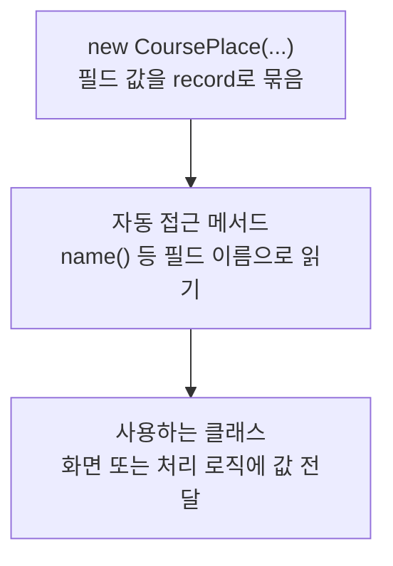

> [!info] 개발 중인 코드
> 2026-11-11 작업본 기준이다. 확정 설계가 아니며, 코드가 바뀌면 이 노트도 새 내용으로 바꿔요.

## 한눈에 보기

예전 Course 안에 들어가는 장소 한 곳의 정보예요. 이름·주소·지도 위치·가격을 코스와 함께 넘기기 위해 묶어요.

- **현재 위치:** 이전/예제 모델
- **원본:** `src/main/java/com/datecourse/model/CoursePlace.java`
- **전체 안내:** [[전체_동작_흐름|전체_동작_흐름]] · [[목차|목차]]

장소 ID·이름·분류·주소·위도·경도·price를 담는다.

## 사용 장면과 읽는 순서

Place를 예전 화면용 CoursePlace로 바꾸면 같은 price라는 이름이라도 금액 기준이 다를 수 있어요. RecommendedCourseMapper가 넣는 가격은 전체 인원 금액이에요.

1. `CoursePlace()`로 장소 번호·이름·분류·주소·좌표·가격을 한 덩어리로 만들어요.
2. 화면에서 `name()` 같은 함수를 써 이름을 읽어요.
3. 가격을 계산할 때는 이 객체를 누가 만들었는지 확인하고, Place의 1인 가격과 그대로 더하지 않아요.

모르는 용어는 [[문서_읽는법|문서 읽는 법과 용어 설명]]에서 찾아볼 수 있어요.

## 동작 순서

```text
FakeCourseData 또는 RecommendedCourseMapper → Course → 이전 화면
```

## 주요 메서드와 흐름도 호출

| 메서드 | 하는 일 |
|---|---|
| `CoursePlace()` | 장소 ID·이름·분류·주소·좌표·가격을 이전 코스 편집 모델로 한데 묶어요. |
| `name()` | 이 장소 묶음에 들어 있는 이름을 읽어요. record가 자동으로 만들어 주는 함수예요. |

## 코드 읽는 법

`record`는 값을 묶는 자료형이다. 예를 들어 `객체.name()`처럼 필드 이름으로 값을 읽어요. 별도 처리 함수가 없으면 호출자가 데이터를 만들어 다음 클래스에 전달하는 흐름을 보면 된다.

## 사용한 Java 라이브러리·API

아래 표는 가져다 쓴 도구, 이 클래스에서 만나는 함수, 사용하는 이유를 연결해 보여줘요. JDK 기본은 Java에 포함된 기능이고, 별도 라이브러리는 프로젝트가 추가로 준비하는 도구예요. 처음에는 도구 이름을 외우기보다 마지막 열의 역할부터 읽어 보세요.

| 라이브러리·API | 사용 메서드/위치 | 여기서 하는 일 |
|---|---|---|
| JDK 기본 자료형·record | 생성자·자동 접근 메서드 | 별도 외부 라이브러리 없이 값이나 실행 진입점만 정의한다. 호출한 다른 클래스가 쓰는 라이브러리와 구분해요. |

외부 라이브러리 버전과 전체 사용 위치: [[라이브러리_사용_안내|라이브러리 사용 안내]]

## 클래스 내부 함수 흐름도



이 값 묶음(record)은 생성할 때 정보를 받고, Java가 제공하는 읽기 함수로 값을 꺼내요. 그림은 이 정보 전달을 보여줘요.

## 핵심 코드

원본 3행 부근의 실제 코드다.

```java
public record CoursePlace(
        String placeId,
        String name,
        String category,   // 식사 / 카페 / 문화
        String address,
        double lat,
        double lng,
        int price
) {}
```

## 변경할 때 주의할 점

price 단위는 생성 경로에 따라 확인해요. RecommendedCourseMapper는 인원 합계 금액을 넣는다.
