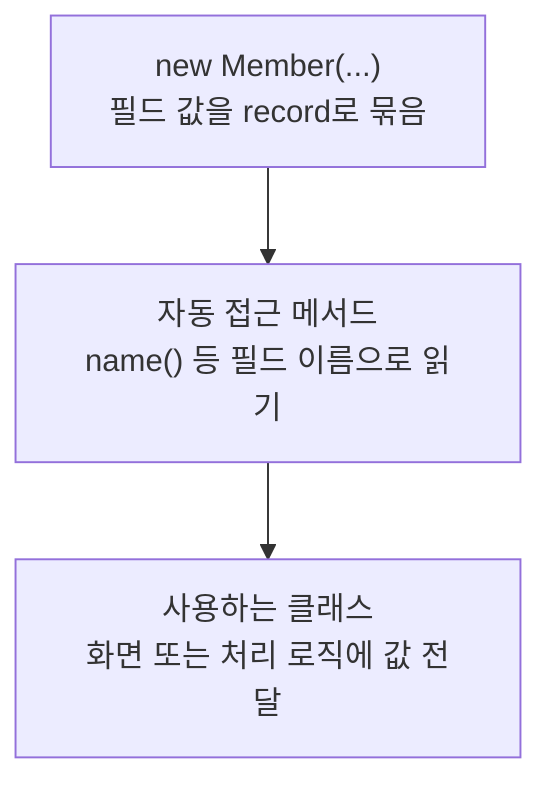

> [!info] 개발 중인 코드
> 2026-11-11 작업본 기준이다. 확정 설계가 아니며, 코드가 바뀌면 이 노트도 새 내용으로 바꿔요.

## 한눈에 보기

예제 JavaFX 관리자 화면에서 회원 한 명을 표시하기 위한 정보 묶음이에요. 실제 DB 로그인에서 돌려주는 회원 정보와 이름이 비슷하지만 별도 타입이에요.

- **현재 위치:** 이전/예제 모델
- **원본:** `src/main/java/com/datecourse/model/Member.java`
- **전체 안내:** [[전체_동작_흐름|전체_동작_흐름]] · [[목차|목차]]

회원 ID·이름·USER/ADMIN 역할·가입일·정지 여부를 담는다.

## 사용 장면과 읽는 순서

관리자 예제 표에 이름·가입일·정지 여부를 보여줄 때 써요. 현재 로그인한 사람의 정보는 UserSession, 실제 저장소의 회원 행은 MemberRepository 안의 Member와 구분해요.

1. `Member()`가 화면 표시용 회원 번호·이름·역할·가입일·정지 여부를 받아요.
2. 표나 목록이 `name()` 같은 읽기 함수로 값을 꺼내 보여줘요.
3. 이 객체를 바꿨다고 실제 DB 회원이 바뀌는지는 별도의 저장 연결을 확인해야 해요.

모르는 용어는 [[문서_읽는법|문서 읽는 법과 용어 설명]]에서 찾아볼 수 있어요.

## 동작 순서

```text
FakeMemberData → AdminController
```

## 주요 메서드와 흐름도 호출

| 메서드 | 하는 일 |
|---|---|
| `Member()` | 예제 회원 화면에서 사용할 회원 정보와 정지 여부를 한데 묶어요. |
| `name()` | 예제 회원의 이름을 읽어요. 실제 로그인 회원을 찾는 DB 조회와는 달라요. |

## 코드 읽는 법

`record`는 값을 묶는 자료형이다. 예를 들어 `객체.name()`처럼 필드 이름으로 값을 읽어요. 별도 처리 함수가 없으면 호출자가 데이터를 만들어 다음 클래스에 전달하는 흐름을 보면 된다.

## 사용한 Java 라이브러리·API

아래 표는 가져다 쓴 도구, 이 클래스에서 만나는 함수, 사용하는 이유를 연결해 보여줘요. JDK 기본은 Java에 포함된 기능이고, 별도 라이브러리는 프로젝트가 추가로 준비하는 도구예요. 처음에는 도구 이름을 외우기보다 마지막 열의 역할부터 읽어 보세요.

| 라이브러리·API | 사용 메서드/위치 | 여기서 하는 일 |
|---|---|---|
| 날짜<br/>JDK 기본: java.time<br/>LocalDate | Member() | 예제 코스·리뷰 날짜와 기본 코스 이름의 날짜를 만들어요. |

외부 라이브러리 버전과 전체 사용 위치: [[라이브러리_사용_안내|라이브러리 사용 안내]]

## 클래스 내부 함수 흐름도



이 값 묶음(record)은 생성할 때 정보를 받고, Java가 제공하는 읽기 함수로 값을 꺼내요. 그림은 이 정보 전달을 보여줘요.

## 핵심 코드

원본 5행 부근의 실제 코드다.

```java
public record Member(
        String memberId,
        String name,
        String role,          // "USER" 또는 "ADMIN"
        LocalDate joinedAt,
        boolean suspended     // true면 정지 상태
) {}
```

## 변경할 때 주의할 점

실제 DB 회원 행인 MemberRepository.Member 및 로그인 세션 UserSession과 다른 타입이다.
