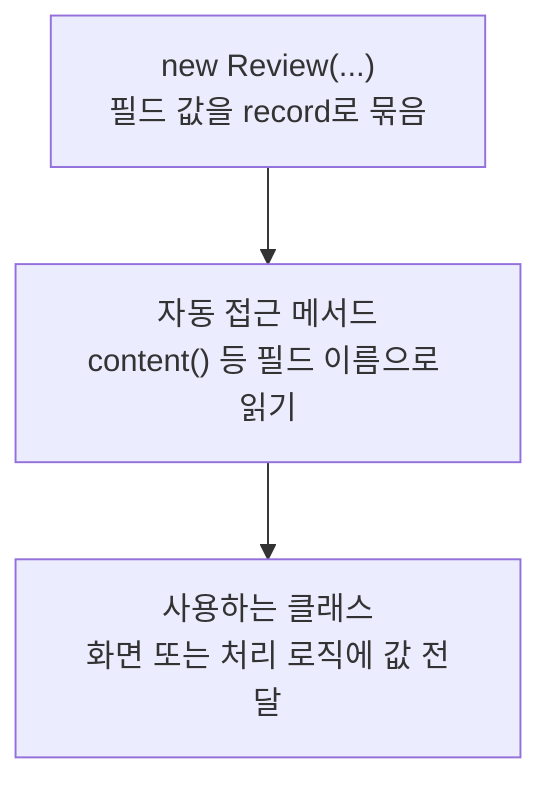

> [!info] 개발 중인 코드
> 2026-11-11 작업본 기준이다. 확정 설계가 아니며, 코드가 바뀌면 이 노트도 새 내용으로 바꿔요.

## 한눈에 보기

예제 커뮤니티에서 후기 한 개의 작성자·코스·별점·내용·작성일을 묶는 데이터예요. 후기를 DB에 등록하는 기능 자체를 담당하지는 않아요.

- **현재 위치:** 이전/예제 모델
- **원본:** `src/main/java/com/datecourse/model/Review.java`
- **전체 안내:** [[전체_동작_흐름|전체_동작_흐름]] · [[목차|목차]]

reviewId, author, course, rating, content, createdAt을 담는다.

## 사용 장면과 읽는 순서

후기 목록에서 글을 고르면 이 묶음 안의 코스 정보와 글 내용을 읽어 상세 화면에 보여줘요.

1. `Review()`가 후기 번호와 작성자·코스·별점·글·날짜를 받아요.
2. `content()` 같은 자동 읽기 함수로 화면에 필요한 값을 꺼내요.
3. 실제 저장·다시 불러오기는 별도 저장소 연결이 있어야 해요. 현재 노트의 예제 후기와 구분하세요.

모르는 용어는 [[문서_읽는법|문서 읽는 법과 용어 설명]]에서 찾아볼 수 있어요.

## 동작 순서

```text
FakeReviewData/CommunityController → 리뷰 목록·관리자 화면
```

## 주요 메서드와 흐름도 호출

| 메서드 | 하는 일 |
|---|---|
| `Review()` | 작성자·대상 코스·평점·내용·작성일을 리뷰 record로 한데 묶어요. |
| `content()` | 이미 묶어 둔 후기의 글 내용을 읽어요. 새로운 후기를 DB에서 가져오는 함수는 아니에요. |

## 코드 읽는 법

`record`는 값을 묶는 자료형이다. 예를 들어 `객체.content()`처럼 필드 이름으로 값을 읽어요. 별도 처리 함수가 없으면 호출자가 데이터를 만들어 다음 클래스에 전달하는 흐름을 보면 된다.

## 사용한 Java 라이브러리·API

아래 표는 가져다 쓴 도구, 이 클래스에서 만나는 함수, 사용하는 이유를 연결해 보여줘요. JDK 기본은 Java에 포함된 기능이고, 별도 라이브러리는 프로젝트가 추가로 준비하는 도구예요. 처음에는 도구 이름을 외우기보다 마지막 열의 역할부터 읽어 보세요.

| 라이브러리·API | 사용 메서드/위치 | 여기서 하는 일 |
|---|---|---|
| 날짜<br/>JDK 기본: java.time<br/>LocalDate | Review() | 예제 코스·리뷰 날짜와 기본 코스 이름의 날짜를 만들어요. |

외부 라이브러리 버전과 전체 사용 위치: [[라이브러리_사용_안내|라이브러리 사용 안내]]

## 클래스 내부 함수 흐름도



이 값 묶음(record)은 생성할 때 정보를 받고, Java가 제공하는 읽기 함수로 값을 꺼내요. 그림은 이 정보 전달을 보여줘요.

## 핵심 코드

원본 5행 부근의 실제 코드다.

```java
public record Review(
        String reviewId,
        String author,
        Course course,       // 리뷰 대상 코스 (가게 목록 포함)
        int rating,          // 1~5
        String content,
        LocalDate createdAt
) {}
```

## 변경할 때 주의할 점

현재 DB 리뷰 조회·등록이 연결된 모델은 아니다.

## 함께 읽기

[[04_데이터/Course|Course]]
