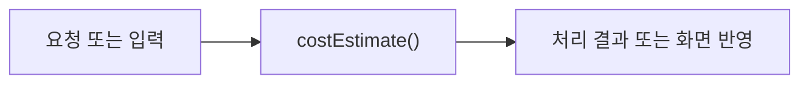

# RoutePlan

> 개발 중인 코드예요. `ea2242b` 기준이며, 후속 커밋에서 동작이 바뀔 수 있어요.

## 한눈에 보기

출발지·인원·반경·방문 순서·장소별 허용 반경을 묶어요. 편집 중 값과 저장 ID는 분리해요.

## 코드 읽기

아래 선언부터 읽고 함수표의 순서로 찾아보세요. 전체 코드는 [기준 커밋의 원본](https://github.com/2egn/DateCourseApp/blob/ea2242b/src/main/java/com/datecourse/model/RoutePlan.java)에서 확인해요.

```java
public record RoutePlan(double startLat, double startLng, int people, int radius,
```

## 주요 함수

| 함수 | 하는 일 |
|---|---|
| `costEstimate()` | 인원을 반영한 가격 범위와 미확인 장소 수를 계산해요. |
| `totalCost()` | 옛 코드용 정확한 합계예요. 미확인·범위에는 쓰지 않아요. |

## 동작 흐름

사용자 요청 또는 다른 클래스의 호출로 시작해요. 자세한 분기는 위 함수표와 원본 코드를 함께 봐요.



## 사용하는 라이브러리

| 도구 | 이 코드에서 필요한 이유 |
|---|---|
| Java 컬렉션·함수 | 목록 복사·조건 처리·전달할 동작 |

라이브러리가 쓰이는 구체적인 위치는 위 함수표와 원본의 해당 함수 본문에서 확인해요. 화면 작업과 DB 작업을 같은 스레드에서 섞지 않는 것이 중요해요.

관련 안내: [[현재_구현_흐름|현재 전체 흐름]] · [[업데이트_내역|이번 변경]]
