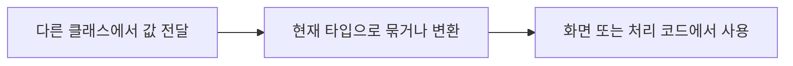

# SavedCourse

> 개발 중인 코드예요. `ea2242b` 기준이며, 후속 커밋에서 동작이 바뀔 수 있어요.

## 한눈에 보기

DB 코스 ID·회원 ID·RoutePlan·최근 수정 시각을 묶는 record예요. 수정 저장에서 같은 ID를 유지해요.

## 코드 읽기

아래 선언부터 읽고 함수표의 순서로 찾아보세요. 전체 코드는 [기준 커밋의 원본](https://github.com/2egn/DateCourseApp/blob/ea2242b/src/main/java/com/datecourse/model/SavedCourse.java)에서 확인해요.

```java
public record SavedCourse(long courseId, long memberId, RoutePlan plan, java.time.Instant updatedAt) {
```

## 동작 흐름



## 사용하는 라이브러리

| 도구 | 이 코드에서 필요한 이유 |
|---|---|
| Java 시간 | 수정 시각 보관·표시 |

관련 안내: [[현재_구현_흐름|현재 전체 흐름]] · [[업데이트_내역|이번 변경]]
