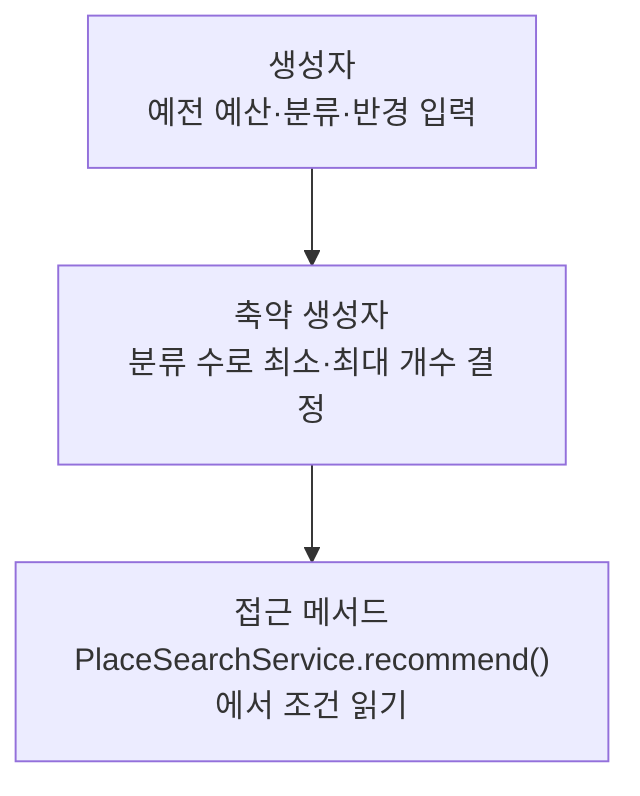

> [!info] 개발 중인 코드
> 2026-11-11 작업본 기준이다. 확정 설계가 아니며, 코드가 바뀌면 이 노트도 새 내용으로 바꿔요.

## 한눈에 보기

예전 방식으로 코스 전체를 한꺼번에 추천할 때 쓰던 조건 묶음이에요. 총예산·활동 분류·인원·거리·장소 수를 담아요.

- **현재 위치:** 이전/예제 모델
- **원본:** `src/main/java/com/datecourse/model/SearchCondition.java`
- **전체 안내:** [[전체_동작_흐름|전체_동작_흐름]] · [[목차|목차]]

budget은 총예산, categories는 분류, minPlaces/maxPlaces는 추천 장소 수 범위다.

## 사용 장면과 읽는 순서

‘식사와 카페를 총예산 안에서 한 번에 골라줘’라는 예전 추천 조건을 표현해요. 현재 장소를 하나씩 고르는 화면에서는 총예산을 따로 입력하지 않아요.

1. `SearchCondition()`에 예전 일괄 추천용 조건을 모아요.
2. `PlaceSearchService.recommend()`가 그 값을 읽어 예전 추천을 수행해요.
3. 현재 화면 조건을 이해할 때는 RoutePlan과 RouteEditorController를 먼저 읽어 두 방식의 규칙을 구분해요.

모르는 용어는 [[문서_읽는법|문서 읽는 법과 용어 설명]]에서 찾아볼 수 있어요.

## 동작 순서

```text
조건 데이터 생성 → PlaceSearchService.recommend()
```

## 주요 메서드와 흐름도 호출

| 메서드 | 하는 일 |
|---|---|
| `SearchCondition()` | 이전 일괄 추천에서 쓸 예산·인원·분류·좌표·반경·장소 수 조건을 한데 묶어요. |
| `PlaceSearchService.recommend()` | 기존 일괄 추천 서비스가 이 record의 조건을 읽어 코스를 만들어요. |

## 코드 읽는 법

`record`는 값을 묶는 자료형이다. 예를 들어 `객체.name()`처럼 필드 이름으로 값을 읽어요. 별도 처리 함수가 없으면 호출자가 데이터를 만들어 다음 클래스에 전달하는 흐름을 보면 된다.

## 사용한 Java 라이브러리·API

아래 표는 가져다 쓴 도구, 이 클래스에서 만나는 함수, 사용하는 이유를 연결해 보여줘요. JDK 기본은 Java에 포함된 기능이고, 별도 라이브러리는 프로젝트가 추가로 준비하는 도구예요. 처음에는 도구 이름을 외우기보다 마지막 열의 역할부터 읽어 보세요.

| 라이브러리·API | 사용 메서드/위치 | 여기서 하는 일 |
|---|---|---|
| 목록·대응표<br/>JDK 기본: java.util<br/>List, HashSet | SearchCondition() | 장소 목록·ID별 반경·정렬·중복 제거·문자열 설정을 관리한다. stream/filter/map은 목록을 고르고 변환하는 데 사용해요. |

외부 라이브러리 버전과 전체 사용 위치: [[라이브러리_사용_안내|라이브러리 사용 안내]]

## 클래스 내부 함수 흐름도



## 핵심 코드

원본 5행 부근의 실제 코드다.

```java
public record SearchCondition(
        int budget,
        int people,
        List<String> categories,
        double lat,
        double lng,
        int radius,
        int minPlaces,
        int maxPlaces
) {
    /** Existing callers retain the original one-place-per-category behavior. */
    public SearchCondition(int budget, int people, List<String> categories, double lat, double lng, int radius) {
        this(budget, people, categories, lat, lng, radius,
                Math.max(1, new java.util.HashSet<>(categories).size()),
                Math.max(1, new java.util.HashSet<>(categories).size()));
    }
}
```

## 변경할 때 주의할 점

현재 one-by-one 화면은 총예산을 입력하지 않는다. 이 모델과 현재 RoutePlan을 혼동하지 않는다.
