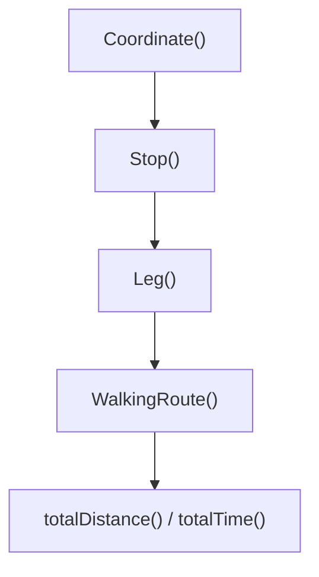

> **문서 기준:** `d32bc76` 리뷰 대상 소스. 개발 중이며 [[업데이트_내역|업데이트 내역]]에서 기존 노트와의 버전 차이를 확인해요.

## 한눈에 보기

TMAP에서 받은 도보 결과를 Java 안에서 사용하기 쉽게 정리한 데이터 묶음이에요. 전체 거리·시간뿐 아니라 구간별 길과 안내도 들어 있어요.

## 사용 장면과 읽는 순서

출발지→식당→카페라면 전체 결과 안에 두 이동 구간이 있고, 각 구간에는 지도에 그릴 좌표와 ‘어디서 방향을 바꾸는지’ 안내가 들어 있어요.

1. `Stop`은 방문 지점, `Coordinate`는 지도 좌표, `Leg`는 두 지점 사이 이동 구간을 표현해요.
2. 구간 안의 `Step`은 안내 문구와 위치를 함께 보관해요.
3. `WalkingRoute()`가 구간들을 묶고 `totalDistance()`·`totalTime()`으로 전체 거리(m)·시간(초)을 읽게 해요. 추천 거리 제한에 쓰는 직선 거리와는 별개예요.

모르는 용어는 [[문서_읽는법|문서 읽는 법과 용어 설명]]에서 찾아볼 수 있어요.

## 주요 메서드

| 메서드·생성자 | 하는 일 |
|---|---|
| `WalkingRoute()` | 구간 목록을 복사하고 전체 거리(m)·시간(초)을 보관해요. |
| `Coordinate()` | 위도·경도가 정상 숫자이고 실제 좌표의 허용 범위 안인지 확인해요. |
| `Stop()` | 방문 지점의 좌표를 검사하고 빈 이름을 기본 안내로 바꿔요. |
| `Leg()` | 한 구간의 경로·안내 목록을 복사해 보관해요. |
| `totalDistance()` | 전체 도보 거리를 미터 단위로 읽어요. |
| `totalTime()` | 전체 예상 시간을 초 단위로 읽어요. |

## 사용한 Java 라이브러리·API

| 라이브러리·API | 사용 위치 | 역할 |
|---|---|---|
| JDK record·List.copyOf | 생성자 | 도보 결과를 값으로 전달하고 목록 변경을 방지한다. |
| Double.isFinite | Coordinate | 잘못된 좌표가 경로 데이터에 들어가지 않도록 확인해요. |

## 클래스 내부 함수 흐름도



화살표는 함수가 다른 함수에 일이나 값을 넘기는 주요 흐름이에요. 창을 열 때, 버튼을 누를 때, 종료할 때의 시작 지점이 다르므로 모든 가지가 한꺼번에 실행되지는 않아요.

## 핵심 코드

실제 소스 일부 발췌다. 긴 메서드는 원본에서 이어서 읽어요.

```java
public record WalkingRoute(List<Leg> legs, long totalDistance, long totalTime) {
    public WalkingRoute { legs = List.copyOf(legs); }

    public record Coordinate(double lat, double lng) {
        public Coordinate {
            if (!Double.isFinite(lat) || !Double.isFinite(lng) || lat < -90 || lat > 90 || lng < -180 || lng > 180)
                throw new IllegalArgumentException("유효한 위도·경도가 필요합니다.");
        }
    }

    public record Stop(double lat, double lng, String name) {
        public Stop {
```

## 변경할 때 주의할 점

Step은 안내 문구·위치를 묶는 내부 record다. 도보 거리는 추천 반경 검사에 쓰는 직선 거리와 구분해요.

[기준 커밋의 원본 코드](https://github.com/2egn/DateCourseApp/blob/d32bc764dea8aec3c630f528b5e59eb1703c708e/src/main/java/com/datecourse/model/WalkingRoute.java) · [[리뷰_및_구현_방향|리뷰와 다음 구현 방향]]
