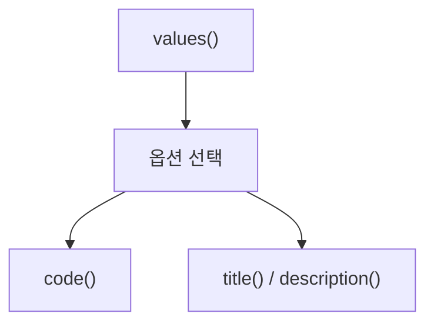

> **문서 기준:** `d32bc76` 리뷰 대상 소스. 개발 중이며 [[업데이트_내역|업데이트 내역]]에서 기존 노트와의 버전 차이를 확인해요.

## 한눈에 보기

도보 길찾기에서 고를 수 있는 네 가지 방식을 모아 둔 목록이에요. Java의 enum은 이런 정해진 선택지만 허용하고 싶을 때 사용해요.

## 사용 장면과 읽는 순서

화면에는 ‘계단 제외’라고 보여주지만 TMAP 요청에는 약속된 숫자 코드를 보내야 해요. 이 타입은 화면 이름과 요청 코드를 함께 기억해요.

1. `values()`로 제공하는 선택지 전체를 읽어 화면에 나열해요.
2. `title()`과 `description()`은 사용자에게 보여줄 이름·설명을 읽어요.
3. `code()`는 서비스에 보낼 0·4·10·30 중 해당 코드를 읽어요. 저장된 선택과 지도 경로가 같은 옵션인지 확인해야 해요.

모르는 용어는 [[문서_읽는법|문서 읽는 법과 용어 설명]]에서 찾아볼 수 있어요.

## 주요 메서드

| 메서드·생성자 | 하는 일 |
|---|---|
| `values()` | Java가 제공하는 메서드로 전체 옵션을 순서대로 돌려줘요. |
| `code()` | API에 전달할 옵션 코드 0·4·10·30을 읽어요. |
| `title()` | 화면에 보여줄 옵션 이름을 읽어요. |
| `description()` | 사용자에게 보여줄 짧은 설명을 읽어요. |

## 사용한 Java 라이브러리·API

| 라이브러리·API | 사용 위치 | 역할 |
|---|---|---|
| JDK enum | 선언·values | 정해진 옵션만 선택하도록 이름·코드·설명을 한곳에 한데 묶어요. |

## 클래스 내부 함수 흐름도



화살표는 함수가 다른 함수에 일이나 값을 넘기는 주요 흐름이에요. 창을 열 때, 버튼을 누를 때, 종료할 때의 시작 지점이 다르므로 모든 가지가 한꺼번에 실행되지는 않아요.

## 핵심 코드

실제 소스 일부 발췌다. 긴 메서드는 원본에서 이어서 읽어요.

```java
public enum WalkingSearchOption {
    RECOMMENDED(0, "추천 경로", "걷기 좋은 추천 경로를 안내해요."),
    MAIN_ROADS(4, "대로 우선", "추천 경로 중 큰길을 우선해요."),
    SHORTEST(10, "최단 경로", "이동 거리가 짧은 경로를 찾아요."),
    WITHOUT_STAIRS(30, "계단 제외", "계단을 제외한 최단 경로를 찾아요.");

    private final int code;
    private final String title, description;
    WalkingSearchOption(int code, String title, String description) {
        this.code = code; this.title = title; this.description = description;
    }
    public int code() { return code; }
```

## 변경할 때 주의할 점

설정에 저장한 코드와 지도에 표시한 경로의 옵션이 일치해야 한다.

[기준 커밋의 원본 코드](https://github.com/2egn/DateCourseApp/blob/d32bc764dea8aec3c630f528b5e59eb1703c708e/src/main/java/com/datecourse/model/WalkingSearchOption.java) · [[리뷰_및_구현_방향|리뷰와 다음 구현 방향]]
