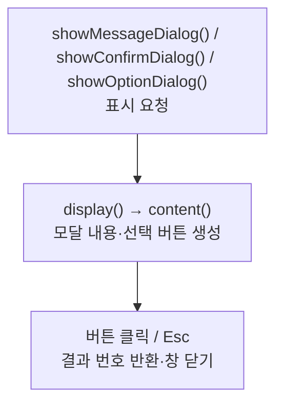

> [!info] 개발 중인 코드
> 2026-11-11 작업본 기준이다. 확정 설계가 아니며, 코드가 바뀌면 이 노트도 새 내용으로 바꿔요.

## 한눈에 보기

로그인·회원가입 같은 Swing 화면에서 안내와 확인 창을 같은 모습으로 띄우기 위한 공통 도구예요. 화면마다 비슷한 창을 다시 만들지 않도록 모아 둔 코드예요.

- **현재 위치:** 현재 사용
- **원본:** `src/main/java/kr/ac/university/localdb/ui/AppDialogs.java`
- **전체 안내:** [[전체_동작_흐름|전체_동작_흐름]] · [[목차|목차]]

## 사용 장면과 읽는 순서

‘입력 내용을 확인해 주세요’는 안내 창, ‘정말 처리할까요?’처럼 사용자의 선택이 필요하면 확인 창을 사용해요.

1. 호출한 화면이 안내 문구와 필요한 버튼 선택지를 넘겨요.
2. `content()`가 창의 내용을 만들고 `display()`가 실제 창을 띄워 응답을 받아요.
3. 확인·취소뿐 아니라 창 닫기·Esc도 어떤 결과로 돌아오는지 확인해요. JavaFX의 Alert와는 별도 도구예요.

모르는 용어는 [[문서_읽는법|문서 읽는 법과 용어 설명]]에서 찾아볼 수 있어요.

## 동작 순서

```text
showMessageDialog()/showConfirmDialog()/showOptionDialog() → display()
content()로 내용·버튼 생성 → 모달 표시 → 클릭 번호 반환
```

## 주요 메서드

| 메서드 | 하는 일 |
|---|---|
| `showMessageDialog()` | 확인 버튼이 있는 안내를 띄운다. |
| `showConfirmDialog()` | 확인/취소 결과를 돌려줘요. |
| `showOptionDialog()` | 전달받은 선택지로 창을 만들어요. |
| `display()` | 실제 창을 열고 응답을 기다린다. |
| `content()` | 미리보기와 실제 창이 공유하는 구성 요소를 만들어요. |

## 사용한 Java 라이브러리·API

아래 표는 가져다 쓴 도구, 이 클래스에서 만나는 함수, 사용하는 이유를 연결해 보여줘요. JDK 기본은 Java에 포함된 기능이고, 별도 라이브러리는 프로젝트가 추가로 준비하는 도구예요. 처음에는 도구 이름을 외우기보다 마지막 열의 역할부터 읽어 보세요.

| 라이브러리·API | 사용 메서드/위치 | 여기서 하는 일 |
|---|---|---|
| Swing·AWT UI<br/>JDK 기본: java.desktop<br/>SwingUtilities, JPanel, JButton, JLabel, JScrollPane, JDialog, JOptionPane 등 | showMessageDialog(), showConfirmDialog(), showOptionDialog(), display(), content(), paintComponent() | 로그인/가입 UI를 만들고 그리며 EDT에서 화면을 새 내용으로 바꿔요. Desktop은 기본 브라우저 열기에도 쓰인다. |
| 비동기·콜백<br/>JDK 기본: java.lang / java.util.concurrent / java.util.function<br/>IntConsumer | content() | 오래 걸리는 작업을 분리하고 완료 동작을 넘겨줘요. 테스트에서는 작업 완료를 기다리거나 결과를 보관해요. |

외부 라이브러리 버전과 전체 사용 위치: [[라이브러리_사용_안내|라이브러리 사용 안내]]

## 클래스 내부 함수 흐름도



이 그림에는 서로 다른 버튼·요청에서 시작하는 흐름도 함께 있어요. 모든 함수가 위에서 아래로 무조건 한 번씩 실행된다는 뜻은 아니에요.

## 핵심 코드

원본 11행 부근의 실제 코드다.

```java
public static void showMessageDialog(Component parent,Object message) {
    showMessageDialog(parent,message,"알림",JOptionPane.INFORMATION_MESSAGE);
}
```

## 변경할 때 주의할 점

버튼 문구와 반환값을 함께 확인해요. 창을 닫거나 Esc를 누르는 경우도 있다. JavaFX Alert와는 별도다.

## 함께 읽기

[[05_회원_DB/UiTheme|UiTheme]]
