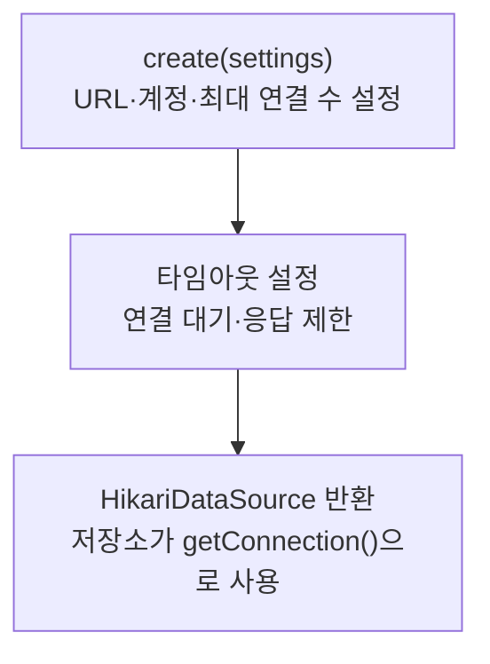

> [!info] 개발 중인 코드
> 2026-11-11 작업본 기준이다. 확정 설계가 아니며, 코드가 바뀌면 이 노트도 새 내용으로 바꿔요.

## 한눈에 보기

DB에 연결할 때마다 새 연결을 만드는 대신, 준비한 연결을 빌려 쓰고 돌려주는 관리 도구예요. 이렇게 모아 재사용하는 연결들을 연결 풀이라고 해요.

- **현재 위치:** 현재 사용
- **원본:** `src/main/java/kr/ac/university/localdb/db/DatabasePool.java`
- **전체 안내:** [[전체_동작_흐름|전체_동작_흐름]] · [[목차|목차]]

## 사용 장면과 읽는 순서

로그인 한 번과 장소 목록 조회 한 번이 각각 연결을 영구히 차지하면 곧 사용할 연결이 없어져요. 일을 마친 연결은 풀에 돌려줘야 다음 조회에서도 쓸 수 있어요.

1. `create()`가 HikariCP를 사용해 연결 수와 기다릴 시간 등을 정해요. 이 노트 기준 최대 연결 수는 2개예요.
2. `getConnection()`으로 연결을 빌리고, SQL 작업 후 Connection.close()로 풀에 돌려줘요.
3. 앱 종료 때 저장소의 close()로 풀 자체를 마쳐요. ‘연결 반납’과 ‘풀 전체 종료’는 다른 동작이에요.

모르는 용어는 [[문서_읽는법|문서 읽는 법과 용어 설명]]에서 찾아볼 수 있어요.

## 동작 순서

```text
MemberRepository 생성 → DbSettings.load() → create() → HikariDataSource
작업 시 getConnection() → 사용 → close()로 풀에 반환
```

## 주요 메서드

| 메서드 | 하는 일 |
|---|---|
| `create()` | 최대 연결 수 2개와 연결·응답 대기 시간 등을 설정한다. |
| `getConnection()` | 다시 쓸 수 있는 DB 연결을 빌려줘요. 작업이 끝나면 close()로 연결을 풀에 돌려줘야 해요. |

## 사용한 Java 라이브러리·API

아래 표는 가져다 쓴 도구, 이 클래스에서 만나는 함수, 사용하는 이유를 연결해 보여줘요. JDK 기본은 Java에 포함된 기능이고, 별도 라이브러리는 프로젝트가 추가로 준비하는 도구예요. 처음에는 도구 이름을 외우기보다 마지막 열의 역할부터 읽어 보세요.

| 라이브러리·API | 사용 메서드/위치 | 여기서 하는 일 |
|---|---|---|
| HikariCP 연결 풀<br/>외부: HikariCP 7.1.0<br/>HikariDataSource | create() | DB 연결을 재사용해요. DatabasePool.create()에서 만들고 저장소가 getConnection()으로 빌려 쓴다. |
| MySQL Connector/J 8.3.0<br/>(외부 JDBC 드라이버) | create() → HikariCP 연결 시 | jdbc:mysql: 접속을 실제 MySQL 통신으로 처리해요. 직접 import하지 않아도 실행 의존성으로 로드된다. |

외부 라이브러리 버전과 전체 사용 위치: [[라이브러리_사용_안내|라이브러리 사용 안내]]

## 클래스 내부 함수 흐름도



## 핵심 코드

원본 9행 부근의 일부 발췌다. 아래 코드만 따로 복사해 실행하는 예제는 아니다.

```java
static HikariDataSource create(DbSettings settings) {
    HikariDataSource pool = new HikariDataSource();
    pool.setPoolName("membership-db");
    pool.setJdbcUrl(settings.url());
    pool.setUsername(settings.user());
    pool.setPassword(settings.password());
    pool.setMaximumPoolSize(2);
    pool.setMinimumIdle(1);
    pool.setConnectionTimeout(10_000);
    pool.setValidationTimeout(3_000);
    pool.setMaxLifetime(600_000);
    // Do not send periodic keepalive queries to an otherwise unused cloud database.
    pool.setKeepaliveTime(0);
    if (settings.url().startsWith("jdbc:mysql:")) {
        pool.addDataSourceProperty("connectTimeout", "5000");
        pool.addDataSourceProperty("socketTimeout", "10000");
    }
    return pool;
// ... 이후 코드는 원본 참고
```

## 변경할 때 주의할 점

일반 Connection.close()는 풀 반환, MemberRepository.close()는 풀 종료다. 앱 종료까지 회원·장소 조회가 풀을 함께 사용해요.

## 함께 읽기

[[05_회원_DB/DbSettings|DbSettings]]
