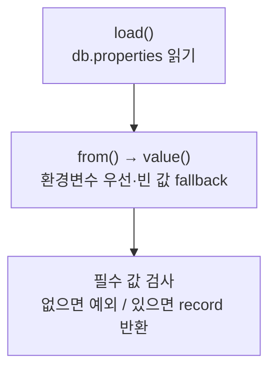

> **공통 DB 설정 추가:** `load()`는 [[03_처리/TeamApiKeys|TeamApiKeys.database()]]로 URL·사용자명·비밀번호를 받아요. 공통 키가 없을 때만 기존 로컬 파일·환경변수를 읽어요. 조회 실패 시 로컬 DB로 자동 전환하지 않아요. 비밀번호의 앞뒤 공백은 보존하고 `toString()`에는 접속 정보를 숨겨요. [[공통_접속_키|팀원 설정 방법]]


> [!info] 개발 중인 코드
> 2026-11-11 작업본 기준이다. 확정 설계가 아니며, 코드가 바뀌면 이 노트도 새 내용으로 바꿔요.

## 한눈에 보기

어느 DB에 어떤 계정으로 연결할지 적힌 설정을 읽는 데이터 객체예요. 이 클래스가 실제로 DB에 접속하는 것은 아니고, 접속에 필요한 값을 준비해요.

- **현재 위치:** 현재 사용
- **원본:** `src/main/java/kr/ac/university/localdb/db/DbSettings.java`
- **전체 안내:** [[전체_동작_흐름|전체_동작_흐름]] · [[목차|목차]]

## 사용 장면과 읽는 순서

설정 파일에는 내 로컬 DB가 적혀 있는데 환경변수가 다른 서버를 가리키면 생각과 다른 곳에 연결하려 할 수 있어요. 어떤 설정이 먼저 적용되는지 확인하는 이유예요.

1. `load()`가 파일과 환경변수의 설정을 모아요.
2. `from()`과 `value()`가 어느 값을 우선할지 정하고 필수 항목을 확인해요.
3. 주소·사용자·비밀번호가 준비되면 연결 풀을 만드는 쪽에 넘겨요. 설정이 빠졌다고 임의의 localhost DB로 연결하지 않아요.

모르는 용어는 [[문서_읽는법|문서 읽는 법과 용어 설명]]에서 찾아볼 수 있어요.

## 동작 순서

```text
load() → db.properties 읽기 → from()
DB_URL/DB_USER/DB_PASSWORD가 비어 있지 않으면 환경변수 우선
필수 값 누락 → 예외 / 정상 → DbSettings 반환
```

## 주요 메서드

| 메서드 | 하는 일 |
|---|---|
| `load()` | 리소스와 환경변수를 모은다. |
| `from()` | 우선순위를 적용하고 필수 값을 확인해요. |
| `value()` | 환경변수와 설정 파일 중 적용할 값을 골라요. 환경변수는 프로그램을 켤 때 밖에서 지정한 설정이에요. |

## 사용한 Java 라이브러리·API

아래 표는 가져다 쓴 도구, 이 클래스에서 만나는 함수, 사용하는 이유를 연결해 보여줘요. JDK 기본은 Java에 포함된 기능이고, 별도 라이브러리는 프로젝트가 추가로 준비하는 도구예요. 처음에는 도구 이름을 외우기보다 마지막 열의 역할부터 읽어 보세요.

| 라이브러리·API | 사용 메서드/위치 | 여기서 하는 일 |
|---|---|---|
| 목록·대응표<br/>JDK 기본: java.util<br/>Map, Properties | DbSettings(), load(), from(), value() | 장소 목록·ID별 반경·정렬·중복 제거·문자열 설정을 관리한다. stream/filter/map은 목록을 고르고 변환하는 데 사용해요. |
| 파일·문자 입출력<br/>JDK 기본: java.io / java.nio<br/>InputStream, IOException | DbSettings(), load() | 설정·아이디 기록·SQL 파일을 읽거나 저장해요. 테스트에서는 화면 이미지를 파일로 남긴다. |

외부 라이브러리 버전과 전체 사용 위치: [[라이브러리_사용_안내|라이브러리 사용 안내]]

## 클래스 내부 함수 흐름도



## 핵심 코드

원본 20행 부근의 실제 코드다.

```java
static DbSettings from(Properties properties, Map<String, String> environment) {
    String url = value(environment, "DB_URL", properties, "db.url").trim();
    String user = value(environment, "DB_USER", properties, "db.user").trim();
    // Password whitespace may be intentional and must be passed through unchanged.
    String password = value(environment, "DB_PASSWORD", properties, "db.password");

    if (url.isBlank() || user.isBlank() || password.isBlank()) {
        throw new IllegalStateException(
                "Database settings are missing. Set db.url, db.user, and db.password in db.properties, "
                        + "or set DB_URL, DB_USER, and DB_PASSWORD environment variables.");
    }
    return new DbSettings(url, user, password);
}
```

## 변경할 때 주의할 점

비밀번호 공백은 보존한다. 실제 접속 정보는 이 노트에 복사하지 않는다. 설정 누락 시 임의의 로컬 DB로 접속하지 않는다.
