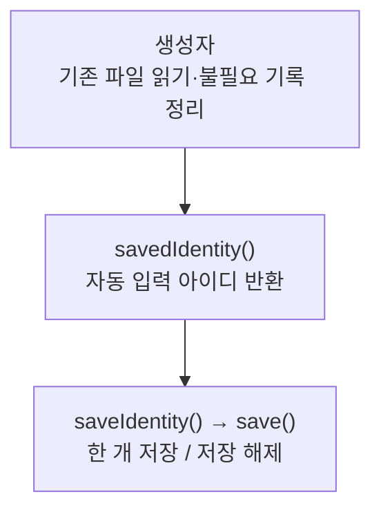

> [!info] 개발 중인 코드
> 2026-11-11 작업본 기준이다. 확정 설계가 아니며, 코드가 바뀌면 이 노트도 새 내용으로 바꿔요.

## 한눈에 보기

다음 로그인 때 아이디를 다시 쓰지 않아도 되도록, 로그인 아이디 하나를 이 PC의 파일에 기억하는 도구예요. 비밀번호나 코스를 저장하는 기능은 아니에요.

- **현재 위치:** 현재 사용
- **원본:** `src/main/java/kr/ac/university/localdb/InputHistory.java`
- **전체 안내:** [[전체_동작_흐름|전체_동작_흐름]] · [[목차|목차]]

## 사용 장면과 읽는 순서

‘아이디 기억’을 선택한 뒤 앱을 다시 켰을 때 입력란에 지난 아이디를 채우는 데 사용해요.

1. `savedIdentity()`가 기억해 둔 아이디를 읽어요.
2. `saveIdentity()`는 이전 아이디 기록을 정리하고 새 아이디 하나를 남겨요.
3. `save()`가 필요한 폴더와 파일을 만들어요. 파일을 읽거나 쓰지 못해도 로그인 자체를 막지는 않아요.

모르는 용어는 [[문서_읽는법|문서 읽는 법과 용어 설명]]에서 찾아볼 수 있어요.

## 동작 순서

```text
생성자 → 기존 파일 읽기 → 과거 불필요 기록 정리
savedIdentity() → 자동 입력값 / saveIdentity() → 한 개 저장 또는 빈 값으로 해제
```

## 주요 메서드

| 메서드 | 하는 일 |
|---|---|
| `savedIdentity()` | 기억한 로그인 아이디를 돌려줘요. |
| `saveIdentity()` | 기존 기록을 비우고 아이디 하나를 저장해요. |
| `save()` | 상위 폴더를 만들고 파일을 기록한다. |

## 사용한 Java 라이브러리·API

아래 표는 가져다 쓴 도구, 이 클래스에서 만나는 함수, 사용하는 이유를 연결해 보여줘요. JDK 기본은 Java에 포함된 기능이고, 별도 라이브러리는 프로젝트가 추가로 준비하는 도구예요. 처음에는 도구 이름을 외우기보다 마지막 열의 역할부터 읽어 보세요.

| 라이브러리·API | 사용 메서드/위치 | 여기서 하는 일 |
|---|---|---|
| 목록·대응표<br/>JDK 기본: java.util<br/>Properties | InputHistory(), savedIdentity(), saveIdentity(), save() | 장소 목록·ID별 반경·정렬·중복 제거·문자열 설정을 관리한다. stream/filter/map은 목록을 고르고 변환하는 데 사용해요. |
| 파일·문자 입출력<br/>JDK 기본: java.io / java.nio<br/>Files, Path, InputStream, OutputStream, IOException | InputHistory(), save() | 설정·아이디 기록·SQL 파일을 읽거나 저장해요. 테스트에서는 화면 이미지를 파일로 남긴다. |

외부 라이브러리 버전과 전체 사용 위치: [[라이브러리_사용_안내|라이브러리 사용 안내]]

## 클래스 내부 함수 흐름도



이 그림에는 서로 다른 버튼·요청에서 시작하는 흐름도 함께 있어요. 모든 함수가 위에서 아래로 무조건 한 번씩 실행된다는 뜻은 아니에요.

## 핵심 코드

원본 33행 부근의 실제 코드다.

```java
public void saveIdentity(String value) {
    data.clear();
    if (!value.isBlank()) data.setProperty("identity.0", value.trim());
    save();
}
```

## 변경할 때 주의할 점

코스 저장이나 비밀번호 저장 기능이 아니다. 읽기/쓰기 실패는 로그인 자체를 막지 않는다.
