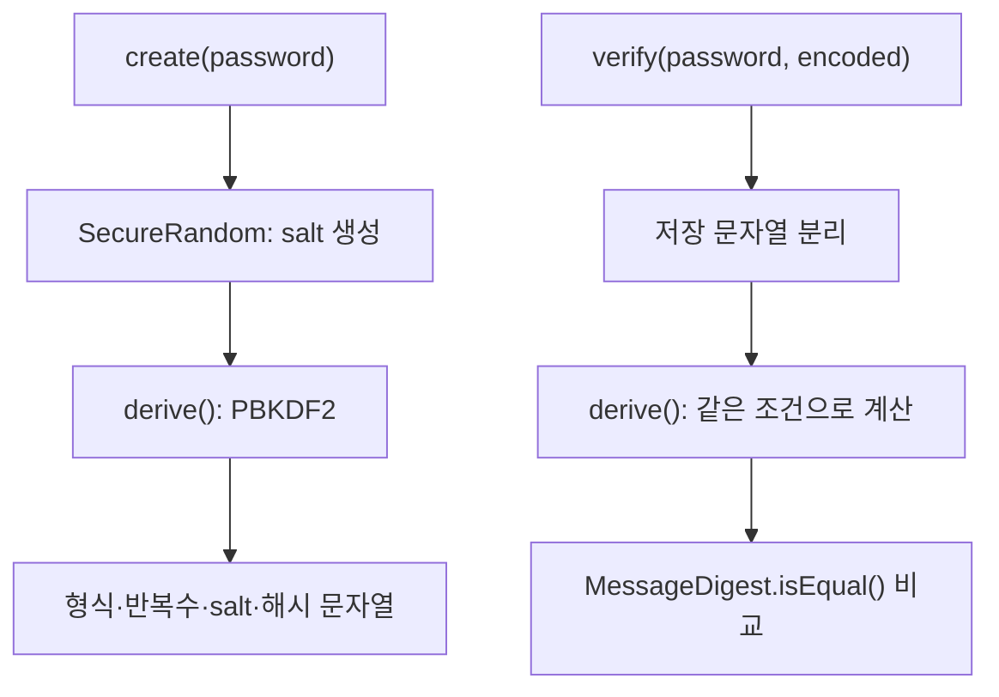

> [!info] 개발 중인 코드
> 2026-11-11 작업본 기준이다. 확정 설계가 아니며, 코드가 바뀌면 이 노트도 새 내용으로 바꿔요.

## 한눈에 보기

비밀번호를 원문 그대로 저장하지 않고, 입력이 맞는지 비교할 수 있는 해시 값을 만드는 도구예요. 저장한 값을 다시 풀어 비밀번호를 꺼내는 방식과는 달라요.

- **현재 위치:** 현재 사용
- **원본:** `src/main/java/kr/ac/university/localdb/PasswordHash.java`
- **전체 안내:** [[전체_동작_흐름|전체_동작_흐름]] · [[목차|목차]]

## 사용 장면과 읽는 순서

같은 비밀번호를 쓴 두 회원도 저장 결과가 같지 않도록 무작위 값인 salt를 함께 사용해요. 로그인 때는 저장 정보와 새 입력으로 비교할 값을 다시 계산해요.

1. 가입 시 `create()`가 salt와 PBKDF2 계산으로 저장할 문자열을 만들어요.
2. 로그인 시 `verify()`가 새 입력이 저장된 값과 맞는지 확인해요.
3. `derive()`는 실제 계산을 맡고, `MessageDigest.isEqual()`은 해시의 바이트를 비교해요. 이 코드가 지원하는 저장 형식도 확인해야 해요.

모르는 용어는 [[문서_읽는법|문서 읽는 법과 용어 설명]]에서 찾아볼 수 있어요.

## 동작 순서

```text
create() → 무작위 salt → derive() → 방식·반복 수·salt·해시 문자열
verify() → 저장 문자열 분리 → 같은 조건으로 derive() → 결과 비교
```

## 주요 메서드

| 메서드 | 하는 일 |
|---|---|
| `create()` | 비밀번호마다 무작위 salt를 준비한 뒤, 원문 대신 저장할 해시 문자열을 만들어요. |
| `verify()` | 입력한 비밀번호로 비교값을 계산해 저장된 해시와 맞는지 확인해요. 비밀번호 원문을 복원하지 않아요. |
| `derive()` | PBKDF2WithHmacSHA256으로 계산하고 비밀번호 사본을 정리한다. |
| `MessageDigest.isEqual()` | 저장된 비밀번호 해시와 새로 계산한 해시의 바이트를 비교한다. |

## 사용한 Java 라이브러리·API

아래 표는 가져다 쓴 도구, 이 클래스에서 만나는 함수, 사용하는 이유를 연결해 보여줘요. JDK 기본은 Java에 포함된 기능이고, 별도 라이브러리는 프로젝트가 추가로 준비하는 도구예요. 처음에는 도구 이름을 외우기보다 마지막 열의 역할부터 읽어 보세요.

| 라이브러리·API | 사용 메서드/위치 | 여기서 하는 일 |
|---|---|---|
| 비밀번호 해시<br/>JDK 기본: java.security / javax.crypto / java.util<br/>SecureRandom, MessageDigest, SecretKeyFactory, PBEKeySpec, Base64 | create(), verify(), derive() | 무작위 salt와 PBKDF2 해시를 생성하고 저장된 해시와 비교한다. Base64는 바이트를 문자열로 표현한다. |

외부 라이브러리 버전과 전체 사용 위치: [[라이브러리_사용_안내|라이브러리 사용 안내]]

## 클래스 내부 함수 흐름도



이 그림에는 서로 다른 버튼·요청에서 시작하는 흐름도 함께 있어요. 모든 함수가 위에서 아래로 무조건 한 번씩 실행된다는 뜻은 아니에요.

## 핵심 코드

원본 21행 부근의 실제 코드다.

```java
public static boolean verify(char[] password, String encoded) throws Exception {
    if (encoded == null || !encoded.startsWith("pbkdf2-sha256$")) return false;
    String[] fields = encoded.split("\\$");
    byte[] salt = Base64.getDecoder().decode(fields[2]);
    byte[] expected = Base64.getDecoder().decode(fields[3]);
    return MessageDigest.isEqual(expected, derive(password, salt, Integer.parseInt(fields[1])));
}
```

## 변경할 때 주의할 점

해시는 복호화해서 원문을 꺼내는 방식이 아니다. 현재 PBKDF2 형식만 검증하며 다른 형식은 실패한다.
