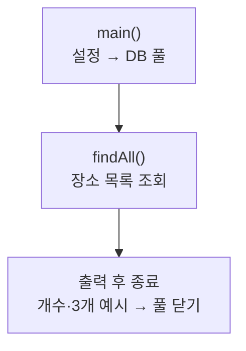

> [!info] 개발 중인 코드
> 2026-11-11 작업본 기준이다. 확정 설계가 아니며, 코드가 바뀌면 이 노트도 새 내용으로 바꿔요.

## 한눈에 보기

화면을 띄우지 않고도 DB에서 장소를 제대로 읽는지 콘솔로 확인하는 점검용 실행 도구예요. 통합 앱의 시작 파일은 아니에요.

- **현재 위치:** 점검 도구
- **원본:** `src/main/java/kr/ac/university/localdb/db/PlaceQueryDemo.java`
- **전체 안내:** [[전체_동작_흐름|전체_동작_흐름]] · [[목차|목차]]

## 사용 장면과 읽는 순서

로그인은 되는데 장소 추천이 비어 있다면, 장소 저장소가 실제로 목록을 돌려주는지 분리해서 확인할 때 사용할 수 있어요.

1. `main()`이 DB 접속 설정과 장소 조회 도구를 준비해요.
2. `findAll()`로 실제 설정된 DB의 장소를 읽어요.
3. 조회 개수와 일부 결과를 콘솔에서 확인해요. 가짜 목록을 출력하는 데모와 달리 실제 접속 환경이 필요해요.

모르는 용어는 [[문서_읽는법|문서 읽는 법과 용어 설명]]에서 찾아볼 수 있어요.

## 동작 순서

```text
main() → DB 풀 생성 → PlaceRepository.findAll() → 개수/처음 3개 출력 → 풀 닫기
```

## 주요 메서드

| 메서드 | 하는 일 |
|---|---|
| `main()` | 실제 장소 조회를 실행하고 결과를 출력한다. |
| `findAll()` | 장소 행을 record_id 순서로 읽어 Java 모델로 바꿔요. |

## 사용한 Java 라이브러리·API

아래 표는 가져다 쓴 도구, 이 클래스에서 만나는 함수, 사용하는 이유를 연결해 보여줘요. JDK 기본은 Java에 포함된 기능이고, 별도 라이브러리는 프로젝트가 추가로 준비하는 도구예요. 처음에는 도구 이름을 외우기보다 마지막 열의 역할부터 읽어 보세요.

| 라이브러리·API | 사용 메서드/위치 | 여기서 하는 일 |
|---|---|---|
| 목록·대응표<br/>JDK 기본: java.util<br/>List | main() | 장소 목록·ID별 반경·정렬·중복 제거·문자열 설정을 관리한다. stream/filter/map은 목록을 고르고 변환하는 데 사용해요. |
| HikariCP 연결 풀<br/>외부: HikariCP 7.1.0<br/>HikariDataSource | main() | DB 연결을 재사용해요. DatabasePool.create()에서 만들고 저장소가 getConnection()으로 빌려 쓴다. |
| MySQL Connector/J 8.3.0<br/>(외부 JDBC 드라이버) | main() → 풀 생성·조회 | jdbc:mysql: 접속을 실제 MySQL 통신으로 처리해요. 직접 import하지 않아도 실행 의존성으로 로드된다. |

외부 라이브러리 버전과 전체 사용 위치: [[라이브러리_사용_안내|라이브러리 사용 안내]]

## 클래스 내부 함수 흐름도



## 핵심 코드

원본 9행 부근의 실제 코드다.

```java
public static void main(String[] args) throws Exception {
    try (HikariDataSource pool = DatabasePool.create(DbSettings.load())) {
        PlaceRepository repository = new PlaceRepository(pool);

        List<Place> places = repository.findAll();

        System.out.println("조회한 장소 수: " + places.size());

        places.stream()
                .limit(3)
                .forEach(System.out::println);
    }
}
```

`try (...)`는 처리가 끝나면 DB 연결·문장·조회 결과를 자동으로 닫는 문법이다. 풀에서 빌린 연결은 이때 풀로 반환된다.

## 변경할 때 주의할 점

앱 시작 경로가 아닌 점검 도구다. 실행하면 실제 설정된 DB를 조회한다.

## 함께 읽기

[[05_회원_DB/DatabasePool|DatabasePool]] · [[05_회원_DB/DbSettings|DbSettings]] · [[04_데이터/Place|Place]] · [[05_회원_DB/PlaceRepository|PlaceRepository]]
