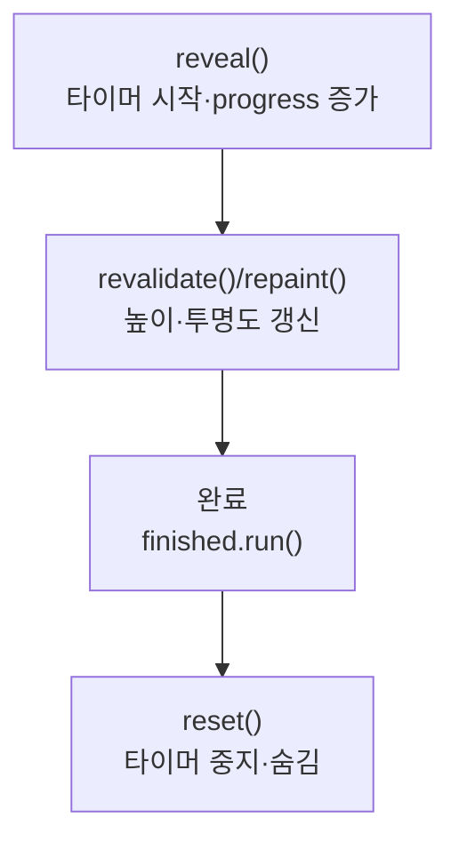

> [!info] 개발 중인 코드
> 2026-11-11 작업본 기준이다. 확정 설계가 아니며, 코드가 바뀌면 이 노트도 새 내용으로 바꿔요.

## 한눈에 보기

회원가입에서 다음 입력칸이 갑자기 나타나는 대신 부드럽게 펼쳐 보이게 하는 화면 부품이에요. 입력값 검사나 가입 저장 자체는 담당하지 않아요.

- **현재 위치:** 현재 사용
- **원본:** `src/main/java/kr/ac/university/localdb/ui/RevealPanel.java`
- **전체 안내:** [[전체_동작_흐름|전체_동작_흐름]] · [[목차|목차]]

## 사용 장면과 읽는 순서

현재 가입 항목을 입력하고 다음 단계로 가면 새 입력 행의 높이와 투명도가 조금씩 바뀌며 나타나요.

1. `reveal()`이 펼침을 시작하고 타이머가 진행 정도를 바꿔요.
2. `revealedHeight()`로 필요한 높이를 구하고 `paint()`가 현재 투명도로 그려요.
3. 애니메이션이 끝나면 넘겨받은 후속 동작을 실행해요. `reset()`은 다시 시작할 수 있도록 표시·타이머 상태를 되돌려요.

모르는 용어는 [[문서_읽는법|문서 읽는 법과 용어 설명]]에서 찾아볼 수 있어요.

## 동작 순서

```text
reveal() → Timer → progress 증가 → 크기 재계산/다시 그리기
애니메이션 종료 → finished.run() / reset() → 숨기고 초기화
```

## 주요 메서드

| 메서드 | 하는 일 |
|---|---|
| `reveal()` | 입력 행을 약 280ms 동안 펼친다. |
| `reset()` | 타이머와 표시 상태를 처음 사용할 상태로 준비해요. |
| `revealedHeight()` | 실제 폰트·컴포넌트 크기에 맞춘 높이를 구한다. |
| `paint()` | 현재 progress에 맞는 투명도로 그린다. |
| `revalidate()` | Swing이 변경된 컴포넌트의 배치를 다시 계산하도록 요청한다. |
| `repaint()` | Swing이 화면을 다시 그리도록 요청한다. |
| `finished.run()` | 펼침 애니메이션이 끝난 뒤 전달받은 후속 동작을 실행한다. |

## 사용한 Java 라이브러리·API

아래 표는 가져다 쓴 도구, 이 클래스에서 만나는 함수, 사용하는 이유를 연결해 보여줘요. JDK 기본은 Java에 포함된 기능이고, 별도 라이브러리는 프로젝트가 추가로 준비하는 도구예요. 처음에는 도구 이름을 외우기보다 마지막 열의 역할부터 읽어 보세요.

| 라이브러리·API | 사용 메서드/위치 | 여기서 하는 일 |
|---|---|---|
| Swing·AWT UI<br/>JDK 기본: java.desktop<br/>JPanel, JLabel, Timer, BorderLayout, Dimension, Graphics, Graphics2D 등 | revealedHeight(), RevealPanel(), reveal(), reset(), getPreferredSize(), getMaximumSize() 외 2개 | 로그인/가입 UI를 만들고 그리며 EDT에서 화면을 새 내용으로 바꿔요. Desktop은 기본 브라우저 열기에도 쓰인다. |
| 비동기·콜백<br/>JDK 기본: java.lang / java.util.concurrent / java.util.function<br/>Runnable | reveal() | 오래 걸리는 작업을 분리하고 완료 동작을 넘겨줘요. 테스트에서는 작업 완료를 기다리거나 결과를 보관해요. |

외부 라이브러리 버전과 전체 사용 위치: [[라이브러리_사용_안내|라이브러리 사용 안내]]

## 클래스 내부 함수 흐름도



## 핵심 코드

원본 23행 부근의 실제 코드다.

```java
public void reveal(Runnable finished) {
    if(timer!=null) timer.stop();
    progress=0; setVisible(true);
    long start=System.nanoTime();
    timer=new Timer(15,e -> {
        float t=Math.min(1f,(System.nanoTime()-start)/280_000_000f);
        progress=1f-(1f-t)*(1f-t);
        revalidate(); repaint();
        if(t>=1f) { timer.stop(); finished.run(); }
    });
    timer.start();
}
```

## 변경할 때 주의할 점

DB나 입력 검사는 담당하지 않는다. Swing Timer는 화면 스레드에서 동작한다.

## 함께 읽기

[[05_회원_DB/UiTheme|UiTheme]]
