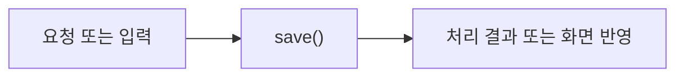

# SavedCourseRepository

> 개발 중인 코드예요. `ea2242b` 기준이며, 후속 커밋에서 동작이 바뀔 수 있어요.

## 한눈에 보기

본인 코스 저장·목록 조회·수정·이름 변경·삭제를 담당해요. 저장 당시 장소 정보를 복원해요.

## 코드 읽기

아래 선언부터 읽고 함수표의 순서로 찾아보세요. 전체 코드는 [기준 커밋의 원본](https://github.com/2egn/DateCourseApp/blob/ea2242b/src/main/java/kr/ac/university/localdb/db/SavedCourseRepository.java)에서 확인해요.

```java
public final class SavedCourseRepository {
```

## 주요 함수

| 함수 | 하는 일 |
|---|---|
| `save()` | 새 ID 저장 또는 같은 ID 갱신을 선택해요. |
| `persist()` | 코스와 장소를 함께 저장하고 실패하면 되돌려요. |
| `findAll()` | 회원별 목록과 방문 순서·가격·출처·수정 시각을 읽어요. |
| `rename()` | 본인 코스 이름을 바꿔요. |
| `delete()` | 본인 코스와 장소 스냅샷을 삭제해요. |

## 동작 흐름

사용자 요청 또는 다른 클래스의 호출로 시작해요. 자세한 분기는 위 함수표와 원본 코드를 함께 봐요.



## 사용하는 라이브러리

| 도구 | 이 코드에서 필요한 이유 |
|---|---|
| JDBC | SQL 요청과 행 읽기 |
| Jackson | 가격·출처 JSON 변환 |
| Java 컬렉션·함수 | 목록 복사·조건 처리·전달할 동작 |
| Java 시간 | 수정 시각 보관·표시 |

라이브러리가 쓰이는 구체적인 위치는 위 함수표와 원본의 해당 함수 본문에서 확인해요. 화면 작업과 DB 작업을 같은 스레드에서 섞지 않는 것이 중요해요.

관련 안내: [[현재_구현_흐름|현재 전체 흐름]] · [[업데이트_내역|이번 변경]]
