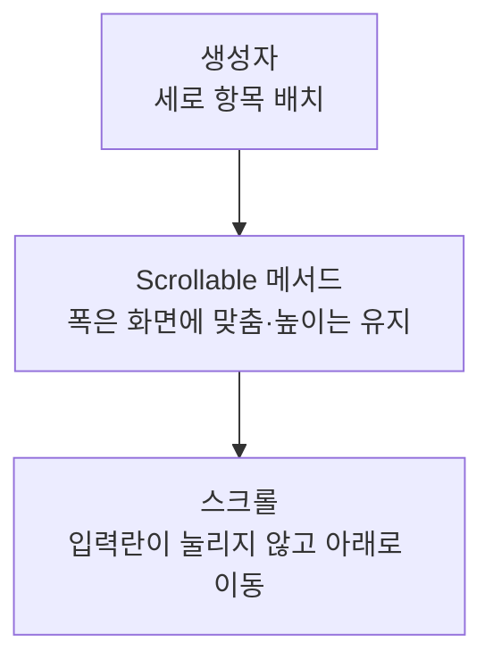

> [!info] 개발 중인 코드
> 2026-11-11 작업본 기준이다. 확정 설계가 아니며, 코드가 바뀌면 이 노트도 새 내용으로 바꿔요.

## 한눈에 보기

회원가입 입력칸들이 좁은 창에서도 가로로 찌그러지지 않고, 내용이 길면 세로로 스크롤되도록 배치하는 화면 틀이에요.

- **현재 위치:** 현재 사용
- **원본:** `src/main/java/kr/ac/university/localdb/ui/SignupForm.java`
- **전체 안내:** [[전체_동작_흐름|전체_동작_흐름]] · [[목차|목차]]

## 사용 장면과 읽는 순서

가입 항목이 많아 창 높이를 넘으면 아래로 스크롤할 수 있어야 해요. 내용을 한 화면 높이에 억지로 줄이면 입력칸이 사라질 수 있어요.

1. `getScrollableTracksViewportWidth()`가 입력 영역의 가로 폭을 보이는 영역에 맞춰요.
2. `getScrollableTracksViewportHeight()`는 내용 높이를 강제로 줄이지 않게 해요.
3. `getScrollableUnitIncrement()`가 한 번 움직일 스크롤 거리를 알려줘요.

모르는 용어는 [[문서_읽는법|문서 읽는 법과 용어 설명]]에서 찾아볼 수 있어요.

## 동작 순서

```text
생성자 → 세로 BoxLayout
JScrollPane → Scrollable 메서드 조회 → 폭은 화면에 맞춤 / 높이는 항목 전체 기준
```

## 주요 메서드

| 메서드 | 하는 일 |
|---|---|
| `getScrollableTracksViewportWidth()` | 가로 폭은 뷰포트를 따라가게 한다. |
| `getScrollableTracksViewportHeight()` | 높이를 강제로 줄이지 않아 세로 스크롤이 가능하게 한다. |
| `getScrollableUnitIncrement()` | 한 번 스크롤할 거리를 돌려줘요. |

## 사용한 Java 라이브러리·API

아래 표는 가져다 쓴 도구, 이 클래스에서 만나는 함수, 사용하는 이유를 연결해 보여줘요. JDK 기본은 Java에 포함된 기능이고, 별도 라이브러리는 프로젝트가 추가로 준비하는 도구예요. 처음에는 도구 이름을 외우기보다 마지막 열의 역할부터 읽어 보세요.

| 라이브러리·API | 사용 메서드/위치 | 여기서 하는 일 |
|---|---|---|
| Swing·AWT UI<br/>JDK 기본: java.desktop<br/>JPanel, BoxLayout, Dimension, Rectangle, Scrollable, SwingConstants | getPreferredScrollableViewportSize(), getScrollableUnitIncrement(), getScrollableBlockIncrement() | 로그인/가입 UI를 만들고 그리며 EDT에서 화면을 새 내용으로 바꿔요. Desktop은 기본 브라우저 열기에도 쓰인다. |

외부 라이브러리 버전과 전체 사용 위치: [[라이브러리_사용_안내|라이브러리 사용 안내]]

## 클래스 내부 함수 흐름도



## 핵심 코드

원본 19행 부근의 실제 코드다.

```java
@Override public boolean getScrollableTracksViewportHeight() { return false; }
```

## 변경할 때 주의할 점

작은 화면에서 가입 입력란이 눌려 사라지는 것을 막는 배치 코드다.
