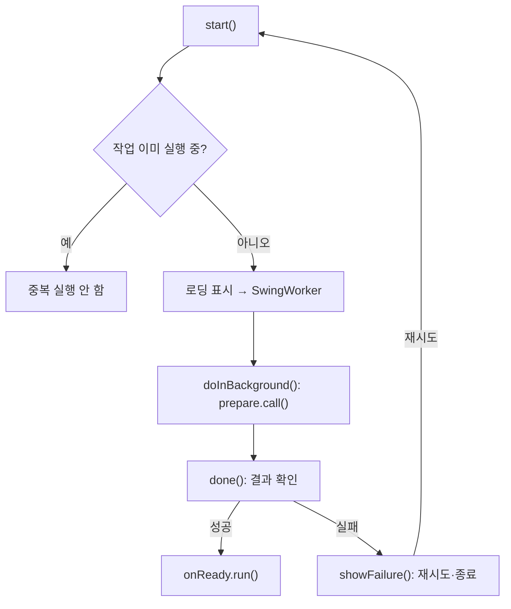

> [!info] 개발 중인 코드
> 2026-11-11 작업본 기준이다. 확정 설계가 아니며, 코드가 바뀌면 이 노트도 새 내용으로 바꿔요.

## 한눈에 보기

앱을 처음 켤 때 DB 준비가 끝날 때까지 진행 상황을 보여주는 화면이에요. 준비에 실패하면 이유와 다시 시도할 버튼을 보여줘요.

- **현재 위치:** 현재 사용
- **원본:** `src/main/java/kr/ac/university/localdb/ui/StartupPanel.java`
- **전체 안내:** [[전체_동작_흐름|전체_동작_흐름]] · [[목차|목차]]

## 사용 장면과 읽는 순서

처음에는 DB에 연결하지 못했지만 설정을 고친 뒤 다시 시도할 수 있어야 해요. 준비 버튼을 여러 번 눌러 같은 초기화가 겹치는 것도 막아야 해요.

1. `start()`가 전달받은 준비 작업을 화면과 분리해서 시작해요.
2. `doInBackground()`에서 실제 준비 동작을 수행하고, `done()`이 결과를 화면에 반영해요.
3. 성공하면 등록된 다음 화면 이동 동작을 실행하고, 실패하면 `showFailure()`가 재시도 안내를 보여줘요.

모르는 용어는 [[문서_읽는법|문서 읽는 법과 용어 설명]]에서 찾아볼 수 있어요.

## 동작 순서

```text
생성 시 준비 작업/성공/종료 콜백 수신
start() → 중복 시작 차단 → SwingWorker.doInBackground() → prepare.call()
done() → 성공 onReady / 실패 showFailure() → 다시 시도
```

## 주요 메서드

| 메서드 | 하는 일 |
|---|---|
| `start()` | UI 밖에서 초기화 작업을 시작한다. |
| `showFailure()` | 실패 안내와 재시도 버튼을 보여줘요. |
| `doInBackground()` | Swing 화면 스레드 밖에서 초기화 작업을 실행한다. |
| `prepare.call()` | 외부에서 전달받은 DB 초기화 작업을 실행한다. |
| `done()` | 초기화 결과를 화면에 반영하고 성공 시 다음 화면으로 넘긴다. |
| `onReady.run()` | 초기화에 성공한 뒤 다음 화면으로 이동하는 콜백을 실행한다. |

## 사용한 Java 라이브러리·API

아래 표는 가져다 쓴 도구, 이 클래스에서 만나는 함수, 사용하는 이유를 연결해 보여줘요. JDK 기본은 Java에 포함된 기능이고, 별도 라이브러리는 프로젝트가 추가로 준비하는 도구예요. 처음에는 도구 이름을 외우기보다 마지막 열의 역할부터 읽어 보세요.

| 라이브러리·API | 사용 메서드/위치 | 여기서 하는 일 |
|---|---|---|
| Swing·AWT UI<br/>JDK 기본: java.desktop<br/>SwingWorker, JPanel, JButton, JLabel, Box, BoxLayout, GridLayout 등 | start(), done(), showFailure() | 로그인/가입 UI를 만들고 그리며 EDT에서 화면을 새 내용으로 바꿔요. Desktop은 기본 브라우저 열기에도 쓰인다. |
| 비동기·콜백<br/>JDK 기본: java.lang / java.util.concurrent / java.util.function<br/>Thread, Runnable, Callable, ExecutionException | start(), doInBackground(), done() | 오래 걸리는 작업을 분리하고 완료 동작을 넘겨줘요. 테스트에서는 작업 완료를 기다리거나 결과를 보관해요. |

외부 라이브러리 버전과 전체 사용 위치: [[라이브러리_사용_안내|라이브러리 사용 안내]]

## 클래스 내부 함수 흐름도



## 핵심 코드

원본 62행 부근의 일부 발췌다. 아래 코드만 따로 복사해 실행하는 예제는 아니다.

```java
void start() {
    if (worker != null) return;
    title.setText("로그인 서비스를 준비하고 있어요");
    description.setText("서버에 연결하고 있어요. 잠시만 기다려 주세요.");
    actions.setVisible(false);
    progress.setVisible(true);
    progress.setIndeterminate(true);
    worker = new SwingWorker<>() {
        @Override protected Void doInBackground() throws Exception {
            return prepare.call();
        }

        @Override protected void done() {
            progress.setIndeterminate(false);
            worker = null;
            try {
                get();
                onReady.run();
// ... 이후 코드는 원본 참고
```

## 변경할 때 주의할 점

DB 준비 작업을 직접 구현하지 않고 콜백으로 받아요. 중복 초기화를 막는 worker 상태가 중요하다.

## 함께 읽기

[[05_회원_DB/UiTheme|UiTheme]]
